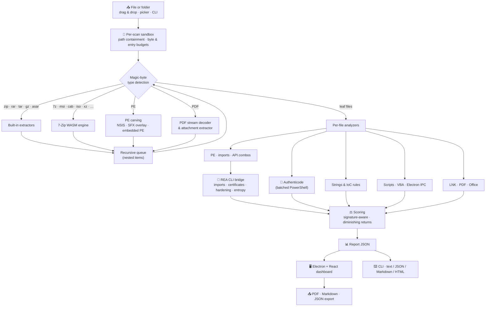

<div align="center">

[English](README.md) | [简体中文](README.zh-CN.md) | **Deutsch** | [Français](README.fr.md) | [Türkçe](README.tr.md) | [日本語](README.ja.md)


# REAP-Shield

### Reverse Engineering & Automated Privacy Shield

**Schauen Sie in eine verdächtige Datei, bevor Sie sie ausführen.**

[](LICENSE)
[](#installation)
[](#architecture)
[](#security)
[](https://github.com/morluto/rea)
[](#testing)

*Ein Open-Source-Desktop- und Kommandozeilenwerkzeug, das ausführbare Dateien, Installer, Archive, Dokumente, Verknüpfungen, Skripte und Electron-Apps statisch untersucht und die Bedrohung in verständlicher Sprache mit Belegen erklärt.*

> 🌱 **Dies ist ein Projekt in aktiver Entwicklung. Teilen Sie gerne Ihr Feedback – es hilft, die Zukunft von REAP-Shield zu gestalten.** Eröffnen Sie jederzeit ein [Issue](https://github.com/Teddy041/reap-shield/issues) oder starten Sie eine Diskussion.


</div>

> ℹ️ Dies ist eine Übersetzung. Die aktuelle und maßgebliche Fassung ist die [englische README](README.md).

---

## 📑 Inhaltsverzeichnis

- [Warum REAP-Shield?](#why)
- [Projektziele](#goals)
- [Für wen ist es gedacht?](#audience)
- [Screenshots](#screenshots)
- [Funktionen](#features)
- [Unterstützte Formate](#formats)
- [Architektur](#architecture)
- [Installation](#installation)
- [Nutzung: Desktop-App](#usage-desktop)
- [Nutzung: CLI & CI/CD](#usage-cli)
- [REA-Integration](#rea)
- [YARA-Regeln](#yara)
- [Bedrohungsbewertung](#scoring)
- [Sicherheitsmodell](#security)
- [Projektstruktur](#structure)
- [Tests](#testing)
- [Windows-EXE erstellen](#building)
- [Einschränkungen](#limitations)
- [Roadmap](#roadmap)
- [Mitwirken](#contributing)
- [Lizenz & Haftungsausschluss](#license)

---

<a id="why"></a>
## 🔍 Warum REAP-Shield?

Die meisten Infektionen beginnen gleich: Jemand doppelklickt auf eine Datei, die er erhalten oder heruntergeladen hat. Das kann ein „gecracktes“ Tool sein, ein Spiel-Mod, eine Rechnung in einer ZIP-Datei, eine Verknüpfung, die wie ein PDF aussieht, oder ein Installer von einer unbekannten Website. Antivirus-Engines geben eine Ja/Nein-Antwort. REAP-Shield beantwortet die Frage, die davor kommt: **Was kann diese Datei tatsächlich tun?**

Ziehen Sie eine Datei oder einen Ordner in das Fenster. REAP-Shield entpackt sie in einer isolierten Sandbox, ohne etwas auszuführen, und untersucht jede Ebene:

- Hashes und digitale Signaturen
- PE-Header, Importe und Packer
- Zeichenketten und Kompromittierungsindikatoren (IoCs)
- Makros, PDF-JavaScript und Befehlszeilen von Verknüpfungen
- Electron-Sicherheitskonfiguration

Sie erhalten eine **Bedrohungsbewertung von 0–100**, ein Urteil **Low / Medium / High / Critical** und kategorisierte Befunde, jeweils mit dem Beleg, der sie ausgelöst hat.

> **Es wird niemals etwas ausgeführt.** REAP-Shield liest nur Bytes. Archive werden in eine Sandbox pro Scan entpackt, die danach gelöscht wird.

---

<a id="goals"></a>
## 🎯 Projektziele

1. **Prüfung vor der Ausführung zugänglich machen.** Reverse-Engineering-Wissen steckt in einem Drag-and-Drop-Werkzeug. Sie müssen kein Malware-Analyst sein, um zu erkennen, dass eine Datei Code injiziert, Browser-Passwörter stiehlt oder Daten an einen Discord-Webhook sendet.
2. **Verpackungstricks durchschauen.** Verschachtelte Archive, Installer, selbstentpackende Dropper, eingebettete ausführbare Dateien, komprimierte Makros und PDF-Streams werden rekursiv entpackt, sodass sich Payloads nicht eine Ebene tiefer verstecken können.
3. **Erklären statt nur markieren.** Jeder Befund nennt die Datei, die Regel, den Beleg (Codezeile, API, Zeichenkette, Offset) und, wo zutreffend, die MITRE-ATT&CK-Technik.
4. **Fehlalarme ehrlich halten.** Gültig signierte Binärdateien, System-DLLs und Installer-Interna werden im Kontext bewertet, statt als Malware behandelt zu werden.
5. **Sicher durch Konstruktion.** Das Werkzeug selbst darf nie zum Schwachpunkt werden: keine Ausführung, strikte Pfadbegrenzung, Ressourcenbudgets und eine gehärtete Electron-Hülle.
6. **In Automatisierung passen.** Dieselbe Engine treibt eine CLI ohne Oberfläche an, mit JSON/Markdown/HTML-Ausgabe und CI-freundlichen Exit-Codes.
7. **Lokal und offen bleiben.** Keine Datei verlässt den Rechner; kein Cloud-Upload, kein Konto, MIT-lizenziert.

---

<a id="audience"></a>
## 👥 Für wen ist es gedacht?

| Zielgruppe | Typischer Einsatz |
| --- | --- |
| **Alltagsnutzer & Gamer** | Heruntergeladene Tools, Mods, Cracks, „kostenlose“ Software und Discord-Anhänge vor dem Öffnen prüfen. Token-Grabber und Info-Stealer stehen im Fokus der Erkennung. |
| **IT- & Helpdesk-Teams** | Anfragen wie „Ist dieser Anhang sicher?“ triagieren: LNK-Dropper, Makro-Dokumente, PDF-Exploits, ISO/IMG und passwortgeschützte Archive aus Phishing-Kampagnen. |
| **SOC-Analysten & Incident Responder** | Schnelle Erst-Triage: Hashes für Threat-Intel-Abfragen, extrahierte C2-Indikatoren, ATT&CK-zugeordnete Fähigkeiten und exportierbare Berichte. |
| **Softwareentwickler & Release Engineers** | Releases in CI absichern, Installer von Drittanbietern prüfen und Electron-Apps vor der Auslieferung auf `nodeIntegration`, deaktiviertes `contextIsolation` und unsichere IPC prüfen. |
| **Sicherheitsforscher & Reverse Engineers** | Strukturierte statische Belege über REA (Importtabellen, Authenticode-Ketten, Härtung, Entropie) als Ausgangspunkt für tiefere Arbeit in Ghidra oder einem Debugger. |
| **Lehrende, Studierende & CTF-Teilnehmende** | Lernen, wie echte Techniken in einer Binärdatei oder einem Dokument aussehen – jede Regel in verständlicher Sprache erklärt. |

---

<a id="screenshots"></a>
## 🖼️ Screenshots

> Die Screenshots zeigen den Scan einer **synthetischen Demo-Probe**, die von der Testsuite erzeugt wird (unsichere Electron-App, Python-Dropper-Muster, ein Zip-Slip-Eintrag, eine gefälschte Datei mit doppelter Endung und eine Kopie der signierten Windows-`notepad.exe`). Sie enthält keine funktionsfähige Malware.

| Ablagebereich | Live-Scanfortschritt |
| :---: | :---: |
|  |  |
| **Bedrohungsbericht & Schweregrad-Anzeige** | **Kategorisierte Befunde** |
|  |  |
| **PE-Analyse mit REA-Belegen** | **Rekursives Dateiinventar** |
|  |  |
| **Rohe REA-Belege** | |
|  | |

---

<a id="features"></a>
## 🚀 Funktionen

### Analyse-Engine

| Bereich | Funktion |
| --- | --- |
| 🗜️ **Sicheres Entpacken** | Rekursives Entpacken von Archiven, Disk-Images, Installern und Dokumenten in eine Sandbox pro Scan. Zip-Slip-, absolute Pfad- und Gerätenamen-Einträge werden blockiert. Symlinks werden nie erstellt. Verschlüsselte Einträge, Archivbomben und übermäßige Verschachtelung werden gemeldet. |
| 🔐 **Hashes & Signaturen** | MD5 / SHA-1 / SHA-256 und Shannon-Entropie für jede Datei. Windows-Authenticode-Prüfung für jede PE-, MSI-, CAB- und Skriptdatei, gebündelt in einem einzigen PowerShell-Prozess. |
| 🧬 **PE-Analyse** | Defensiver PE32/PE32+-Parser: Sektionen und Entropie, W+X-Sektionen, Packer-Signaturen (UPX, Themida, VMProtect, MPRESS, ASPack, Enigma, …), Einsprungpunkt-Anomalien, Overlays, ASLR/DEP/CFG, .NET-Erkennung, Importtabelle. |
| ⚠️ **Verdächtige APIs** | Katalog von ~90 missbrauchten Windows-APIs plus Technik-Kombinationen, zugeordnet zu **MITRE ATT&CK**: Remote-Thread-Injektion, Process Hollowing, Keylogging, Credential Dumping, Download-and-Execute und Ransomware-artige Verschlüsselung. Hinter `GetProcAddress` versteckte APIs werden ebenfalls markiert. |
| 🌐 **Zeichenketten & IoCs** | ASCII- und UTF-16LE-Zeichenketten werden auf viele Indikatoren geprüft. Gefundene Geheimnisse werden **in Berichten geschwärzt**. Indikatoren: <ul><li>**Exfiltration und C2:** Discord-Webhooks, Telegram-Bot-Tokens, Discord-Tokens, C2-Endpunkte mit roher IP, Tor-Adressen, Paste-/Tunnel-/Filedrop-Hosts</li><li>**Ausführung:** Krypto-Miner, PowerShell-Download-Cradles, LOLBins</li><li>**Persistenz und Rechte:** Autostart-Schlüssel, geplante Aufgaben, UAC-Umgehungen</li><li>**Diebstahl und Zerstörung:** Browser-, Wallet- und Discord-Anmeldedatenpfade, Löschen von Schattenkopien</li><li>**Umgehung:** Anti-VM- und Anti-Analyse-Zeichenketten, Base64-kodierte ausführbare Dateien</li></ul> |
| 📦 **Payload-Extraktion** | NSIS-Installer-Inhalte, an ausführbare Dateien angehängte Archive (SFX-Dropper) und vollständige, in andere ausführbare Dateien eingebettete PE-Images werden herausgelöst und als eigene Dateien gescannt. |
| 📄 **Dokumente** | **PDF:** Schlüsselwort-Inventar (inklusive hex-verschleierter Namen), Dekodierung von Flate-Streams, damit komprimiertes JavaScript gescannt wird, Erkennung von Autostart, `/Launch`, Anhänge werden extrahiert und gescannt. **Office:** VBA-Quellcode entpackt (MS-OVBA) und gescannt, XLM-Makroblätter, Remote-Template-Injection, DDE, ms-msdt-Missbrauch (Follina-artig). |
| 🔗 **Verknüpfungen & Skript-Hosts** | **LNK:** Ziel, Argumente und Symbol werden ausgewertet; LOLBin-Ziele, versteckte Fenster, getarnte Symbole und aufgeblähte Argumente werden markiert. HTML-Smuggling, mit Script Encoder kodierte JSE/VBE, UNC-basierte NTLM-Lecks in `.url` / `.scf` / `.library-ms`. |
| 🐍 **Skripte** | Regeln für JavaScript, Python, PowerShell, Batch und VBA. Beispiele: dekodiertes `eval`, `child_process`, obfuscator.io-Ausgabe, `marshal`/`exec`-Dropper, ctypes-Shellcode-Loader, `winreg`-Persistenz, Entschlüsselung von Browser-Passwörtern. |
| ⚛️ **Electron- & IPC-Audit** | `nodeIntegration`, `contextIsolation:false`, `sandbox:false`, `webSecurity:false`, Remote-Modul, offengelegtes rohes `ipcRenderer`, unbeschränkte Kanal-Weiterleitung, IPC-Handler, die `exec`/`shell`/`fs` erreichen, `openExternal`, TLS-Umgehungen. |
| 🧠 **REA-Belege** | Maßgebliche PE-Importtabellen (inklusive Delay-Load), Authenticode-Zertifikatsketten, Binärhärtung und Byte-Entropie-Karten von [REA](https://github.com/morluto/rea). Optionale Ghidra-gestützte Analyse. |
| 🎯 **YARA-Signaturen** | Jede Datei, auch alles aus Containern Entpackte, wird mit [YARA-X](https://github.com/VirusTotal/yara-x) (WebAssembly) gegen das Regelpaket von [YARA Forge](https://github.com/YARAHQ/yara-forge) (Download per Klick) und Ihre eigenen `.yar`-Dateien geprüft. Treffer zeigen Regel, Beschreibung, Autor und die gefundenen Zeichenketten mit Offsets. |

### Desktop-App

- 🖱️ Dateien *oder Ordner* per **Drag & Drop** ablegen oder mit einer Datei-/Ordnerauswahl durchsuchen.
- 📈 **Live-Fortschritt** mit Verfolgung pro Phase und laufendem Protokoll; Scans laufen in einem Worker-Thread und können abgebrochen werden.
- 🎯 **Bedrohungsanzeige** (Low / Medium / High / Critical) mit einer verständlichen Zusammenfassung und kopierbaren Hashes.
- 🗂️ **Befundliste** in 11 Kategorien mit Schweregrad-Filter und Volltextsuche.
- 🧾 **Tabs** für das rekursive Dateiinventar, PE-Details (Sektionen, Entropie-Balken, Schutzmechanismen, Signatur, REA-Härtung) und rohe REA-Belege.
- 📤 Berichte als **PDF**, **Markdown** oder **JSON** **exportieren**.
- 🗑️ Die gescannte Datei oder den Ordner **löschen**, indem er in den Papierkorb verschoben wird (wiederherstellbar, mit Bestätigung), und mit **Zurück** einen neuen Scan starten.

---

<a id="formats"></a>
## 📂 Unterstützte Formate

| Kategorie | Formate | Engine |
| --- | --- | --- |
| Ausführbare Dateien | `.exe` `.dll` `.sys` `.scr` `.cpl` `.ocx` `.node` (PE32/PE32+, .NET), ELF, Mach-O | Eingebauter PE-Parser + REA |
| Archive | `.zip` (inkl. `.jar` `.apk` und Office Open XML), `.rar` (RAR4/RAR5), `.tar` `.tar.gz` `.tgz` `.gz`, `.asar` | Eingebaut (yauzl, node-tar, node-unrar-js WASM, eigener ASAR-Parser) |
| Archive & Images | `.7z` `.xz` `.bz2` `.zst` `.cab` `.msi` `.iso` `.vhd` `.vhdx` `.wim` `.chm` `.lzh` `.arj` `.cpio`, ältere Office-Formate (OLE) | **Nach WebAssembly kompiliertes 7-Zip** (im Speicher, keine native Binärdatei) |
| Installer | NSIS-Installer, selbstentpackende Archive (Overlay-Extraktion), eingebettete PE-Images | 7-Zip WASM + eingebauter Extraktor |
| Dokumente | `.pdf`, `.doc` `.docm` `.docx` `.xls` `.xlsm` `.xlsx` `.ppt` `.pptm` `.pptx` `.rtf` `.msg` | Eingebaute PDF- / MS-OVBA-Analysatoren |
| Verknüpfungen | `.lnk` `.url` `.scf` `.library-ms` `.searchConnector-ms` | Eingebauter MS-SHLLINK-Parser + Regeln |
| Skripte & Markup | `.js` `.mjs` `.cjs` `.ts` `.jse` `.py` `.ps1` `.bat` `.cmd` `.vbs` `.vbe` `.wsf` `.sct` `.hta` `.html` `.svg` `.reg` `.xml` | Regel-Engine |
| Ordner | Jeder Ordner (wird an Ort und Stelle gelesen, Symlinks / Junctions werden nicht verfolgt) | Eingebauter Ordner-Scanner |

Verschachtelte Kombinationen werden rekursiv entpackt. Beispiele: eine `.tar.xz`, eine ZIP-Datei in einer ISO in einem 7z oder ein Skript, das an ein PDF in einer ZIP-Datei angehängt ist.

---

<a id="architecture"></a>
## 🏗️ Architektur



Die **Analyse-Engine** (`src/analyzer/`) ist reines Node.js und wird von der Desktop-App und der CLI gemeinsam genutzt. In der Desktop-App läuft sie in einem **Worker-Thread**, damit die Oberfläche reaktionsfähig bleibt und Scans abgebrochen werden können.

---

<a id="installation"></a>
## 📦 Installation

### Option A: Ein-Klick-Launcher (Windows, empfohlen)

Klonen Sie das Repository (oder laden Sie es als ZIP herunter) und doppelklicken Sie im Projektordner auf **`REAP-Shield Launcher.exe`**. Beim ersten Start fragt er nach einer Bestätigung, führt `npm install` aus und baut die Oberfläche in einem Konsolenfenster; danach startet er die App. Spätere Starts öffnen die App direkt und bauen die Oberfläche nur neu, wenn sich ihre Quellen geändert haben (zum Beispiel nach `git pull`). Node.js 22+ ist erforderlich; fehlt es, bietet der Launcher an, die Node.js-Downloadseite zu öffnen.

Der Launcher ist ein kleines Programm (~40 KB), gebaut aus [`launcher/Launcher.cs`](launcher/Launcher.cs). Er führt nur npm, Node.js und die Electron-Binärdatei im `node_modules` des Projekts aus. Er ist nicht codesigniert, daher kann Windows SmartScreen einen Hinweis *„Unbekannter Herausgeber“* anzeigen. Zum selbst Neubauen: `powershell -ExecutionPolicy Bypass -File launcher\build.ps1`. Mit `--yes` wird die Bestätigung beim ersten Start übersprungen.

### Option B: Portable Windows-EXE

Einmal mit `npm run dist` erstellen (siehe [Windows-EXE erstellen](#building)), dann `REAP-Shield.exe` starten. Keine Installation nötig. Die Datei ist nicht codesigniert, daher kann Windows SmartScreen beim ersten Start einen Hinweis *„Unbekannter Herausgeber“* anzeigen.

### Option C: Aus dem Quellcode

**Voraussetzungen:** Node.js 22+ (Node 24 empfohlen) unter Windows, macOS oder Linux. Für die Authenticode-Prüfung wird Windows benötigt.

```bash
git clone https://github.com/Teddy041/reap-shield.git
cd reap-shield
npm install
```

Falls die Electron-Binärdatei bei der Installation nicht heruntergeladen wurde (neuere npm-Versionen können Installationsskripte überspringen), führen Sie aus:

```bash
node node_modules/electron/install.js
```

Dann die App starten:

```bash
npm start
```

---

<a id="usage-desktop"></a>
## 🖥️ Nutzung: Desktop-App

```bash
npm start      # build the UI and launch Electron
npm run dev    # Vite dev server + Electron with hot reload
```

1. Eine Datei oder einen Ordner im Ablagebereich **ablegen**, zum Durchsuchen darauf klicken oder **Scan a folder…** verwenden.
2. Den **Live-Fortschritt** durch Validate → Extract → Hash → Analyze → REA → Score verfolgen.
3. Das **Urteil** lesen und dann die Tabs für Befunde, Dateiinventar, PE-Analyse, REA-Belege und Warnungen öffnen.
4. Den Bericht als PDF, Markdown oder JSON **exportieren**, das Element in den Papierkorb **löschen** oder mit **Zurück** einen neuen Scan starten.

**Scan-Optionen**

| Option | Wirkung |
| --- | --- |
| REA analysis | Fügt REA-Belege für PE-Dateien hinzu (automatisch aktiv, wenn REA gefunden wird) |
| Deep Electron analysis | REA-Rekonstruktion von JavaScript-Anwendungen für `.asar`-Dateien (langsam) |
| Verify signatures | Windows-Authenticode-Prüfung |
| YARA signatures | Prüft Dateien gegen die installierten YARA-Regeln. Das Panel **YARA rules** lädt YARA Forge herunter oder aktualisiert es und öffnet den Ordner für eigene Regeln |
| Max file size | Größte zu scannende Datei: 256 MB – 16 GB, Standard **1 GB**. Größere Einzeldateien werden mit einer klaren Meldung abgelehnt; in Ordnern werden sie übersprungen und unter *Warnings* aufgeführt. Die Auswahl wird gespeichert. |

> **Sicherer Bereich für „Max file size“: 0,5 – 2 GB (1 GB empfohlen).** Nahezu jede Malware ist kleiner als 200 MB. Höhere Grenzen funktionieren, aber Scans dauern länger, die Text-/IoC-Suche deckt nur die ersten 96 MB jeder Datei ab, und aus Archiven entpackte Daten bleiben auf 2 GB begrenzt (der Schutz vor Archivbomben ändert sich mit dieser Einstellung nicht).

<a id="reliability"></a>
#### Warum sind größere Dateien weniger zuverlässig?

Eine höhere Grenze sorgt dafür, dass REAP-Shield eine große Datei *annimmt*, macht die Analyse dieser Datei aber nicht vollständig:

| Grund | Was passiert |
| --- | --- |
| **Teilweises Lesen** | Die Text- und IoC-Suche liest nur die ersten 96 MB jeder Datei (Skripte: 48 MB, PE-Header: 256 MB). Bei einer 5-GB-Datei sind das weniger als 2 % des Inhalts; alles, was weiter hinten liegt, wird nie untersucht. |
| **REA-Grenze** | REA untersucht Dateien bis 64 MB. Größere ausführbare Dateien erhalten keine REA-Belege. |
| **Archivgrenzen** | RAR-/7z-Archive über 384 MB werden nicht entpackt, einzelne Einträge über 512 MB werden übersprungen, und das Entpacken stoppt bei insgesamt 2 GB. Das Innere großer Container wird nur teilweise gesehen. |
| **Aufblähungstrick** | Angreifer füllen Malware absichtlich mit Hunderten MB Datenmüll auf, weil viele Scanner große Dateien überspringen oder abschneiden. REAP-Shield markiert ausführbare Dateien über 100 MB, die größtenteils aus Füllbytes bestehen (`evasion.inflated-file`). |
| **Mengengrenzen** | Sehr große Installer und Disk-Images können die Budgets von 5.000 Dateien und 25 REA-Dateien überschreiten, sodass spätere Dateien weniger oder gar nicht analysiert werden. |

Wenn eine Datei nur teilweise untersucht wurde, sagt der Bericht das: Ein Banner **Partial coverage** erscheint, die Urteilszusammenfassung erhält einen Abdeckungshinweis, und ein Befund *Scan Coverage & Limits* listet jede Datei mit dem untersuchten Prozentsatz auf. Bei großen Dateien ist **ein Low-Urteil ein schwächerer Beleg**; untersuchen Sie alles Wichtige in einer isolierten virtuellen Maschine.

Wenn Sie während `npm run dev` die Adresse `http://127.0.0.1:5173` in einem normalen Browser öffnen, zeigt das Dashboard einen **Demo-Modus** mit einem mitgelieferten Beispielbericht.

---

<a id="usage-cli"></a>
## ⌨️ Nutzung: CLI & CI/CD

```bash
npx reap-shield scan suspicious.rar
npx reap-shield scan ./Downloads/SomeTool --format md --output report.md
npx reap-shield scan app.asar --format json --output report.json
npx reap-shield scan setup.exe --fail-on medium
npx reap-shield scan sample.exe --provider ghidra --keep-sandbox
npx reap-shield rules update --package core
npx reap-shield scan sample.exe --yara-rules ./my-rules
npx reap-shield doctor
```

| Option | Bedeutung |
| --- | --- |
| `-f, --format` | `text` (Standard), `json`, `md`, `html` |
| `-o, --output` | Bericht in eine Datei schreiben |
| `--fail-on` | Mit Code 1 beenden, wenn das Urteil `low`, `medium`, `high` (Standard) oder `critical` erreicht oder übersteigt; `never` schlägt nie fehl |
| `--no-rea` | REA überspringen, auch wenn verfügbar |
| `--deep` | REA-Rekonstruktion von JavaScript-Anwendungen für ASAR-Dateien |
| `--provider` | Nativer REA-Provider, z. B. `ghidra` |
| `--no-signature` | Authenticode-Prüfung überspringen |
| `--no-yara` | YARA-Abgleich überspringen |
| `--yara-rules <path>` | Zusätzliche YARA-Regeldatei oder -ordner für diesen Scan (mehrfach angebbar) |
| `--keep-sandbox` | Entpackte Dateien zur manuellen Prüfung behalten |
| `--max-size <GB>` | Größte zu scannende Datei, 0,05 – 16 GB (Standard 1). Sicherer Bereich 0,5 – 2 GB. |
| `-q, --quiet` | Keine Fortschrittsausgabe |

**Exit-Codes:** `0` Urteil unter dem Schwellenwert · `1` Urteil auf oder über `--fail-on` · `2` Bedienfehler · `3` Scan fehlgeschlagen.

### Beispiel für GitHub Actions

```yaml
- name: Inspect release artifact
  run: npx reap-shield scan dist/MyApp-Setup.exe --format md --output reap-report.md --fail-on high

- name: Upload REAP-Shield report
  if: always()
  uses: actions/upload-artifact@v4
  with:
    name: reap-shield-report
    path: reap-report.md
```

---

<a id="rea"></a>
## 🧠 REA-Integration

[REA (Reverse Engineer Anything)](https://github.com/morluto/rea) ist ein Reverse-Engineering-Toolkit, das sowohl als CLI als auch als MCP-Server verfügbar ist. REAP-Shield nutzt die **CLI** von REA. Jeder Aufruf läuft als isolierter Prozess, der JSON-Belege zurückgibt:

| REA-Befehl | Verwendet für |
| --- | --- |
| `inspect-pe-imports` | Maßgebliche Import- und Delay-Load-Tabellen, in die API-Analyse übernommen |
| `inspect-pe-certificates` | Authenticode-PKCS#7-Zertifikatskette (Unterzeichner, Aussteller) |
| `inspect-binary-hardening` | ASLR, High-Entropy-VA, NX, CFG, SEH und Integritäts-Flags |
| `inspect-byte-entropy` | Bereiche hoher Entropie, die auf gepackte oder verschlüsselte Payloads hinweisen |
| `analyze --provider ghidra` | Optionale Analyse mit Dekompilierung (`--provider ghidra`) |
| `analyze-javascript-application` | Optionale tiefe Rekonstruktion von Electron-Apps (`--deep`) |

**REA ist optional.** Ohne REA laufen alle eingebauten Analysatoren weiterhin. REAP-Shield sucht REA in dieser Reihenfolge:

1. `REA_BIN`: Pfad zu `rea`, `rea.cmd` oder `scripts/rea.mjs`
2. `REA_HOME`: Pfad zu einem gebauten REA-Checkout
3. Ein benachbarter Checkout unter `../../rea`
4. `rea` im `PATH` (`npm install -g rea-agents`)

Führen Sie `npx reap-shield doctor` aus, um zu sehen, was gefunden wurde. REA läuft auf höchstens 25 PE-Dateien pro Scan, und seine Belege werden roh im Tab **REA Evidence** angezeigt.

> **Windows-Hinweis:** Die tiefe JavaScript-Rekonstruktion von REA benötigt das paketierte native Modul von REA, das in einem Git-Checkout von REA fehlt. Installieren Sie REA für diese Funktion über npm (`npm i -g rea-agents`). Ohne das Modul wird der Tiefenlauf als `capability_unavailable` gemeldet, und alle anderen Prüfungen laufen weiter.

---

<a id="yara"></a>
## 🎯 YARA-Regeln

REAP-Shield prüft jede gescannte Datei, auch aus Archiven, Installern und Dokumenten entpackte, mit **[YARA-X](https://github.com/VirusTotal/yara-x)** gegen YARA-Regeln. YARA-X ist die offizielle Neuimplementierung von YARA in Rust durch VirusTotal. Es läuft als WebAssembly (`@virustotal/yara-x`) und funktioniert daher ohne native Binärdateien gleich unter Windows, macOS und Linux. Jeder Treffer wird zu einem Befund der Kategorie *YARA Signature Matches* mit Regelname, Beschreibung, Autor, den gefundenen Zeichenketten samt Offsets und dem Referenzlink.

**REAP-Shield liefert keine Regeln mit**, weil die Lizenzen der Regeln unterschiedlich sind. Sie fügen sie auf zwei Wegen hinzu:

| Quelle | So geht es |
| --- | --- |
| **YARA Forge** (empfohlen) | In der App ein Paket wählen und auf **Download rules** klicken; auf der Kommandozeile `npx reap-shield rules update` ausführen. [YARA Forge](https://github.com/YARAHQ/yara-forge) bündelt qualitätsgefilterte Regeln aus vielen öffentlichen Repositories. `core` (etwa 5.000 Regeln) hat die wenigsten Fehlalarme; `extended` und `full` bringen mehr Regeln und mehr Rauschen. Ein Download ersetzt die installierten Regeln erst, nachdem er erfolgreich kompiliert wurde. Jede Regel behält ihre eigene Lizenz (siehe die Meta-Felder `author`, `reference` und `license_url`). |
| **Eigene Regeln** | Legen Sie `.yar`- / `.yara`-Dateien in den Ordner für eigene Regeln (**Open custom rules folder** in der App oder `npx reap-shield rules status`, um den Pfad anzuzeigen). Jede Datei wird in einem eigenen Namensraum kompiliert; eine fehlerhafte Datei wird übersprungen und gemeldet, die anderen werden trotzdem geladen. Für einen einzelnen Scan fügen Sie Regeln mit `--yara-rules <Datei oder Ordner>` hinzu. |

Die Regeln liegen im benutzerbezogenen Datenordner: `%APPDATA%\REAP-Shield\yara` unter Windows, `~/Library/Application Support/REAP-Shield/yara` unter macOS und `~/.config/REAP-Shield/yara` unter Linux (änderbar mit `REAP_YARA_DIR`).

- **Schweregrad:** Das Meta-Feld `severity` einer Regel (`info` … `critical`) wird direkt übernommen. Sonst wird das Feld `score` (von YARA Forge verwendet) umgerechnet: ab 90 critical, ab 75 high, ab 60 medium, ab 40 low. Regeln ohne beides gelten als *medium*. Private Hilfsregeln werden nie gemeldet, und die Herabstufung signierter Dateien gilt wie bei anderen Befunden.
- **Leistung:** Das Kompilieren des YARA-Forge-Pakets `core` dauert etwa 3–5 Sekunden. Die Desktop-App kompiliert es einmal und verwendet es für weitere Scans wieder, bis sich eine Regeldatei ändert; die CLI kompiliert einmal pro Aufruf. Der Abgleich dauert bei einer typischen EXE etwa eine Sekunde. Von jeder Datei werden bis zu 96 MB gelesen, mit einem Timeout von 15 Sekunden pro Datei.
- **Fehlalarme:** In unseren Tests mit gängigen Windows-System- und Entwicklerprogrammen (notepad, shell32, kernel32, PowerShell, certutil, git, node) lieferte das Paket `core` keine Treffer.

---

<a id="scoring"></a>
## ⚖️ Bedrohungsbewertung

- **Gewichtung nach Schweregrad:** info 0 · low 3 · medium 8 · high 18 · critical 35.
- **Abnehmender Ertrag:** wiederholte Treffer derselben Regel tragen höchstens das Doppelte ihres Gewichts bei, damit eine einzelne laute Regel die Bewertung nicht dominiert.
- **Sättigung:** die Summe wird mit `100 · (1 − e^(−raw/70))` auf 0–100 abgebildet.
- **Urteilsstufen:** Low < 20 ≤ Medium < 45 ≤ High < 70 ≤ Critical.
- **Eskalation:** eine kritische Regel erzwingt mindestens *High*, zwei erzwingen *Critical*, und drei hohe Regeln erzwingen mindestens *High*.
- **Signaturbewusstsein:** bei Dateien mit gültiger Authenticode-Signatur werden Fähigkeits-Befunde herabgestuft. Kritische Verhaltensindikatoren (Webhooks, Ransomware-Befehle, Shellcode-Loader) werden **nie** herabgestuft, da es Malware gibt, die mit gestohlenen Zertifikaten signiert ist.

---

<a id="security"></a>
## 🔒 Sicherheitsmodell

- **Es wird nichts ausgeführt.** Dateien werden schreibgeschützt geöffnet. Entpackte Dateien werden mit Modus `0600` neben einer Markierungsdatei `DO-NOT-EXECUTE.txt` geschrieben. 7-Zip- und RAR-Dekodierung laufen als WebAssembly im Speicher, nie als native Prozesse.
- **Eingrenzung.** Jeder Archiveintrag läuft durch `Sandbox.safeJoin`, das `..`, absolute Pfade, Laufwerksbuchstaben, NUL-Bytes und Windows-Gerätenamen ablehnt. Symlinks, Hardlinks und Geräteeinträge werden nie erstellt, und Ordner-Scans folgen nie Symlinks oder Junctions.
- **Budgets.** Für jeden Scan gelten folgende Grenzen:

  | Grenze | Wert |
  | --- | --- |
  | Größe der gescannten Datei selbst | Vom Nutzer wählbar, Standard 1 GiB (sicherer Bereich 0,5–2 GiB) |
  | Größe eines entpackten Eintrags | 512 MiB |
  | Insgesamt entpackte Bytes | 2 GiB |
  | Anzahl der Einträge | 20.000 |
  | Kompressionsverhältnis | 250:1 |
  | Verschachtelungstiefe von Archiven | 4 |
  | Archivgröße im Speicher (RAR / 7-Zip) | 384 MiB |
  | Pro Datei auf Zeichenketten gescannte Bytes | 96 MiB |
- **Fehlerisolierung.** Jede Phase läuft in `guard()`, sodass eine fehlerhafte Datei zu einem Befund oder Fehlereintrag wird, nie zu einem Absturz. Bei abgebrochenen oder abgestürzten Scans wird die Sandbox entfernt, und veraltete Sandboxes werden beim Start bereinigt.
- **Gehärtete Electron-Hülle.**
  - `contextIsolation` und die Renderer-`sandbox` sind aktiv; `nodeIntegration` ist deaktiviert.
  - Eine strikte Content-Security-Policy gilt.
  - Jeder IPC-Handler prüft den sendenden Frame, und die Preload-API ist fest definiert.
  - Navigation und neue Fenster sind blockiert, und alle Berechtigungsanfragen werden abgelehnt.
  - Der PDF-Export wird mit deaktiviertem JavaScript gerendert.
- **Nicht vertrauenswürdige Ausgabe.** Alle Berichtstexte werden in HTML und Markdown maskiert, und React maskiert alle UI-Texte.
- **Datenschutz.** Dateien verlassen nie den Rechner. Es gibt keine Telemetrie, keine Cloud-Abfrage und kein Konto. Der einzige Netzwerkzugriff ist der optionale Download der YARA-Regeln, der nur startet, wenn Sie auf **Download rules** klicken oder `rules update` ausführen.

---

<a id="structure"></a>
## 🗂️ Projektstruktur

```
reap-shield/
├── src/
│   ├── analyzer/              Core engine (pure Node.js, shared by GUI and CLI)
│   │   ├── index.mjs            scanFile() pipeline
│   │   ├── config.mjs           Safety limits, severities, categories
│   │   ├── sandbox.mjs          Per-scan workspace, path containment, budgets
│   │   ├── fileType.mjs         Magic-byte file type detection
│   │   ├── extractors.mjs       ZIP / TAR / GZIP / RAR / ASAR + 7-Zip WASM extractors
│   │   ├── documents.mjs        LNK, PDF and Office VBA (MS-OVBA) analyzers
│   │   ├── pe.mjs               Defensive PE32/PE32+ parser
│   │   ├── apiCatalog.mjs       Suspicious Windows APIs and ATT&CK technique combos
│   │   ├── strings.mjs          String extraction and IoC rules
│   │   ├── scripts.mjs          JS / Python / PowerShell / VBA / Electron IPC rules
│   │   ├── signature.mjs        Authenticode verification (batched PowerShell)
│   │   ├── yara.mjs             YARA-X rule loading, matching and YARA Forge updates
│   │   ├── hashing.mjs          Streaming MD5 / SHA-1 / SHA-256 + entropy
│   │   ├── rea.mjs              REA CLI bridge (locate, run, normalise evidence)
│   │   ├── scoring.mjs          Threat score and verdict
│   │   └── report.mjs           Markdown and HTML renderers
│   ├── cli/reap-shield.mjs    Headless CLI for CI/CD
│   ├── main/                  Electron main process, preload bridge, scan worker
│   └── ui/                    React 19 + Tailwind CSS 4 dashboard
├── tests/                     node:test suites with synthetic (non-functional) fixtures
├── scripts/                   Dev launcher, demo sample/report, icon, build info
├── launcher/                  One-click Windows launcher (C# source + build script)
├── REAP-Shield Launcher.exe   Prebuilt launcher (see Installation)
├── build/icon.png             Application icon
└── docs/screenshots/          README screenshots
```

---

<a id="testing"></a>
## 🧪 Tests

```bash
npm test
```

Die Testsuiten erzeugen alle Testdateien zur Laufzeit und decken ab:

- **Sicheres Entpacken:** Zip-Slip, absolute und Gerätepfade, Symlinks, fehlerhafte Archive, verschlüsseltes 7z, Bereinigung der Sandbox.
- **Formate:** ZIP, TAR.GZ, RAR (wenn WinRAR installiert ist), 7z, tar.xz, Ordner, LNK, PDF mit automatisch ausgeführtem JavaScript und Anhängen, Office-VBA-Dropper mit Template-Injection, SFX-Overlays, eingebettete PE-Images, JSE und HTML-Smuggling.
- **Erkennung:** unsichere Electron-ASAR, Python-Dropper-Muster, der MS-OVBA-Dekompressor.
- **Berichte:** Bewertung sowie HTML-/Markdown-Maskierung nicht vertrauenswürdiger Inhalte.
- **YARA:** Treffer eigener Regeln mit Belegen, private und fehlerhafte Regeln, Archivinhalte, die Zuordnung von Score zu Schweregrad und der YARA-Forge-Updater (mit simuliertem Download).

Die Testdateien enthalten nur verdächtige *Zeichenketten und Strukturen*. **Keine davon ist funktionsfähige Malware.**

End-to-End-Smoke-Test der echten Desktop-App. Er rendert die Oberfläche, prüft die Renderer-Isolierung, scannt über IPC und den Worker und exportiert optional ein PDF:

```bash
npm run build:ui
REAP_SMOKE_TEST=/path/to/sample.zip REAP_SMOKE_PDF=/tmp/report.pdf npx electron .
```

---

<a id="building"></a>
## 🛠️ Windows-EXE erstellen

```bash
npm run dist
```

Dies erzeugt eine einzelne, **portable** `release/REAP-Shield.exe` (etwa 110 MB, keine Installation):

- **REA:** Der Build speichert den Pfad eines benachbarten REA-Checkouts, falls vorhanden, sodass die EXE REA auf dem Build-Rechner automatisch nutzt. Anderswo sucht sie REA über `REA_BIN`, `REA_HOME` oder `PATH`.
- **Sandbox:** Die paketierte App legt ihre Sandbox unter `%APPDATA%\REAP-Shield\sandbox` ab.

Hilfsskripte:

| Skript | Zweck |
| --- | --- |
| `npm run icon` | `build/icon.png` aus dem Vektorlogo neu erzeugen |
| `npm run demo-report` | Den Bericht für den Browser-Demo-Modus neu erzeugen |
| `npm run screenshots` | `docs/screenshots/` aus der echten App neu aufnehmen. Lokale Pfade werden anonymisiert. |

---

<a id="limitations"></a>
## 🚧 Einschränkungen

- **Statische Analyse hat blinde Flecken.** Stark gepackte oder verschlüsselte Payloads, zur Laufzeit nachgeladene zweite Stufen und neue Techniken können Verhalten verbergen. **Ein *Low*-Urteil beweist nicht, dass eine Datei sicher ist.**
- **Heuristische Regeln können danebenliegen.** Sicherheitstools, Installer und Systemprogramme nutzen „gefährliche“ APIs legitimerweise. Befunde sind Belege für eine Entscheidung, kein endgültiges Urteil.
- **Plattformspezifische Prüfungen.** Die Authenticode-Prüfung gibt es nur unter Windows, und ELF-/Mach-O-Dateien erhalten Zeichenketten-, IoC- und REA-Härtungsprüfungen, aber keine tiefe Analyse.
- **Passwortgeschützte Inhalte können nicht untersucht werden.** Sie werden gemeldet, nicht entpackt. Inno Setup und einige proprietäre Installerformate werden nicht entpackt.

---

<a id="roadmap"></a>
## 🗺️ Roadmap

- [x] Unterstützung für YARA-Regeln und eigene Regelpakete
- [ ] Optionale Hash-Reputationsabfragen (Opt-in, datenschutzfreundlich)
- [ ] Entpacken von Inno Setup und MSIX
- [ ] .NET-IL-Analyse über REA (`inspect-il`, `inspect-managed-artifact`)
- [ ] Scan-Verlauf und Berichtsvergleich
- [ ] Codesignierte Releases und ein Installer
- [ ] Lokalisierte Oberfläche

---

<a id="contributing"></a>
## 🤝 Mitwirken

**Teilen Sie gerne Ihr Feedback, um das Projekt wachsen zu lassen: REAP-Shield befindet sich in aktiver Entwicklung.** Fehlerberichte, Meldungen von Fehlalarmen, Feature-Ideen und Fragen sind in den [Issues](https://github.com/Teddy041/reap-shield/issues) willkommen.

Beiträge sind willkommen. Erkennungsregeln liegen als einfache Daten in `src/analyzer/scripts.mjs`, `strings.mjs` und `apiCatalog.mjs` – ein guter Einstieg für einen ersten Beitrag.

1. Forken Sie das Repository und erstellen Sie einen Feature-Branch.
2. Fügen Sie Tests in `tests/` hinzu oder aktualisieren Sie sie. Testdateien müssen zur Laufzeit erzeugt werden und dürfen **niemals** funktionsfähige Malware enthalten.
3. Führen Sie `npm test` aus und stellen Sie sicher, dass alle Suiten bestehen.
4. Öffnen Sie einen Pull Request, der beschreibt, welche Technik Ihre Änderung erkennt und wie Sie Fehlalarme vermieden haben.

---

<a id="license"></a>
## 📜 Lizenz & Haftungsausschluss

REAP-Shield wird unter der [MIT-Lizenz](LICENSE) veröffentlicht. Es baut auf [REA](https://github.com/morluto/rea) (MIT), 7-Zip über [7z-wasm](https://www.npmjs.com/package/7z-wasm) (LGPL / unRAR-Lizenz), [node-unrar-js](https://www.npmjs.com/package/node-unrar-js), [yauzl](https://www.npmjs.com/package/yauzl), [node-tar](https://www.npmjs.com/package/tar), [Electron](https://www.electronjs.org/), [React](https://react.dev/) und [Tailwind CSS](https://tailwindcss.com/) auf.

> **Haftungsausschluss:** REAP-Shield ist ein Hilfsmittel zur statischen Analyse für defensive Sicherheit, Ausbildung und Softwarequalität. Es ersetzt kein Antivirus- oder Endpoint-Protection-Produkt. Führen Sie unbekannte Software immer nur in einer isolierten virtuellen Maschine aus. Die Autoren übernehmen keine Haftung für Entscheidungen, die auf Grundlage seiner Ausgabe getroffen werden.

<div align="center">

**Erst prüfen, dann ausführen.** 🛡️

</div>
