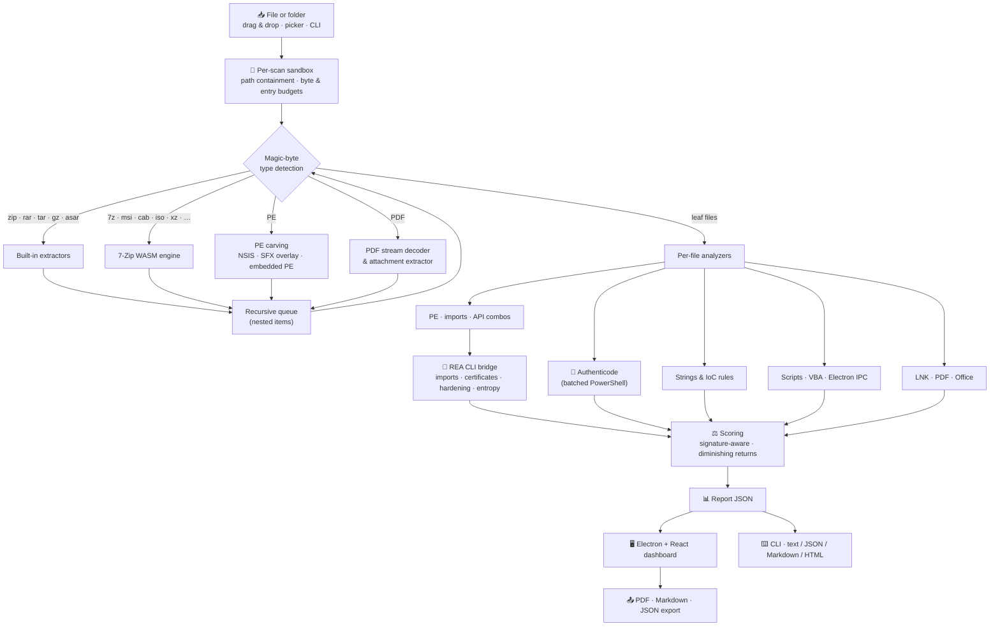

<div align="center">

[English](README.md) | [简体中文](README.zh-CN.md) | [Deutsch](README.de.md) | **Français** | [Türkçe](README.tr.md) | [日本語](README.ja.md)


# REAP-Shield

### Reverse Engineering & Automated Privacy Shield

**Regardez à l'intérieur d'un fichier suspect avant de l'exécuter.**

[](LICENSE)
[](#installation)
[](#architecture)
[](#security)
[](https://github.com/morluto/rea)
[](#testing)

*Un outil open source, en application de bureau et en ligne de commande, qui inspecte de manière statique les exécutables, installateurs, archives, documents, raccourcis, scripts et applications Electron, puis explique la menace en langage clair, preuves à l'appui.*

> 🌱 **Ce projet évolue activement. N'hésitez pas à partager vos retours : ils aident à façonner l'avenir de REAP-Shield.** Ouvrez une [issue](https://github.com/Teddy041/reap-shield/issues) ou lancez une discussion à tout moment.


</div>

> ℹ️ Ceci est une traduction. La version à jour et de référence est le [README en anglais](README.md).

---

## 📑 Table des matières

- [Pourquoi REAP-Shield ?](#why)
- [Objectifs du projet](#goals)
- [À qui s'adresse-t-il ?](#audience)
- [Captures d'écran](#screenshots)
- [Fonctionnalités](#features)
- [Formats pris en charge](#formats)
- [Architecture](#architecture)
- [Installation](#installation)
- [Utilisation : application de bureau](#usage-desktop)
- [Utilisation : CLI et CI/CD](#usage-cli)
- [Intégration REA](#rea)
- [Règles YARA](#yara)
- [Score de menace](#scoring)
- [Modèle de sécurité](#security)
- [Structure du projet](#structure)
- [Tests](#testing)
- [Compiler l'exécutable Windows](#building)
- [Limites](#limitations)
- [Feuille de route](#roadmap)
- [Contribuer](#contributing)
- [Licence et avertissement](#license)

---

<a id="why"></a>
## 🔍 Pourquoi REAP-Shield ?

La plupart des infections commencent de la même façon : quelqu'un double-clique sur un fichier qu'on lui a envoyé ou qu'il a téléchargé. Cela peut être un outil « cracké », un mod de jeu, une facture dans un ZIP, un raccourci qui ressemble à un PDF ou un installateur provenant d'un site inconnu. Les antivirus répondent par oui ou par non. REAP-Shield répond à la question qui vient avant : **que peut réellement faire ce fichier ?**

Déposez un fichier ou un dossier dans la fenêtre. REAP-Shield le décompresse dans un bac à sable isolé, sans rien exécuter, et inspecte chaque couche :

- empreintes (hashes) et signatures numériques
- en-têtes PE, imports et packers
- chaînes de caractères et indicateurs de compromission (IoC)
- macros, JavaScript des PDF et lignes de commande des raccourcis
- configuration de sécurité Electron

Vous obtenez un **score de menace de 0 à 100**, un verdict **Low / Medium / High / Critical** et des constats classés par catégorie, chacun accompagné de la preuve qui l'a déclenché.

> **Rien n'est jamais exécuté.** REAP-Shield se contente de lire des octets. Les archives sont décompressées dans un bac à sable propre à chaque analyse, supprimé ensuite.

---

<a id="goals"></a>
## 🎯 Objectifs du projet

1. **Rendre l'inspection avant exécution accessible.** Le savoir en rétro-ingénierie est réuni dans un outil glisser-déposer : inutile d'être analyste de malwares pour voir qu'un fichier injecte du code, vole des mots de passe de navigateur ou envoie des données vers un webhook Discord.
2. **Voir à travers les astuces d'empaquetage.** Archives imbriquées, installateurs, droppers auto-extractibles, exécutables intégrés, macros compressées et flux PDF sont décompressés récursivement : une charge utile ne peut pas se cacher une couche plus bas.
3. **Expliquer, pas seulement signaler.** Chaque constat indique le fichier, la règle, la preuve (ligne de code, API, chaîne, offset) et, le cas échéant, la technique MITRE ATT&CK.
4. **Rester honnête sur les faux positifs.** Les binaires correctement signés, les DLL système et les fichiers internes d'installateurs sont évalués dans leur contexte au lieu d'être traités comme des malwares.
5. **Être sûr par conception.** L'outil ne doit jamais devenir le maillon faible : aucune exécution, confinement strict des chemins, budgets de ressources et coque Electron renforcée.
6. **S'intégrer à l'automatisation.** Le même moteur alimente une CLI sans interface avec sortie JSON/Markdown/HTML et des codes de sortie adaptés à la CI.
7. **Rester local et ouvert.** Aucun fichier ne quitte la machine ; pas d'envoi vers le cloud, pas de compte, licence MIT.

---

<a id="audience"></a>
## 👥 À qui s'adresse-t-il ?

| Public | Usage typique |
| --- | --- |
| **Utilisateurs et joueurs** | Vérifier outils téléchargés, mods, cracks, logiciels « gratuits » et pièces jointes Discord avant de les ouvrir. Les voleurs de jetons et les info-stealers sont une priorité de détection. |
| **Équipes IT et support** | Trier les demandes « cette pièce jointe est-elle sûre ? » : droppers LNK, documents à macros, exploits PDF, ISO/IMG et archives protégées par mot de passe utilisés dans le phishing. |
| **Analystes SOC et équipes de réponse à incident** | Tri rapide de premier niveau : empreintes pour les recherches de threat intel, indicateurs C2 extraits, capacités associées à ATT&CK et rapports exportables. |
| **Développeurs et ingénieurs release** | Contrôler les versions en CI, auditer les installateurs tiers et vérifier les applications Electron (`nodeIntegration`, `contextIsolation` désactivé, IPC non sûr) avant publication. |
| **Chercheurs en sécurité et rétro-ingénieurs** | Preuves statiques structurées via REA (tables d'import, chaînes Authenticode, durcissement, entropie) comme point de départ pour un travail approfondi dans Ghidra ou un débogueur. |
| **Enseignants, étudiants et joueurs de CTF** | Apprendre à quoi ressemblent de vraies techniques dans un binaire ou un document, chaque règle étant expliquée en langage clair. |

---

<a id="screenshots"></a>
## 🖼️ Captures d'écran

> Les captures montrent l'analyse d'un **échantillon de démonstration synthétique** généré par la suite de tests (application Electron non sécurisée, motifs de dropper Python, une entrée zip-slip, un faux fichier à double extension et une copie du `notepad.exe` signé de Windows). Il ne contient aucun malware fonctionnel.

| Zone de dépôt | Progression en direct |
| :---: | :---: |
|  |  |
| **Rapport de menace et jauge de gravité** | **Constats par catégorie** |
|  |  |
| **Inspection PE avec preuves REA** | **Inventaire récursif des fichiers** |
|  |  |
| **Preuves REA brutes** | |
|  | |

---

<a id="features"></a>
## 🚀 Fonctionnalités

### Moteur d'analyse

| Domaine | Ce qu'il fait |
| --- | --- |
| 🗜️ **Décompression sûre** | Extraction récursive des archives, images disque, installateurs et documents dans un bac à sable par analyse. Les entrées zip-slip, à chemin absolu ou à nom de périphérique sont bloquées. Aucun lien symbolique n'est créé. Les entrées chiffrées, les bombes d'archives et l'imbrication excessive sont signalées. |
| 🔐 **Empreintes et signatures** | MD5 / SHA-1 / SHA-256 et entropie de Shannon pour chaque fichier. Vérification Windows Authenticode de chaque PE, MSI, CAB et script, regroupée dans un seul processus PowerShell. |
| 🧬 **Inspection PE** | Analyseur PE32/PE32+ défensif : sections et entropie, sections W+X, signatures de packers (UPX, Themida, VMProtect, MPRESS, ASPack, Enigma, …), anomalies du point d'entrée, overlays, ASLR/DEP/CFG, détection .NET, table d'import. |
| ⚠️ **API suspectes** | Catalogue d'environ 90 API Windows détournées et combinaisons de techniques associées à **MITRE ATT&CK** : injection par thread distant, process hollowing, enregistrement de frappes, vol d'identifiants, téléchargement-exécution et chiffrement de type rançongiciel. Les API cachées derrière `GetProcAddress` sont aussi signalées. |
| 🌐 **Chaînes et IoC** | Les chaînes ASCII et UTF-16LE sont analysées à la recherche de nombreux indicateurs. Les secrets détectés sont **masqués dans les rapports**. Indicateurs : <ul><li>**Exfiltration et C2 :** webhooks Discord, jetons de bots Telegram, jetons Discord, points de terminaison C2 à IP brute, adresses Tor, hôtes de paste / tunnel / dépôt de fichiers</li><li>**Exécution :** mineurs de cryptomonnaie, téléchargements PowerShell, LOLBins</li><li>**Persistance et privilèges :** clés de démarrage automatique, tâches planifiées, contournements de l'UAC</li><li>**Vol et destruction :** chemins d'identifiants de navigateurs, portefeuilles et Discord, suppression des clichés instantanés</li><li>**Évasion :** chaînes anti-VM et anti-analyse, exécutables encodés en Base64</li></ul> |
| 📦 **Extraction de charges** | Le contenu des installateurs NSIS, les archives ajoutées à la fin d'exécutables (droppers SFX) et les images PE complètes intégrées dans d'autres exécutables sont extraits et analysés comme des fichiers séparés. |
| 📄 **Documents** | **PDF :** inventaire des mots-clés (y compris les noms masqués en hexadécimal), décodage des flux Flate pour analyser le JavaScript compressé, détection d'exécution automatique, `/Launch`, extraction et analyse des pièces jointes. **Office :** source VBA décompressée (MS-OVBA) et analysée, feuilles de macros XLM, injection de modèle distant, DDE, abus de ms-msdt (type Follina). |
| 🔗 **Raccourcis et hôtes de scripts** | **LNK :** cible, arguments et icône analysés ; cibles LOLBin, fenêtres masquées, icônes déguisées et arguments rembourrés signalés. HTML smuggling, JSE/VBE encodés avec Script Encoder, fuites NTLM via UNC dans `.url` / `.scf` / `.library-ms`. |
| 🐍 **Scripts** | Règles JavaScript, Python, PowerShell, batch et VBA. Exemples : `eval` décodé, `child_process`, sortie d'obfuscator.io, droppers `marshal`/`exec`, chargeurs de shellcode ctypes, persistance `winreg`, déchiffrement de mots de passe de navigateur. |
| ⚛️ **Audit Electron et IPC** | `nodeIntegration`, `contextIsolation:false`, `sandbox:false`, `webSecurity:false`, module remote, exposition brute d'`ipcRenderer`, relais de canaux sans restriction, gestionnaires IPC atteignant `exec`/`shell`/`fs`, `openExternal`, contournements TLS. |
| 🧠 **Preuves REA** | Tables d'import PE de référence (y compris le chargement différé), chaînes de certificats Authenticode, durcissement binaire et cartes d'entropie par octet issus de [REA](https://github.com/morluto/rea). Analyse optionnelle appuyée sur Ghidra. |
| 🎯 **Signatures YARA** | Chaque fichier, y compris tout ce qui est extrait des conteneurs, est comparé avec [YARA-X](https://github.com/VirusTotal/yara-x) (WebAssembly) au paquet de règles [YARA Forge](https://github.com/YARAHQ/yara-forge) (téléchargement en un clic) et à vos propres fichiers `.yar`. Les correspondances indiquent la règle, la description, l'auteur et les chaînes trouvées avec leurs offsets. |

### Application de bureau

- 🖱️ **Glisser-déposer** des fichiers *ou des dossiers*, ou parcourir avec un sélecteur de fichier / dossier.
- 📈 **Progression en direct** avec suivi par étape et journal en continu ; les analyses tournent dans un worker thread et peuvent être annulées.
- 🎯 **Jauge de menace** (Low / Medium / High / Critical) avec un résumé en langage clair et des empreintes copiables.
- 🗂️ **Liste des constats** répartie en 11 catégories, avec filtre de gravité et recherche plein texte.
- 🧾 **Onglets** pour l'inventaire récursif des fichiers, les détails PE (sections, barres d'entropie, protections, signature, durcissement REA) et les preuves REA brutes.
- 📤 **Export** des rapports en **PDF**, **Markdown** ou **JSON**.
- 🗑️ **Supprimer** le fichier ou dossier analysé en le déplaçant vers la Corbeille (récupérable, avec confirmation), et **Retour** pour lancer une nouvelle analyse.

---

<a id="formats"></a>
## 📂 Formats pris en charge

| Catégorie | Formats | Moteur |
| --- | --- | --- |
| Exécutables | `.exe` `.dll` `.sys` `.scr` `.cpl` `.ocx` `.node` (PE32/PE32+, .NET), ELF, Mach-O | Analyseur PE intégré + REA |
| Archives | `.zip` (y compris `.jar` `.apk` et Office Open XML), `.rar` (RAR4/RAR5), `.tar` `.tar.gz` `.tgz` `.gz`, `.asar` | Intégré (yauzl, node-tar, node-unrar-js WASM, analyseur ASAR maison) |
| Archives et images | `.7z` `.xz` `.bz2` `.zst` `.cab` `.msi` `.iso` `.vhd` `.vhdx` `.wim` `.chm` `.lzh` `.arj` `.cpio`, anciens formats Office (OLE) | **7-Zip compilé en WebAssembly** (en mémoire, aucun binaire natif) |
| Installateurs | Installateurs NSIS, archives auto-extractibles (extraction d'overlay), images PE intégrées | 7-Zip WASM + extracteur intégré |
| Documents | `.pdf`, `.doc` `.docm` `.docx` `.xls` `.xlsm` `.xlsx` `.ppt` `.pptm` `.pptx` `.rtf` `.msg` | Analyseurs PDF / MS-OVBA intégrés |
| Raccourcis | `.lnk` `.url` `.scf` `.library-ms` `.searchConnector-ms` | Analyseur MS-SHLLINK intégré + règles |
| Scripts et balisage | `.js` `.mjs` `.cjs` `.ts` `.jse` `.py` `.ps1` `.bat` `.cmd` `.vbs` `.vbe` `.wsf` `.sct` `.hta` `.html` `.svg` `.reg` `.xml` | Moteur de règles |
| Dossiers | N'importe quel dossier (lu sur place, liens symboliques / jonctions non suivis) | Parcours de dossiers intégré |

Les combinaisons imbriquées sont décompressées récursivement. Exemples : un `.tar.xz`, un zip dans une ISO dans un 7z, ou un script joint à un PDF dans un ZIP.

---

<a id="architecture"></a>
## 🏗️ Architecture



Le **moteur d'analyse** (`src/analyzer/`) est en Node.js pur et partagé par l'application de bureau et la CLI. Dans l'application de bureau, il tourne dans un **worker thread** : l'interface reste réactive et les analyses peuvent être annulées.

---

<a id="installation"></a>
## 📦 Installation

### Option A : lanceur en un clic (Windows, recommandé)

Clonez le dépôt (ou téléchargez-le en ZIP) puis double-cliquez sur **`REAP-Shield Launcher.exe`** dans le dossier du projet. Au premier lancement, il demande une confirmation, exécute `npm install` et construit l'interface dans une fenêtre de console, puis démarre l'application. Les lancements suivants ouvrent directement l'application et ne reconstruisent l'interface que si ses sources ont changé (par exemple après `git pull`). Node.js 22+ est requis ; s'il est absent, le lanceur propose d'ouvrir la page de téléchargement de Node.js.

Le lanceur est un petit programme (~40 Ko) compilé à partir de [`launcher/Launcher.cs`](launcher/Launcher.cs). Il n'exécute que npm, Node.js et le binaire Electron présent dans le `node_modules` du projet. Il n'est pas signé, Windows SmartScreen peut donc afficher un avertissement *« éditeur inconnu »*. Pour le recompiler vous-même : `powershell -ExecutionPolicy Bypass -File launcher\build.ps1`. Ajoutez `--yes` pour ignorer la confirmation du premier lancement.

### Option B : exécutable Windows portable

Compilez-le une fois avec `npm run dist` (voir [Compiler l'exécutable Windows](#building)), puis lancez `REAP-Shield.exe`. Aucune installation n'est nécessaire. L'exécutable n'est pas signé numériquement : Windows SmartScreen peut afficher un avertissement *« éditeur inconnu »* au premier lancement.

### Option C : depuis les sources

**Prérequis :** Node.js 22+ (Node 24 recommandé) sous Windows, macOS ou Linux. Windows est nécessaire pour la vérification Authenticode.

```bash
git clone https://github.com/Teddy041/reap-shield.git
cd reap-shield
npm install
```

Si le binaire Electron n'a pas été téléchargé pendant l'installation (les versions récentes de npm peuvent ignorer les scripts d'installation), exécutez :

```bash
node node_modules/electron/install.js
```

Puis lancez l'application :

```bash
npm start
```

---

<a id="usage-desktop"></a>
## 🖥️ Utilisation : application de bureau

```bash
npm start      # build the UI and launch Electron
npm run dev    # Vite dev server + Electron with hot reload
```

1. **Déposez** un fichier ou un dossier dans la zone de dépôt, cliquez dessus pour parcourir, ou utilisez **Scan a folder…**.
2. Suivez la **progression en direct** à travers Validate → Extract → Hash → Analyze → REA → Score.
3. Lisez le **verdict**, puis ouvrez les onglets des constats, de l'inventaire des fichiers, de l'inspection PE, des preuves REA et des avertissements.
4. **Exportez** le rapport en PDF, Markdown ou JSON, **supprimez** l'élément vers la Corbeille, ou faites **Retour** pour une nouvelle analyse.

**Options d'analyse**

| Option | Effet |
| --- | --- |
| REA analysis | Ajoute les preuves REA pour les fichiers PE (activée automatiquement si REA est trouvé) |
| Deep Electron analysis | Reconstruction REA d'applications JavaScript pour les fichiers `.asar` (lent) |
| Verify signatures | Vérification Windows Authenticode |
| YARA signatures | Compare les fichiers aux règles YARA installées. Le panneau **YARA rules** télécharge ou met à jour YARA Forge et ouvre le dossier des règles personnelles |
| Max file size | Plus grand fichier analysé : 256 Mo – 16 Go, **1 Go** par défaut. Les fichiers isolés plus grands sont refusés avec un message clair ; dans les dossiers, ils sont ignorés et listés sous *Warnings*. Le choix est mémorisé. |

> **Plage sûre pour « Max file size » : 0,5 – 2 Go (1 Go recommandé).** Presque tous les malwares font moins de 200 Mo. Des limites plus élevées fonctionnent, mais les analyses sont plus longues, la recherche de texte / d'IoC ne couvre que les 96 premiers Mo de chaque fichier, et les données extraites des archives restent plafonnées à 2 Go (la protection contre les bombes d'archives ne change pas avec ce réglage).

<a id="reliability"></a>
#### Pourquoi les gros fichiers sont-ils moins fiables ?

Augmenter la limite permet à REAP-Shield d'*accepter* un gros fichier, mais ne rend pas son analyse complète :

| Raison | Ce qui se passe |
| --- | --- |
| **Lecture partielle** | La recherche de texte et d'IoC ne lit que les 96 premiers Mo de chaque fichier (scripts : 48 Mo, en-têtes PE : 256 Mo). Dans un fichier de 5 Go, cela représente moins de 2 % du contenu ; ce qui se trouve plus loin n'est jamais examiné. |
| **Limite de REA** | REA inspecte les fichiers jusqu'à 64 Mo. Les exécutables plus grands n'obtiennent aucune preuve REA. |
| **Plafonds des archives** | Les archives RAR / 7z de plus de 384 Mo ne sont pas décompressées, les entrées individuelles de plus de 512 Mo sont ignorées et l'extraction s'arrête à 2 Go au total. L'intérieur des gros conteneurs n'est vu qu'en partie. |
| **Astuce du gonflement** | Les attaquants remplissent volontairement leurs malwares de centaines de Mo de données inutiles, car beaucoup de scanners ignorent ou tronquent les gros fichiers. REAP-Shield signale les exécutables de plus de 100 Mo composés surtout de remplissage (`evasion.inflated-file`). |
| **Plafonds de volume** | Les très gros installateurs et images disque peuvent dépasser les budgets de 5 000 fichiers et 25 fichiers REA ; les fichiers suivants sont moins analysés, voire pas du tout. |

Lorsqu'un fichier n'a été examiné qu'en partie, le rapport l'indique : une bannière **Partial coverage** apparaît, le résumé du verdict ajoute une note de couverture et un constat *Scan Coverage & Limits* liste chaque fichier avec le pourcentage examiné. Pour les gros fichiers, **un verdict Low est une preuve plus faible** ; inspectez tout fichier important dans une machine virtuelle isolée.

Pendant `npm run dev`, ouvrir `http://127.0.0.1:5173` dans un navigateur classique affiche le tableau de bord en **mode démo**, avec un rapport d'exemple intégré.

---

<a id="usage-cli"></a>
## ⌨️ Utilisation : CLI et CI/CD

```bash
npx reap-shield scan suspicious.rar
npx reap-shield scan ./Downloads/SomeTool --format md --output report.md
npx reap-shield scan app.asar --format json --output report.json
npx reap-shield scan setup.exe --fail-on medium
npx reap-shield scan sample.exe --provider ghidra --keep-sandbox
npx reap-shield rules update --package core
npx reap-shield scan sample.exe --yara-rules ./my-rules
npx reap-shield doctor
npx reap-shield bench --malicious ./corpus/malicious --clean ./corpus/clean --limit 500 --jobs 4
```

| Option | Signification |
| --- | --- |
| `-f, --format` | `text` (par défaut), `json`, `md`, `html` |
| `-o, --output` | Écrire le rapport dans un fichier |
| `--fail-on` | Quitter avec le code 1 si le verdict atteint ou dépasse `low`, `medium`, `high` (par défaut) ou `critical` ; `never` n'échoue jamais |
| `--no-rea` | Ignorer REA même s'il est disponible |
| `--deep` | Reconstruction REA d'applications JavaScript pour les fichiers ASAR |
| `--provider` | Fournisseur natif REA, par ex. `ghidra` |
| `--no-signature` | Ignorer la vérification Authenticode |
| `--no-yara` | Ignore la recherche YARA |
| `--yara-rules <path>` | Fichier ou dossier de règles YARA supplémentaire pour cette analyse (répétable) |
| `--keep-sandbox` | Conserver les fichiers extraits pour un examen manuel |
| `--max-size <GB>` | Plus grand fichier à analyser, 0,05 – 16 Go (1 par défaut). Plage sûre : 0,5 – 2 Go. |
| `-q, --quiet` | Pas d'affichage de progression |

**Codes de sortie :** `0` verdict sous le seuil · `1` verdict égal ou supérieur à `--fail-on` · `2` erreur d'utilisation · `3` échec de l'analyse.

### Exemple GitHub Actions

```yaml
- name: Inspect release artifact
  run: npx reap-shield scan dist/MyApp-Setup.exe --format md --output reap-report.md --fail-on high

- name: Upload REAP-Shield report
  if: always()
  uses: actions/upload-artifact@v4
  with:
    name: reap-shield-report
    path: reap-report.md
```

---

<a id="rea"></a>
## 🧠 Intégration REA

[REA (Reverse Engineer Anything)](https://github.com/morluto/rea) est une boîte à outils de rétro-ingénierie disponible à la fois en CLI et en serveur MCP. REAP-Shield utilise la **CLI** de REA. Chaque appel s'exécute comme un processus isolé qui renvoie des preuves au format JSON :

| Commande REA | Utilisée pour |
| --- | --- |
| `inspect-pe-imports` | Tables d'import et de chargement différé de référence, fusionnées dans l'analyse des API |
| `inspect-pe-certificates` | Chaîne de certificats Authenticode PKCS#7 (signataire, émetteur) |
| `inspect-binary-hardening` | ASLR, high-entropy VA, NX, CFG, SEH et indicateurs d'intégrité |
| `inspect-byte-entropy` | Zones à forte entropie révélant des charges empaquetées ou chiffrées |
| `analyze --provider ghidra` | Analyse optionnelle s'appuyant sur la décompilation (`--provider ghidra`) |
| `analyze-javascript-application` | Reconstruction approfondie optionnelle des applications Electron (`--deep`) |

**REA est optionnel.** Sans lui, tous les analyseurs intégrés fonctionnent toujours. REAP-Shield cherche REA dans cet ordre :

1. `REA_BIN` : chemin vers `rea`, `rea.cmd` ou `scripts/rea.mjs`
2. `REA_HOME` : chemin vers une copie de REA compilée
3. Une copie voisine dans `../../rea`
4. `rea` dans le `PATH` (`npm install -g rea-agents`)

Lancez `npx reap-shield doctor` pour voir ce qui a été trouvé. REA s'exécute sur au plus 25 fichiers PE par analyse, et ses preuves sont affichées brutes dans l'onglet **REA Evidence**.

> **Note Windows :** la reconstruction JavaScript approfondie de REA nécessite le module natif empaqueté de REA, absent d'une copie Git de REA. Installez REA depuis npm (`npm i -g rea-agents`) pour cette fonctionnalité. Sans ce module, l'analyse approfondie est signalée comme `capability_unavailable` et toutes les autres vérifications fonctionnent toujours.

---

<a id="yara"></a>
## 🎯 Règles YARA

REAP-Shield compare chaque fichier analysé, y compris ceux extraits des archives, installeurs et documents, à des règles YARA avec **[YARA-X](https://github.com/VirusTotal/yara-x)**, la réécriture officielle de YARA en Rust par VirusTotal. Il s'exécute en WebAssembly (`@virustotal/yara-x`) et fonctionne donc de la même façon sous Windows, macOS et Linux, sans binaire natif. Chaque correspondance devient un résultat de la catégorie *YARA Signature Matches* avec le nom de la règle, la description, l'auteur, les chaînes trouvées avec leurs offsets et le lien de référence.

**Aucune règle n'est fournie avec REAP-Shield**, car les licences des règles varient. Vous les ajoutez de deux façons :

| Source | Comment |
| --- | --- |
| **YARA Forge** (recommandé) | Dans l'application, choisissez un paquet et cliquez sur **Download rules** ; en ligne de commande, lancez `npx reap-shield rules update`. [YARA Forge](https://github.com/YARAHQ/yara-forge) regroupe des règles filtrées par qualité issues de nombreux dépôts publics. `core` (environ 5 000 règles) produit le moins de faux positifs ; `extended` et `full` ajoutent plus de règles et plus de bruit. Un téléchargement ne remplace les règles installées qu'après avoir été compilé avec succès. Chaque règle conserve sa propre licence (voir ses champs méta `author`, `reference` et `license_url`). |
| **Vos propres règles** | Placez des fichiers `.yar` / `.yara` dans le dossier des règles personnelles (**Open custom rules folder** dans l'application, ou `npx reap-shield rules status` pour afficher son chemin). Chaque fichier est compilé dans son propre espace de noms ; un fichier invalide est ignoré et signalé, les autres sont tout de même chargés. Pour une seule analyse, ajoutez des règles avec `--yara-rules <fichier ou dossier>`. |

Les règles sont stockées dans le dossier de données de l'utilisateur : `%APPDATA%\REAP-Shield\yara` sous Windows, `~/Library/Application Support/REAP-Shield/yara` sous macOS et `~/.config/REAP-Shield/yara` sous Linux (modifiable avec `REAP_YARA_DIR`).

- **Sévérité :** le champ méta `severity` d'une règle (`info` … `critical`) est utilisé tel quel. Sinon, son champ `score` (utilisé par YARA Forge) est converti : 90+ critical, 75+ high, 60+ medium, 40+ low. Les règles sans l'un ni l'autre sont *medium*. Les règles d'aide privées ne sont jamais signalées, et l'abaissement pour les fichiers signés s'applique comme pour les autres résultats.
- **Performances :** la compilation du paquet YARA Forge `core` prend environ 3 à 5 secondes. L'application de bureau le compile une fois et le réutilise pour les analyses suivantes tant qu'aucun fichier de règles ne change ; la CLI le compile une fois par exécution. La recherche prend environ une seconde pour un exécutable typique. Chaque fichier est lu jusqu'à 96 Mo, avec un délai maximal de 15 secondes par fichier.
- **Faux positifs :** lors de nos tests sur des programmes système et de développement Windows courants (notepad, shell32, kernel32, PowerShell, certutil, git, node), le paquet `core` n'a produit aucune correspondance.

---

<a id="scoring"></a>
## ⚖️ Score de menace

- **Poids par gravité :** info 0 · low 3 · medium 8 · high 18 · critical 35.
- **Rendements décroissants :** les occurrences répétées d'une même règle ajoutent au plus 2 fois son poids, pour qu'une règle bruyante ne domine pas le score.
- **Saturation :** le total est ramené sur 0–100 avec `100 · (1 − e^(−raw/70))`.
- **Seuils de verdict :** Low < 20 ≤ Medium < 45 ≤ High < 70 ≤ Critical.
- **Escalade :** une règle critique impose au moins *High*, deux imposent *Critical*, et trois règles élevées imposent au moins *High*.
- **Prise en compte des signatures :** les constats de capacités des fichiers à signature Authenticode valide sont abaissés. Les indicateurs comportementaux critiques (webhooks, commandes de rançongiciel, chargeurs de shellcode) ne sont **jamais** abaissés, car il existe des malwares signés avec des certificats volés.

---

<a id="security"></a>
## 🔒 Modèle de sécurité

- **Rien n'est exécuté.** Les fichiers sont ouverts en lecture seule. Les fichiers extraits sont écrits avec le mode `0600` à côté d'un marqueur `DO-NOT-EXECUTE.txt`. Le décodage 7-Zip et RAR s'exécute en WebAssembly en mémoire, jamais comme processus natif.
- **Confinement.** Le nom de chaque entrée d'archive passe par `Sandbox.safeJoin`, qui rejette `..`, les chemins absolus, les lettres de lecteur, les octets NUL et les noms de périphériques Windows. Les liens symboliques, liens physiques et entrées de périphériques ne sont jamais créés, et l'analyse de dossiers ne suit jamais les liens symboliques ni les jonctions.
- **Budgets.** Les limites suivantes s'appliquent à chaque analyse :

  | Limite | Valeur |
  | --- | --- |
  | Taille du fichier analysé lui-même | Choisie par l'utilisateur, 1 Gio par défaut (plage sûre 0,5–2 Gio) |
  | Taille d'une entrée extraite | 512 Mio |
  | Total des octets extraits | 2 Gio |
  | Nombre d'entrées | 20 000 |
  | Taux de compression | 250:1 |
  | Profondeur d'imbrication des archives | 4 |
  | Taille d'archive décodée en mémoire (RAR / 7-Zip) | 384 Mio |
  | Octets analysés pour les chaînes, par fichier | 96 Mio |
- **Isolation des erreurs.** Chaque étape s'exécute dans `guard()` : un fichier malformé devient un constat ou une entrée d'erreur, jamais un plantage. Les bacs à sable des analyses annulées ou interrompues sont supprimés, et les anciens sont purgés au démarrage.
- **Coque Electron renforcée.**
  - `contextIsolation` et la `sandbox` du renderer sont activés ; `nodeIntegration` est désactivé.
  - Une Content-Security-Policy stricte s'applique.
  - Chaque gestionnaire IPC valide la frame émettrice, et l'API de preload est figée.
  - La navigation et les nouvelles fenêtres sont bloquées, et toutes les demandes de permission sont refusées.
  - L'export PDF est rendu avec JavaScript désactivé.
- **Sortie non fiable.** Tout le texte des rapports est échappé en HTML et Markdown, et React échappe tout le texte de l'interface.
- **Confidentialité.** Les fichiers ne quittent jamais la machine. Pas de télémétrie, pas de requête cloud, pas de compte. Le seul accès réseau est le téléchargement facultatif des règles YARA, qui ne démarre que lorsque vous cliquez sur **Download rules** ou lancez `rules update`.

---

<a id="structure"></a>
## 🗂️ Structure du projet

```
reap-shield/
├── src/
│   ├── analyzer/              Core engine (pure Node.js, shared by GUI and CLI)
│   │   ├── index.mjs            scanFile() pipeline
│   │   ├── config.mjs           Safety limits, severities, categories
│   │   ├── sandbox.mjs          Per-scan workspace, path containment, budgets
│   │   ├── fileType.mjs         Magic-byte file type detection
│   │   ├── extractors.mjs       ZIP / TAR / GZIP / RAR / ASAR + 7-Zip WASM extractors
│   │   ├── documents.mjs        LNK, PDF and Office VBA (MS-OVBA) analyzers
│   │   ├── pe.mjs               Defensive PE32/PE32+ parser
│   │   ├── apiCatalog.mjs       Suspicious Windows APIs and ATT&CK technique combos
│   │   ├── strings.mjs          String extraction and IoC rules
│   │   ├── scripts.mjs          JS / Python / PowerShell / VBA / Electron IPC rules
│   │   ├── signature.mjs        Authenticode verification (batched PowerShell)
│   │   ├── yara.mjs             YARA-X rule loading, matching and YARA Forge updates
│   │   ├── benchmark.mjs        Detection benchmark: labelled corpus, metrics and report
│   │   ├── hashing.mjs          Streaming MD5 / SHA-1 / SHA-256 + entropy
│   │   ├── rea.mjs              REA CLI bridge (locate, run, normalise evidence)
│   │   ├── scoring.mjs          Threat score and verdict
│   │   └── report.mjs           Markdown and HTML renderers
│   ├── cli/reap-shield.mjs    Headless CLI for CI/CD
│   ├── main/                  Electron main process, preload bridge, scan worker
│   └── ui/                    React 19 + Tailwind CSS 4 dashboard
├── tests/                     node:test suites with synthetic (non-functional) fixtures
├── scripts/                   Dev launcher, demo sample/report, icon, build info
├── launcher/                  One-click Windows launcher (C# source + build script)
├── REAP-Shield Launcher.exe   Prebuilt launcher (see Installation)
├── build/icon.png             Application icon
├── assets/logo-source.webp    Logo source image (icons are generated from it)
└── docs/screenshots/          README screenshots
```

---

<a id="testing"></a>
## 🧪 Tests

```bash
npm test
```

Les suites génèrent tous les fichiers de test à l'exécution et couvrent :

- **Sécurité de l'extraction :** zip-slip, chemins absolus et de périphériques, liens symboliques, archives malformées, 7z chiffré, nettoyage du bac à sable.
- **Formats :** ZIP, TAR.GZ, RAR (si WinRAR est installé), 7z, tar.xz, dossiers, LNK, PDF avec JavaScript auto-exécuté et pièces jointes, dropper VBA Office avec injection de modèle, overlays SFX, images PE intégrées, JSE et HTML smuggling.
- **Détection :** ASAR Electron non sécurisé, motifs de dropper Python, décompresseur MS-OVBA.
- **Rapports :** score et échappement HTML / Markdown du contenu non fiable.
- **YARA :** correspondances de règles personnelles avec preuves, règles privées et invalides, contenu d'archives, conversion du score en sévérité et mise à jour YARA Forge (avec un téléchargement simulé).
- **Benchmark :** collecte du corpus (doublons, échantillonnage reproductible, conflits d’étiquettes), métriques de la matrice de confusion, gestion des erreurs par échantillon et exécution de bout en bout sur des échantillons synthétiques.

Les fichiers de test ne contiennent que des *chaînes et structures* suspectes. **Aucun n'est un malware fonctionnel.**

Test de fumée de bout en bout de la véritable application de bureau. Il affiche l'interface, vérifie l'isolation du renderer, lance une analyse via l'IPC et le worker, et exporte éventuellement un PDF :

```bash
npm run build:ui
REAP_SMOKE_TEST=/path/to/sample.zip REAP_SMOKE_PDF=/tmp/report.pdf npx electron .
```

### Benchmark de détection

```bash
npx reap-shield bench --malicious ./corpus/malicious --clean ./corpus/clean --limit 500 --jobs 4
npx reap-shield bench --clean "C:/Windows/System32" --ext exe,dll --limit 300 --max-fp 2
```

Mesurez dans quelle mesure REAP-Shield sépare les fichiers malveillants des fichiers sains sur **votre propre corpus étiqueté**. Chaque échantillon passe par l’analyse statique habituelle (rien n’est exécuté) et le résultat est écrit dans `benchmark.md` et `benchmark.json` :

- **Métriques :** taux de détection (rappel), taux de faux positifs, précision et F1 au niveau `--threshold`, plus un tableau pour chaque seuil (*Medium+*, *High+*, *Critical+*).
- **Ventilations :** répartition des verdicts par étiquette, résultats par type de fichier, règles qui se déclenchent le plus sur les fichiers sains (sources de faux positifs) et règles vues uniquement sur les fichiers malveillants.
- **Listes :** chaque échantillon malveillant manqué et chaque faux positif, avec type, taille, score et SHA-256. Les échantillons manqués sont la meilleure base pour écrire de nouvelles règles.
- **Corpus :** les dossiers sont parcourus récursivement ; les fichiers vides, les doublons exacts (SHA-256) et les fichiers étiquetés des deux côtés sont ignorés et comptés. `--limit` avec `--seed` choisit un sous-ensemble aléatoire reproductible ; `--ext` ne garde que les extensions indiquées.
- **Contrôles CI :** `--min-detection <%>` et `--max-fp <%>` font sortir la commande avec le code `1` quand un taux se dégrade.

| Option | Signification |
| --- | --- |
| `--malicious <path>` | Fichier ou dossier d’échantillons malveillants connus (répétable) |
| `--clean <path>` | Fichier ou dossier d’échantillons sains connus (répétable) |
| `--threshold <level>` | Verdict minimal compté comme détecté : `medium` (par défaut), `high`, `critical` |
| `--ext <list>` | Uniquement ces extensions, p. ex. `exe,dll,ps1` |
| `--limit <n>` | Au plus *n* échantillons par étiquette (sous-ensemble aléatoire reproductible, `--seed`) |
| `--jobs <n>` | Échantillons analysés en parallèle, 1 – 8 (par défaut 1) |
| `--min-detection <%>` / `--max-fp <%>` | Code de sortie `1` si le taux de détection est plus bas / le taux de faux positifs plus élevé |
| `-o, --output <dir>` | Dossier de sortie (par défaut `temp/benchmark/<heure>`) |

> **Ne manipulez des logiciels malveillants que dans une machine virtuelle isolée.** Des collections comme MalwareBazaar fournissent les échantillons dans des ZIP protégés par mot de passe : extrayez-les d’abord dans la VM, car les archives chiffrées sont signalées, pas décompressées. Si un antivirus met un échantillon en quarantaine pendant l’exécution, il est listé comme erreur et l’exécution continue. Un corpus petit ou déséquilibré donne des taux trompeurs.

---

<a id="building"></a>
## 🛠️ Compiler l'exécutable Windows

```bash
npm run dist
```

Cette commande produit un `release/REAP-Shield.exe` **portable** en un seul fichier (environ 110 Mo, sans installation) :

- **REA :** la compilation enregistre le chemin d'une copie voisine de REA, si elle existe, afin que l'exécutable utilise REA automatiquement sur la machine de compilation. Ailleurs, il cherche REA via `REA_BIN`, `REA_HOME` ou `PATH`.
- **Bac à sable :** l'application empaquetée conserve son bac à sable dans `%APPDATA%\REAP-Shield\sandbox`.

Scripts utilitaires :

| Script | Rôle |
| --- | --- |
| `npm run icon` | Régénérer `build/icon.png` et le logo de l'application à partir de `assets/logo-source.webp` |
| `npm run demo-report` | Régénérer le rapport du mode démo navigateur |
| `npm run screenshots` | Recapturer `docs/screenshots/` depuis la véritable application. Les chemins locaux sont anonymisés. |

---

<a id="limitations"></a>
## 🚧 Limites

- **L'analyse statique a des angles morts.** Des charges fortement empaquetées ou chiffrées, des seconds étages téléchargés à l'exécution et des techniques inédites peuvent masquer un comportement. **Un verdict *Low* ne prouve pas qu'un fichier est sûr.**
- **Les règles heuristiques peuvent se tromper.** Les outils de sécurité, installateurs et utilitaires système utilisent légitimement des API « dangereuses ». Les constats sont des éléments de décision, pas un jugement définitif.
- **Vérifications propres à la plateforme.** La vérification Authenticode n'existe que sous Windows, et les fichiers ELF / Mach-O bénéficient des vérifications de chaînes, d'IoC et de durcissement REA, mais pas d'une analyse approfondie.
- **Le contenu protégé par mot de passe ne peut pas être inspecté.** Il est signalé, pas décompressé. Inno Setup et certains formats d'installateurs propriétaires ne sont pas décompressés.

---

<a id="roadmap"></a>
## 🗺️ Feuille de route

- [x] Prise en charge des règles YARA et de packs de règles personnalisés
- [x] Benchmark de détection sur des corpus étiquetés (taux de détection et de faux positifs)
- [ ] Recherches optionnelles de réputation des empreintes (sur activation, respectueuses de la vie privée)
- [ ] Décompression d'Inno Setup et MSIX
- [ ] Inspection IL .NET via REA (`inspect-il`, `inspect-managed-artifact`)
- [ ] Historique des analyses et comparaison de rapports
- [ ] Versions signées numériquement et un installateur
- [ ] Interface traduite

---

<a id="contributing"></a>
## 🤝 Contribuer

**N'hésitez pas à partager vos retours pour aider le projet à grandir : REAP-Shield est en développement actif.** Rapports de bugs, signalements de faux positifs, idées de fonctionnalités et questions sont les bienvenus dans les [Issues](https://github.com/Teddy041/reap-shield/issues).

Les contributions sont les bienvenues. Les règles de détection sont de simples données dans `src/analyzer/scripts.mjs`, `strings.mjs` et `apiCatalog.mjs`, ce qui en fait un bon point de départ pour une première contribution.

1. Forkez le dépôt et créez une branche de fonctionnalité.
2. Ajoutez ou mettez à jour des tests dans `tests/`. Les fichiers de test doivent être générés à l'exécution et ne doivent **jamais** contenir de malware fonctionnel.
3. Lancez `npm test` et vérifiez que toutes les suites passent.
4. Ouvrez une pull request décrivant la technique détectée par votre modification et la manière dont vous avez évité les faux positifs.

---

<a id="license"></a>
## 📜 Licence et avertissement

REAP-Shield est publié sous [licence MIT](LICENSE). Il s'appuie sur [REA](https://github.com/morluto/rea) (MIT), 7-Zip via [7z-wasm](https://www.npmjs.com/package/7z-wasm) (licence LGPL / unRAR), [node-unrar-js](https://www.npmjs.com/package/node-unrar-js), [yauzl](https://www.npmjs.com/package/yauzl), [node-tar](https://www.npmjs.com/package/tar), [Electron](https://www.electronjs.org/), [React](https://react.dev/) et [Tailwind CSS](https://tailwindcss.com/).

> **Avertissement :** REAP-Shield est une aide à l'analyse statique pour la sécurité défensive, la formation et la qualité logicielle. Il ne remplace pas un antivirus ni une solution de protection des terminaux. Exécutez toujours un logiciel inconnu uniquement dans une machine virtuelle isolée. Les auteurs déclinent toute responsabilité pour les décisions prises sur la base de ses résultats.

<div align="center">

**Inspectez avant d'exécuter.** 🛡️

</div>
