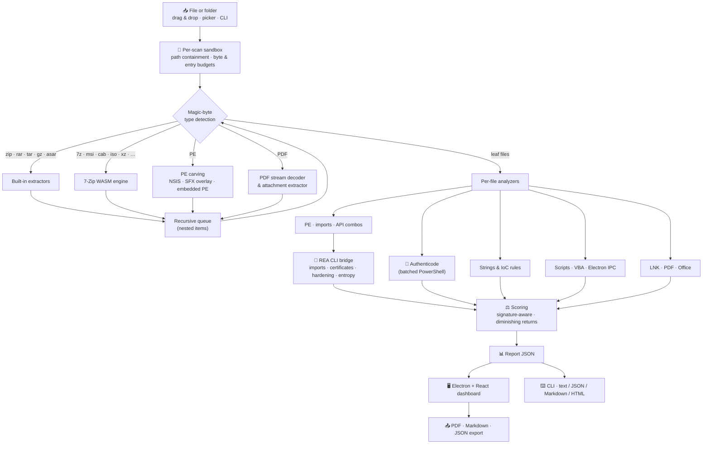

<div align="center">

[English](README.md) | [简体中文](README.zh-CN.md) | [Deutsch](README.de.md) | [Français](README.fr.md) | [Türkçe](README.tr.md) | **日本語**


# REAP-Shield

### Reverse Engineering & Automated Privacy Shield

**怪しいファイルは、実行する前に中身を確認しましょう。**

[](LICENSE)
[](#installation)
[](#architecture)
[](#security)
[](https://github.com/morluto/rea)
[](#testing)

*実行ファイル、インストーラー、アーカイブ、ドキュメント、ショートカット、スクリプト、Electron アプリを静的に検査し、脅威を根拠とともにわかりやすい言葉で説明する、オープンソースのデスクトップ／コマンドラインツールです。*

> 🌱 **本プロジェクトは現在も活発に開発中です。プロジェクトの発展のため、フィードバックをお気軽にお寄せください。** いつでも [issue](https://github.com/Teddy041/reap-shield/issues) を作成したり、ディスカッションを始めたりできます。


</div>

> ℹ️ これは翻訳版です。最新かつ正式な内容は[英語版 README](README.md) を参照してください。

---

## 📑 目次

- [なぜ REAP-Shield なのか？](#why)
- [プロジェクトの目標](#goals)
- [対象ユーザー](#audience)
- [スクリーンショット](#screenshots)
- [機能](#features)
- [対応フォーマット](#formats)
- [アーキテクチャ](#architecture)
- [インストール](#installation)
- [使い方：デスクトップアプリ](#usage-desktop)
- [使い方：CLI と CI/CD](#usage-cli)
- [REA との連携](#rea)
- [脅威スコア](#scoring)
- [セキュリティモデル](#security)
- [プロジェクト構成](#structure)
- [テスト](#testing)
- [Windows 実行ファイルのビルド](#building)
- [制限事項](#limitations)
- [ロードマップ](#roadmap)
- [コントリビューション](#contributing)
- [ライセンスと免責事項](#license)

---

<a id="why"></a>
## 🔍 なぜ REAP-Shield なのか？

ほとんどの感染は同じように始まります。誰かが、送られてきた、あるいはダウンロードしたファイルをダブルクリックするのです。それは「クラック版」のツール、ゲームの MOD、ZIP に入った請求書、PDF に見えるショートカット、見知らぬサイトのインストーラーかもしれません。ウイルス対策エンジンは「はい／いいえ」で答えます。REAP-Shield はその前にある問いに答えます。**このファイルは実際に何ができるのか？**

ファイルやフォルダーをウィンドウにドロップしてください。REAP-Shield は何も実行せずに、隔離されたサンドボックス内で展開し、あらゆる層を検査します。

- ハッシュとデジタル署名
- PE ヘッダー、インポート、パッカー
- 文字列と侵害の痕跡（IoC）
- マクロ、PDF 内の JavaScript、ショートカットのコマンドライン
- Electron のセキュリティ設定

その結果、**0〜100 の脅威スコア**、**Low / Medium / High / Critical** の判定、そしてカテゴリ別に整理された検出結果が得られます。各検出結果には、それを引き起こした根拠が付いています。

> **何も実行されません。** REAP-Shield はバイトを読むだけです。アーカイブはスキャンごとのサンドボックスに展開され、スキャン後に削除されます。

---

<a id="goals"></a>
## 🎯 プロジェクトの目標

1. **実行前の検査を誰でも使えるものにする。** リバースエンジニアリングの知識をドラッグ＆ドロップのツールにまとめました。マルウェアアナリストでなくても、ファイルがコードを注入する、ブラウザーのパスワードを盗む、Discord の Webhook に情報を送るといった振る舞いを見抜けます。
2. **パッケージングの小細工を見抜く。** ネストされたアーカイブ、インストーラー、自己展開型ドロッパー、埋め込まれた実行ファイル、圧縮されたマクロ、PDF ストリームを再帰的に展開するので、ペイロードが一段下に隠れることはできません。
3. **フラグを立てるだけでなく、説明する。** すべての検出結果に、ファイル、ルール、根拠（コード行、API、文字列、オフセット）、該当する場合は MITRE ATT&CK の手法を明記します。
4. **誤検知に誠実である。** 正しく署名されたバイナリ、システム DLL、インストーラー内部のファイルは、マルウェア扱いせず文脈に沿って評価します。
5. **設計段階から安全である。** ツール自体が弱点になってはいけません。実行は一切なし、厳格なパス制限、リソース予算、堅牢化された Electron シェルを備えています。
6. **自動化に組み込める。** 同じエンジンが、JSON/Markdown/HTML 出力と CI 向けの終了コードを持つ、画面のない CLI を動かします。
7. **ローカルかつオープンであり続ける。** ファイルがマシンの外に出ることはありません。クラウドへのアップロードもアカウントも不要で、MIT ライセンスです。

---

<a id="audience"></a>
## 👥 対象ユーザー

| 対象 | 主な使い方 |
| --- | --- |
| **一般ユーザーとゲーマー** | ダウンロードしたツール、MOD、クラック、「無料」ソフト、Discord の添付ファイルを開く前にチェック。トークン窃取ツールや情報窃取型マルウェア（インフォスティーラー）の検出に特に力を入れています。 |
| **IT・ヘルプデスクチーム** | 「この添付ファイルは安全？」という問い合わせの切り分け。フィッシングで使われる LNK ドロッパー、マクロ付き文書、PDF エクスプロイト、ISO/IMG、パスワード付きアーカイブなど。 |
| **SOC アナリストとインシデント対応担当者** | 迅速な一次トリアージ。脅威インテリジェンス照会用のハッシュ、抽出された C2 指標、ATT&CK に対応付けられた機能、エクスポート可能なレポート。 |
| **ソフトウェア開発者とリリースエンジニア** | CI でリリースをチェックし、サードパーティのインストーラーを監査し、出荷前に Electron アプリの `nodeIntegration`、無効化された `contextIsolation`、安全でない IPC を確認。 |
| **セキュリティ研究者とリバースエンジニア** | REA による構造化された静的な根拠（インポートテーブル、Authenticode 証明書チェーン、ハードニング、エントロピー）を、Ghidra やデバッガーでの詳細解析の出発点として活用。 |
| **教育者・学生・CTF プレイヤー** | 実際の攻撃手法がバイナリや文書の中でどう見えるかを、各ルールのわかりやすい説明とともに学習。 |

---

<a id="screenshots"></a>
## 🖼️ スクリーンショット

> スクリーンショットは、テストスイートが生成した**合成デモサンプル**のスキャン結果です（安全でない Electron アプリ、Python ドロッパーのパターン、zip-slip エントリ、偽の二重拡張子ファイル、署名済みの Windows `notepad.exe` のコピー）。動作するマルウェアは含まれていません。

| ドロップエリア | リアルタイムのスキャン進捗 |
| :---: | :---: |
|  |  |
| **脅威レポートと深刻度ゲージ** | **カテゴリ別の検出結果** |
|  |  |
| **REA の根拠付き PE 検査** | **再帰的なファイル一覧** |
|  |  |
| **REA の生データ** | |
|  | |

---

<a id="features"></a>
## 🚀 機能

### 解析エンジン

| 分野 | 内容 |
| --- | --- |
| 🗜️ **安全な展開** | アーカイブ、ディスクイメージ、インストーラー、ドキュメントを、スキャンごとのサンドボックスへ再帰的に展開します。zip-slip、絶対パス、デバイス名のエントリはブロックされ、シンボリックリンクは作成されません。暗号化エントリ、アーカイブ爆弾、過度なネストは報告されます。 |
| 🔐 **ハッシュと署名** | すべてのファイルについて MD5 / SHA-1 / SHA-256 とシャノンエントロピーを計算します。PE、MSI、CAB、スクリプトはすべて Windows Authenticode で検証し、1 つの PowerShell プロセスでまとめて処理します。 |
| 🧬 **PE 検査** | 防御的な PE32/PE32+ パーサー：セクションとエントロピー、書き込み＋実行可能（W+X）セクション、パッカーのシグネチャ（UPX、Themida、VMProtect、MPRESS、ASPack、Enigma など）、エントリポイントの異常、オーバーレイ、ASLR/DEP/CFG、.NET の検出、インポートテーブル。 |
| ⚠️ **不審な API** | 悪用されやすい約 90 個の Windows API のカタログと、**MITRE ATT&CK** に対応付けた手法の組み合わせ：リモートスレッドインジェクション、プロセスハロウイング、キーロギング、認証情報のダンプ、ダウンロード＆実行、ランサムウェア型の暗号化。`GetProcAddress` の背後に隠された API も検出します。 |
| 🌐 **文字列と IoC** | ASCII と UTF-16LE の文字列から多数の指標を検索します。検出された機密情報は**レポート内でマスク**されます。主な指標：<ul><li>**データ持ち出しと C2：** Discord Webhook、Telegram ボットトークン、Discord トークン、IP 直指定の C2 エンドポイント、Tor アドレス、ペースト／トンネル／ファイル共有サービス</li><li>**実行：** 暗号資産マイナー、PowerShell のダウンロード処理、LOLBin</li><li>**永続化と権限：** 自動起動キー、タスクスケジューラ、UAC バイパス</li><li>**窃取と破壊：** ブラウザー・ウォレット・Discord の認証情報パス、シャドウコピーの削除</li><li>**回避：** 仮想マシン・解析ツールの検知文字列、Base64 エンコードされた実行ファイル</li></ul> |
| 📦 **ペイロードの切り出し** | NSIS インストーラーの中身、実行ファイルの末尾に付加されたアーカイブ（SFX ドロッパー）、他の実行ファイルに埋め込まれた完全な PE イメージを切り出し、個別のファイルとしてスキャンします。 |
| 📄 **ドキュメント** | **PDF：** キーワード一覧（16 進数で難読化された名前を含む）、圧縮された JavaScript をスキャンするための Flate ストリームのデコード、自動実行の検出、`/Launch`、添付ファイルの抽出とスキャン。**Office：** VBA ソースの展開（MS-OVBA）とスキャン、XLM マクロシート、リモートテンプレートインジェクション、DDE、ms-msdt（Follina 型）の悪用。 |
| 🔗 **ショートカットとスクリプトホスト** | **LNK：** ターゲット、引数、アイコンを解析し、LOLBin のターゲット、非表示ウィンドウ、偽装アイコン、水増しされた引数を検出します。HTML スマグリング、Script Encoder でエンコードされた JSE/VBE、`.url` / `.scf` / `.library-ms` の UNC パスによる NTLM 漏えいも対象です。 |
| 🐍 **スクリプト** | JavaScript、Python、PowerShell、バッチ、VBA のルール。例：デコード後の `eval`、`child_process`、obfuscator.io の出力、`marshal`/`exec` ドロッパー、ctypes によるシェルコードローダー、`winreg` による永続化、ブラウザーパスワードの復号。 |
| ⚛️ **Electron と IPC の監査** | `nodeIntegration`、`contextIsolation:false`、`sandbox:false`、`webSecurity:false`、remote モジュール、`ipcRenderer` の直接公開、無制限のチャネル転送、`exec`/`shell`/`fs` に到達する IPC ハンドラー、`openExternal`、TLS 検証の回避。 |
| 🧠 **REA の根拠** | [REA](https://github.com/morluto/rea) による信頼性の高い PE インポートテーブル（遅延ロードを含む）、Authenticode 証明書チェーン、バイナリのハードニング、バイトエントロピーマップ。Ghidra を使った解析もオプションで利用できます。 |

### デスクトップアプリ

- 🖱️ ファイル*またはフォルダー*を**ドラッグ＆ドロップ**、またはファイル／フォルダー選択ダイアログで指定。
- 📈 段階ごとの進捗とリアルタイムログによる**ライブ進捗表示**。スキャンはワーカースレッドで実行され、キャンセルも可能です。
- 🎯 わかりやすい要約とコピー可能なハッシュ付きの**脅威ゲージ**（Low / Medium / High / Critical）。
- 🗂️ 11 のカテゴリに分類され、深刻度フィルターと全文検索を備えた**検出結果リスト**。
- 🧾 再帰的なファイル一覧、PE の詳細（セクション、エントロピーバー、保護機能、署名、REA のハードニング情報）、REA の生データを表示する**タブ**。
- 📤 レポートを **PDF**、**Markdown**、**JSON** で**エクスポート**。
- 🗑️ スキャンしたファイルやフォルダーをごみ箱に移動して**削除**（確認付き・復元可能）、**戻る**で新しいスキャンを開始。

---

<a id="formats"></a>
## 📂 対応フォーマット

| カテゴリ | フォーマット | エンジン |
| --- | --- | --- |
| 実行ファイル | `.exe` `.dll` `.sys` `.scr` `.cpl` `.ocx` `.node`（PE32/PE32+、.NET）、ELF、Mach-O | 内蔵 PE パーサー + REA |
| アーカイブ | `.zip`（`.jar` `.apk`、Office Open XML を含む）、`.rar`（RAR4/RAR5）、`.tar` `.tar.gz` `.tgz` `.gz`、`.asar` | 内蔵（yauzl、node-tar、node-unrar-js WASM、独自の ASAR パーサー） |
| アーカイブとイメージ | `.7z` `.xz` `.bz2` `.zst` `.cab` `.msi` `.iso` `.vhd` `.vhdx` `.wim` `.chm` `.lzh` `.arj` `.cpio`、旧 Office 形式（OLE） | **WebAssembly にコンパイルされた 7-Zip**（メモリ上で動作し、ネイティブバイナリは使用しません） |
| インストーラー | NSIS インストーラー、自己展開型アーカイブ（オーバーレイの切り出し）、埋め込み PE イメージ | 7-Zip WASM + 内蔵の切り出し機能 |
| ドキュメント | `.pdf`、`.doc` `.docm` `.docx` `.xls` `.xlsm` `.xlsx` `.ppt` `.pptm` `.pptx` `.rtf` `.msg` | 内蔵 PDF / MS-OVBA アナライザー |
| ショートカット | `.lnk` `.url` `.scf` `.library-ms` `.searchConnector-ms` | 内蔵 MS-SHLLINK パーサー + ルール |
| スクリプトとマークアップ | `.js` `.mjs` `.cjs` `.ts` `.jse` `.py` `.ps1` `.bat` `.cmd` `.vbs` `.vbe` `.wsf` `.sct` `.hta` `.html` `.svg` `.reg` `.xml` | ルールエンジン |
| フォルダー | 任意のフォルダー（その場で読み取り、シンボリックリンク／ジャンクションはたどりません） | 内蔵フォルダー走査 |

ネストした組み合わせも再帰的に展開されます。例：`.tar.xz`、7z の中の ISO の中の zip、ZIP の中の PDF に添付されたスクリプトなど。

---

<a id="architecture"></a>
## 🏗️ アーキテクチャ



**解析エンジン**（`src/analyzer/`）は純粋な Node.js で書かれており、デスクトップアプリと CLI で共有されます。デスクトップアプリでは**ワーカースレッド**で動作するため、UI が固まることはなく、スキャンもキャンセルできます。

---

<a id="installation"></a>
## 📦 インストール

### 方法 A：ポータブル版 Windows 実行ファイル

`npm run dist` で一度ビルドし（[Windows 実行ファイルのビルド](#building)を参照）、`REAP-Shield.exe` を実行します。インストールは不要です。実行ファイルはコード署名されていないため、初回起動時に Windows SmartScreen が「不明な発行元」の警告を表示することがあります。

### 方法 B：ソースコードから

**動作要件：** Windows、macOS、Linux 上の Node.js 22 以上（Node 24 推奨）。Authenticode 検証には Windows が必要です。

```bash
git clone https://github.com/Teddy041/reap-shield.git
cd reap-shield
npm install
```

インストール時に Electron 本体がダウンロードされなかった場合（新しい npm はインストールスクリプトをスキップすることがあります）、次を実行してください。

```bash
node node_modules/electron/install.js
```

その後、アプリを起動します。

```bash
npm start
```

---

<a id="usage-desktop"></a>
## 🖥️ 使い方：デスクトップアプリ

```bash
npm start      # build the UI and launch Electron
npm run dev    # Vite dev server + Electron with hot reload
```

1. ファイルやフォルダーをドロップエリアに**ドロップ**するか、エリアをクリックして選択するか、**Scan a folder…** を使います。
2. **ライブ進捗**が Validate → Extract → Hash → Analyze → REA → Score と進む様子を確認します。
3. **判定**を読み、検出結果、ファイル一覧、PE 検査、REA の根拠、警告の各タブを開きます。
4. レポートを PDF・Markdown・JSON で**エクスポート**するか、対象をごみ箱へ移して**削除**するか、**戻る**で新しいスキャンを始めます。

**スキャンオプション**

| オプション | 効果 |
| --- | --- |
| REA analysis | PE ファイルに REA の根拠を追加（REA が見つかると自動で有効） |
| Deep Electron analysis | `.asar` ファイルに対する REA の JavaScript アプリ再構築（低速） |
| Verify signatures | Windows Authenticode による検証 |
| Max file size | スキャン対象の最大ファイルサイズ：256 MB〜16 GB、既定値 **1 GB**。これを超える単体ファイルはわかりやすいメッセージとともに拒否され、フォルダー内の該当ファイルはスキップされて *Warnings* に一覧表示されます。選択内容は記憶されます。 |

> **「Max file size」の安全な範囲：0.5〜2 GB（推奨 1 GB）。** マルウェアのほぼすべては 200 MB 未満です。上限を上げても動作しますが、スキャンに時間がかかり、テキスト／IoC の検索は各ファイルの先頭 96 MB しか対象にならず、アーカイブから展開されるデータは 2 GB までに制限されたままです（アーカイブ爆弾対策はこの設定では変わりません）。

<a id="reliability"></a>
#### ファイルが大きいほど結果の信頼性が下がるのはなぜ？

上限を上げると、REAP-Shield は大きなファイルを*受け付ける*ようになりますが、そのファイルの解析が完全になるわけではありません。

| 理由 | 何が起こるか |
| --- | --- |
| **部分的な読み取り** | テキストと IoC の検索は各ファイルの先頭 96 MB だけを読み取ります（スクリプト：48 MB、PE ヘッダー：256 MB）。5 GB のファイルでは内容の 2% 未満にすぎず、それより後ろにあるものは一切調べられません。 |
| **REA の上限** | REA が検査するのは 64 MB までのファイルです。それより大きな実行ファイルには REA の根拠が付きません。 |
| **アーカイブの上限** | 384 MB を超える RAR / 7z アーカイブは展開されず、512 MB を超える単体エントリはスキップされ、展開は合計 2 GB で停止します。大きなコンテナーの中身は一部しか確認できません。 |
| **水増しの手口** | 多くのスキャナーが大きなファイルをスキップしたり途中で切り捨てたりするため、攻撃者はマルウェアに数百 MB のゴミデータを意図的に詰め込みます。REAP-Shield は、100 MB を超え、その大半が埋め草データの実行ファイルを検出します（`evasion.inflated-file`）。 |
| **数量の上限** | 非常に大きなインストーラーやディスクイメージでは、5,000 ファイルと 25 件の REA 解析という予算を超えることがあり、後半のファイルは解析が浅くなるか、まったく行われません。 |

いずれかのファイルが部分的にしか検査されなかった場合、レポートにその旨が表示されます。**Partial coverage** バナーが表示され、判定の要約にカバー率の注記が加わり、*Scan Coverage & Limits* の検出結果に各ファイルと検査された割合が一覧表示されます。大きなファイルでは、**Low の判定は弱い根拠にすぎません**。重要なものは隔離された仮想マシンで調べてください。

`npm run dev` の実行中に通常のブラウザーで `http://127.0.0.1:5173` を開くと、サンプルレポート付きの**デモモード**でダッシュボードが表示されます。

---

<a id="usage-cli"></a>
## ⌨️ 使い方：CLI と CI/CD

```bash
npx reap-shield scan suspicious.rar
npx reap-shield scan ./Downloads/SomeTool --format md --output report.md
npx reap-shield scan app.asar --format json --output report.json
npx reap-shield scan setup.exe --fail-on medium
npx reap-shield scan sample.exe --provider ghidra --keep-sandbox
npx reap-shield doctor
```

| オプション | 意味 |
| --- | --- |
| `-f, --format` | `text`（既定）、`json`、`md`、`html` |
| `-o, --output` | レポートをファイルに書き出す |
| `--fail-on` | 判定が `low`、`medium`、`high`（既定）、`critical` 以上なら終了コード 1 で終了。`never` は失敗扱いにしない |
| `--no-rea` | REA が利用可能でもスキップする |
| `--deep` | ASAR ファイルに対する REA の JavaScript アプリ再構築 |
| `--provider` | REA のネイティブプロバイダー（例：`ghidra`） |
| `--no-signature` | Authenticode の検証をスキップする |
| `--keep-sandbox` | 展開したファイルを手動確認用に残す |
| `--max-size <GB>` | スキャン対象の最大ファイルサイズ、0.05〜16 GB（既定 1）。安全な範囲は 0.5〜2 GB。 |
| `-q, --quiet` | 進捗を表示しない |

**終了コード：** `0` 判定がしきい値未満 · `1` 判定が `--fail-on` 以上 · `2` 使い方の誤り · `3` スキャン失敗。

### GitHub Actions の例

```yaml
- name: Inspect release artifact
  run: npx reap-shield scan dist/MyApp-Setup.exe --format md --output reap-report.md --fail-on high

- name: Upload REAP-Shield report
  if: always()
  uses: actions/upload-artifact@v4
  with:
    name: reap-shield-report
    path: reap-report.md
```

---

<a id="rea"></a>
## 🧠 REA との連携

[REA（Reverse Engineer Anything）](https://github.com/morluto/rea) は、CLI と MCP サーバーの両方で利用できるリバースエンジニアリング用ツールキットです。REAP-Shield は REA の **CLI** を使用します。各呼び出しは独立したプロセスとして実行され、JSON 形式の根拠を返します。

| REA コマンド | 用途 |
| --- | --- |
| `inspect-pe-imports` | 信頼性の高いインポート／遅延ロードテーブル。API 解析に統合されます |
| `inspect-pe-certificates` | Authenticode PKCS#7 証明書チェーン（署名者、発行者） |
| `inspect-binary-hardening` | ASLR、高エントロピー VA、NX、CFG、SEH、整合性フラグ |
| `inspect-byte-entropy` | パックまたは暗号化されたペイロードを示す高エントロピー領域 |
| `analyze --provider ghidra` | オプションの逆コンパイルに基づく解析（`--provider ghidra`） |
| `analyze-javascript-application` | オプションの Electron アプリ詳細再構築（`--deep`） |

**REA は任意です。** REA がなくても、内蔵のアナライザーはすべて動作します。REAP-Shield は次の順で REA を探します。

1. `REA_BIN`：`rea`、`rea.cmd`、または `scripts/rea.mjs` へのパス
2. `REA_HOME`：ビルド済みの REA のパス
3. `../../rea` にある隣接ディレクトリ
4. `PATH` 上の `rea`（`npm install -g rea-agents`）

`npx reap-shield doctor` を実行すると、何が見つかったかを確認できます。REA はスキャンごとに最大 25 個の PE ファイルに対して実行され、その根拠は **REA Evidence** タブにそのまま表示されます。

> **Windows に関する注意：** REA の JavaScript 詳細再構築には、REA にパッケージされたネイティブモジュールが必要ですが、git で取得した REA には含まれていません。この機能を使うには npm から REA をインストールしてください（`npm i -g rea-agents`）。モジュールがない場合、詳細解析は `capability_unavailable` として報告され、他のチェックはすべて通常どおり実行されます。

---

<a id="scoring"></a>
## ⚖️ 脅威スコア

- **深刻度の重み：** info 0 · low 3 · medium 8 · high 18 · critical 35。
- **収穫逓減：** 同じルールに繰り返し該当しても加算は重みの最大 2 倍までなので、1 つのうるさいルールがスコアを支配することはありません。
- **飽和：** 合計値は `100 · (1 − e^(−raw/70))` によって 0〜100 に変換されます。
- **判定の区分：** Low < 20 ≤ Medium < 45 ≤ High < 70 ≤ Critical。
- **エスカレーション：** critical のルールが 1 つあれば最低でも *High*、2 つあれば *Critical*、high のルールが 3 つあれば最低でも *High* になります。
- **署名の考慮：** 有効な Authenticode 署名を持つファイルでは、機能に関する検出結果の深刻度が下げられます。ただし振る舞いに関する critical の指標（Webhook、ランサムウェアのコマンド、シェルコードローダー）は**決して**下げられません。盗まれた証明書で署名されたマルウェアが存在するためです。

---

<a id="security"></a>
## 🔒 セキュリティモデル

- **何も実行されません。** ファイルは読み取り専用で開かれます。展開されたファイルは `0600` の権限で、`DO-NOT-EXECUTE.txt` という目印のファイルと並べて書き込まれます。7-Zip と RAR のデコードは、ネイティブプロセスではなくメモリ上の WebAssembly として動作します。
- **封じ込め。** すべてのアーカイブエントリ名は `Sandbox.safeJoin` を通過し、`..`、絶対パス、ドライブレター、NUL バイト、Windows のデバイス名は拒否されます。シンボリックリンク、ハードリンク、デバイスエントリは決して作成されず、フォルダーのスキャンでもシンボリックリンクやジャンクションはたどりません。
- **リソース予算。** すべてのスキャンに次の上限が適用されます。

  | 上限 | 値 |
  | --- | --- |
  | スキャン対象ファイル自体のサイズ | ユーザーが選択、既定 1 GiB（安全な範囲 0.5〜2 GiB） |
  | 展開された単体エントリのサイズ | 512 MiB |
  | 展開されるバイト数の合計 | 2 GiB |
  | エントリ数 | 20,000 |
  | 圧縮率 | 250:1 |
  | アーカイブのネストの深さ | 4 |
  | メモリ上で展開するアーカイブのサイズ（RAR / 7-Zip） | 384 MiB |
  | 1 ファイルあたり文字列検索するバイト数 | 96 MiB |
- **障害の分離。** 各段階は `guard()` 内で実行されるため、壊れたファイルはクラッシュではなく、検出結果やエラー記録になります。キャンセルまたはクラッシュしたスキャンのサンドボックスは削除され、古いサンドボックスは起動時に一掃されます。
- **堅牢化された Electron シェル。**
  - `contextIsolation` とレンダラーの `sandbox` を有効化し、`nodeIntegration` は無効です。
  - 厳格な Content-Security-Policy を適用しています。
  - すべての IPC ハンドラーが送信元フレームを検証し、preload API は固定されています。
  - ページ遷移と新しいウィンドウはブロックされ、すべての権限要求は拒否されます。
  - PDF のエクスポートは JavaScript を無効にした状態でレンダリングされます。
- **信頼できない出力。** レポートのテキストはすべて HTML と Markdown でエスケープされ、React も UI のテキストをすべてエスケープします。
- **プライバシー。** ファイルがマシンの外に出ることはありません。テレメトリーもクラウドへの問い合わせもなく、アカウントも不要です。

---

<a id="structure"></a>
## 🗂️ プロジェクト構成

```
reap-shield/
├── src/
│   ├── analyzer/              Core engine (pure Node.js, shared by GUI and CLI)
│   │   ├── index.mjs            scanFile() pipeline
│   │   ├── config.mjs           Safety limits, severities, categories
│   │   ├── sandbox.mjs          Per-scan workspace, path containment, budgets
│   │   ├── fileType.mjs         Magic-byte file type detection
│   │   ├── extractors.mjs       ZIP / TAR / GZIP / RAR / ASAR + 7-Zip WASM extractors
│   │   ├── documents.mjs        LNK, PDF and Office VBA (MS-OVBA) analyzers
│   │   ├── pe.mjs               Defensive PE32/PE32+ parser
│   │   ├── apiCatalog.mjs       Suspicious Windows APIs and ATT&CK technique combos
│   │   ├── strings.mjs          String extraction and IoC rules
│   │   ├── scripts.mjs          JS / Python / PowerShell / VBA / Electron IPC rules
│   │   ├── signature.mjs        Authenticode verification (batched PowerShell)
│   │   ├── hashing.mjs          Streaming MD5 / SHA-1 / SHA-256 + entropy
│   │   ├── rea.mjs              REA CLI bridge (locate, run, normalise evidence)
│   │   ├── scoring.mjs          Threat score and verdict
│   │   └── report.mjs           Markdown and HTML renderers
│   ├── cli/reap-shield.mjs    Headless CLI for CI/CD
│   ├── main/                  Electron main process, preload bridge, scan worker
│   └── ui/                    React 19 + Tailwind CSS 4 dashboard
├── tests/                     node:test suites with synthetic (non-functional) fixtures
├── scripts/                   Dev launcher, demo sample/report, icon, build info
├── build/icon.png             Application icon
└── docs/screenshots/          README screenshots
```

---

<a id="testing"></a>
## 🧪 テスト

```bash
npm test
```

テストスイートはすべてのテスト用ファイルを実行時に生成し、次の項目をカバーします。

- **展開の安全性：** zip-slip、絶対パスとデバイスパス、シンボリックリンク、壊れたアーカイブ、暗号化された 7z、サンドボックスの後片付け。
- **フォーマット：** ZIP、TAR.GZ、RAR（WinRAR がインストールされている場合）、7z、tar.xz、フォルダー、LNK、自動実行 JavaScript と添付ファイルを含む PDF、テンプレートインジェクション付きの Office VBA ドロッパー、SFX オーバーレイ、埋め込み PE イメージ、JSE、HTML スマグリング。
- **検出：** 安全でない Electron ASAR、Python ドロッパーのパターン、MS-OVBA 展開処理。
- **レポート：** スコアリングと、信頼できない内容の HTML / Markdown エスケープ。

テスト用ファイルに含まれるのは、不審な*文字列と構造*だけです。**いずれも動作するマルウェアではありません。**

実際のデスクトップアプリをエンドツーエンドでスモークテストできます。UI の描画、レンダラーの分離の確認、IPC とワーカーを通じたスキャン、オプションで PDF のエクスポートを行います。

```bash
npm run build:ui
REAP_SMOKE_TEST=/path/to/sample.zip REAP_SMOKE_PDF=/tmp/report.pdf npx electron .
```

---

<a id="building"></a>
## 🛠️ Windows 実行ファイルのビルド

```bash
npm run dist
```

単一ファイルの**ポータブル版** `release/REAP-Shield.exe`（約 110 MB、インストール不要）が生成されます。

- **REA：** 隣接する REA のパスが存在すればビルド時に記録されるため、ビルドしたマシンでは exe が自動的に REA を使います。それ以外の環境では `REA_BIN`、`REA_HOME`、`PATH` から REA を探します。
- **サンドボックス：** パッケージ版アプリはサンドボックスを `%APPDATA%\REAP-Shield\sandbox` に保存します。

補助スクリプト：

| スクリプト | 目的 |
| --- | --- |
| `npm run icon` | ベクターロゴから `build/icon.png` を再生成する |
| `npm run demo-report` | ブラウザーのデモモード用レポートを再生成する |
| `npm run screenshots` | 実際のアプリから `docs/screenshots/` を撮り直す。ローカルパスは匿名化されます。 |

---

<a id="limitations"></a>
## 🚧 制限事項

- **静的解析には死角があります。** 強力にパックまたは暗号化されたペイロード、実行時にダウンロードされる第 2 段階、新しい手法は振る舞いを隠せる場合があります。**判定が *Low* でも、ファイルが安全である証明にはなりません。**
- **ヒューリスティックなルールは誤ることがあります。** セキュリティツール、インストーラー、システムユーティリティは「危険な」API を正当な目的で使います。検出結果は判断材料であり、最終的な結論ではありません。
- **プラットフォーム依存のチェック。** Authenticode の検証は Windows のみです。ELF / Mach-O ファイルには文字列、IoC、REA のハードニング確認が行われますが、詳細な解析は行われません。
- **パスワードで保護された内容は検査できません。** 報告はされますが、展開はされません。Inno Setup や一部の独自インストーラー形式も展開されません。

---

<a id="roadmap"></a>
## 🗺️ ロードマップ

- [ ] YARA ルールとカスタムルールパックのサポート
- [ ] オプションのハッシュ評価照会（オプトイン、プライバシーに配慮）
- [ ] Inno Setup と MSIX の展開
- [ ] REA による .NET IL の検査（`inspect-il`、`inspect-managed-artifact`）
- [ ] スキャン履歴とレポートの比較
- [ ] コード署名済みリリースとインストーラー
- [ ] UI のローカライズ

---

<a id="contributing"></a>
## 🤝 コントリビューション

**プロジェクトの成長のため、フィードバックをお気軽にお寄せください。REAP-Shield は現在も活発に開発されています。** バグ報告、誤検知の報告、機能のアイデア、質問は [Issues](https://github.com/Teddy041/reap-shield/issues) で歓迎します。

コントリビューションを歓迎します。検出ルールは `src/analyzer/scripts.mjs`、`strings.mjs`、`apiCatalog.mjs` にシンプルなデータとして記述されているため、最初のコントリビューションに最適です。

1. リポジトリをフォークし、機能ブランチを作成します。
2. `tests/` にテストを追加または更新します。テスト用ファイルは実行時に生成し、動作するマルウェアを**決して**含めてはいけません。
3. `npm test` を実行し、すべてのテストが通ることを確認します。
4. 変更によってどの手法を検出できるのか、誤検知をどう避けたのかを説明したプルリクエストを作成します。

---

<a id="license"></a>
## 📜 ライセンスと免責事項

REAP-Shield は [MIT ライセンス](LICENSE)で公開されています。[REA](https://github.com/morluto/rea)（MIT）、[7z-wasm](https://www.npmjs.com/package/7z-wasm) 経由の 7-Zip（LGPL / unRAR ライセンス）、[node-unrar-js](https://www.npmjs.com/package/node-unrar-js)、[yauzl](https://www.npmjs.com/package/yauzl)、[node-tar](https://www.npmjs.com/package/tar)、[Electron](https://www.electronjs.org/)、[React](https://react.dev/)、[Tailwind CSS](https://tailwindcss.com/) を基盤としています。

> **免責事項：** REAP-Shield は、防御的なセキュリティ、教育、ソフトウェア品質のための静的解析補助ツールです。ウイルス対策製品やエンドポイント保護製品の代わりにはなりません。不明なソフトウェアは、必ず隔離された仮想マシンでのみ実行してください。作者は、本ツールの出力に基づいて行われた判断について一切の責任を負いません。

<div align="center">

**実行する前に、まず検査を。** 🛡️

</div>
