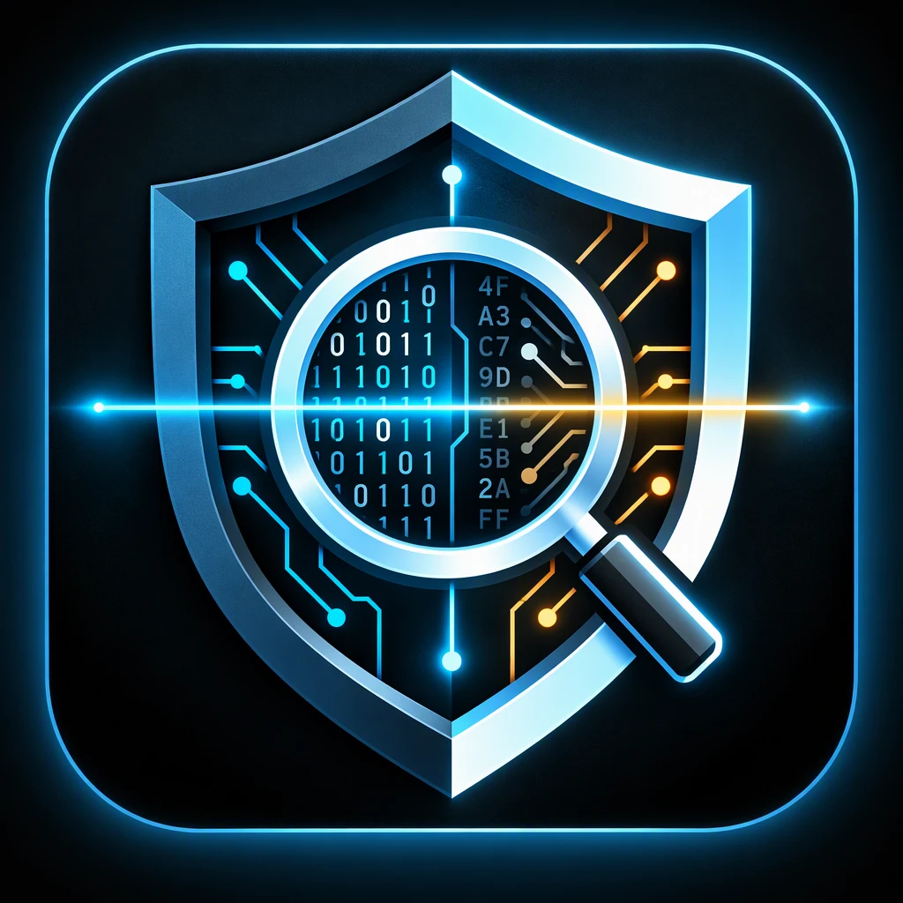
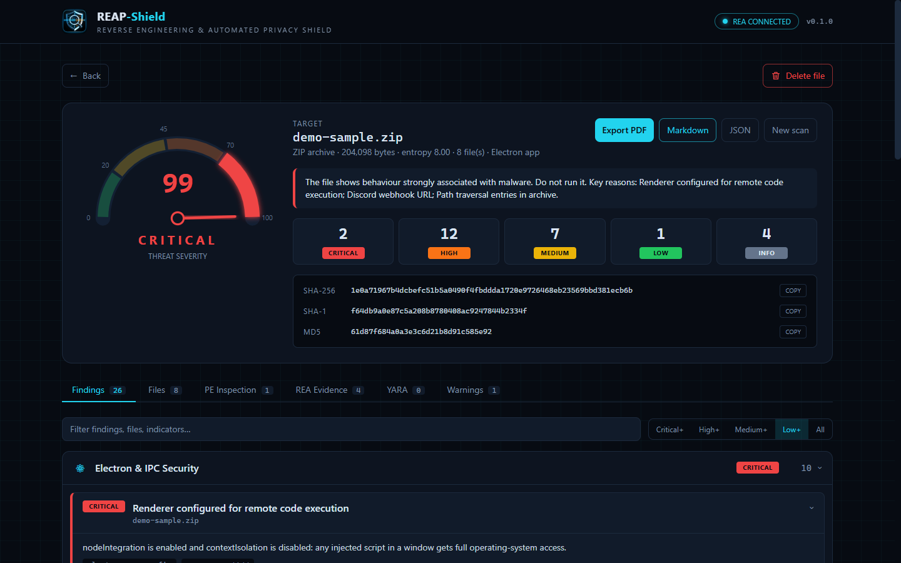
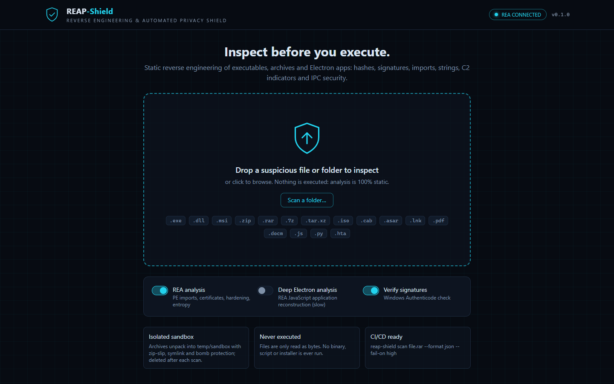
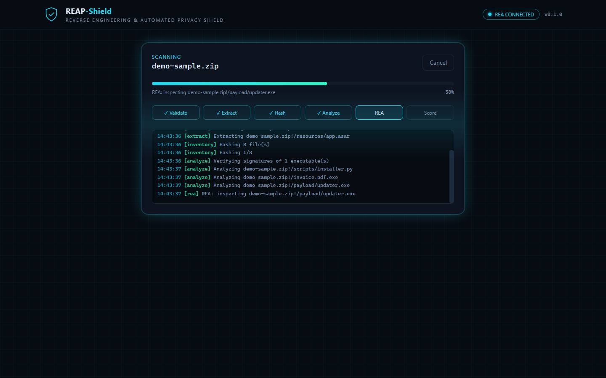
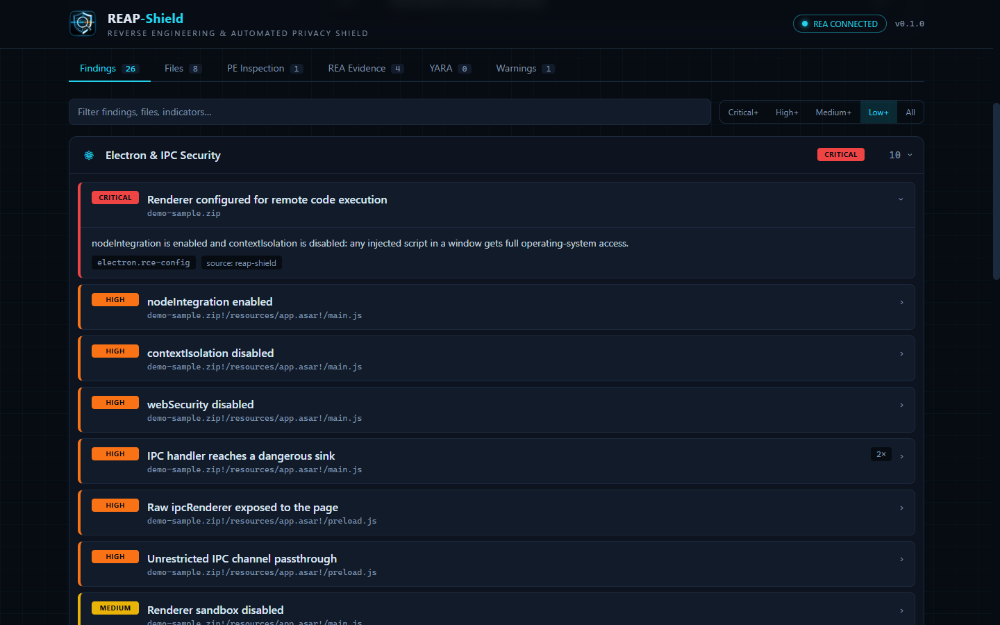
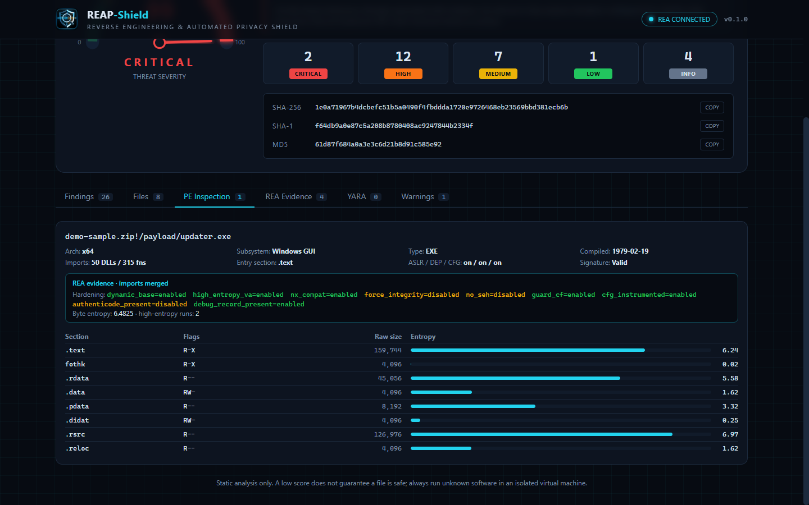
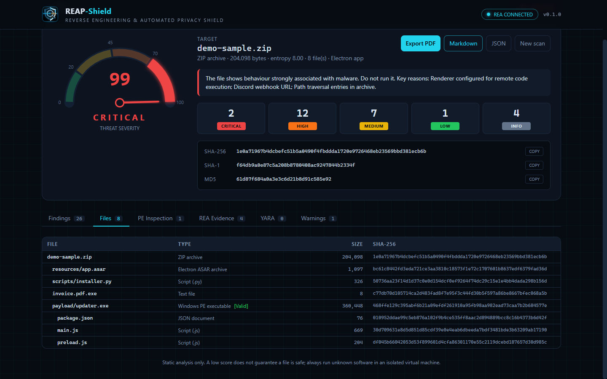
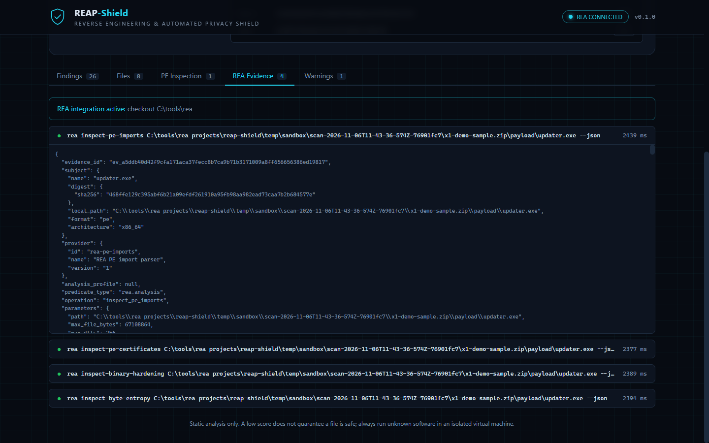
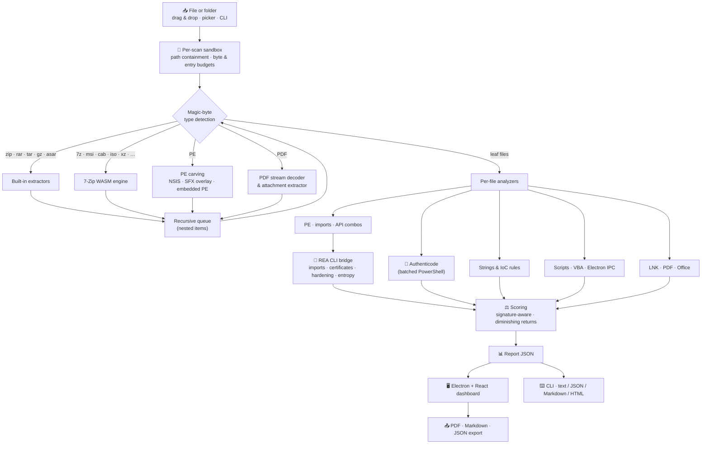

<div align="center">

**English** | [简体中文](README.zh-CN.md) | [Deutsch](README.de.md) | [Français](README.fr.md) | [Türkçe](README.tr.md) | [日本語](README.ja.md)



# REAP-Shield

### Reverse Engineering & Automated Privacy Shield

**Look inside a suspicious file before you run it.**

[](LICENSE)
[](#-installation)
[](#-architecture)
[](#-security-model)
[](https://github.com/morluto/rea)
[](#-testing)

*An open-source desktop and command-line tool that statically inspects executables, installers, archives, documents, shortcuts, scripts and Electron apps, then explains the threat in plain language, with evidence.*

> 🌱 **This is an actively evolving project. Please don't hesitate to share your feedback; it helps shape REAP-Shield's future.** Open an [issue](https://github.com/Teddy041/reap-shield/issues) or start a discussion anytime.



</div>

---

## 📑 Table of Contents

- [Why REAP-Shield?](#-why-reap-shield)
- [Project Goals](#-project-goals)
- [Who Is It For?](#-who-is-it-for)
- [Screenshots](#-screenshots)
- [Features](#-features)
- [Supported Formats](#-supported-formats)
- [Architecture](#-architecture)
- [Installation](#-installation)
- [Usage: Desktop App](#-usage-desktop-app)
- [Usage: CLI & CI/CD](#-usage-cli--cicd)
- [REA Integration](#-rea-integration)
- [YARA Rules](#-yara-rules)
- [Threat Scoring](#-threat-scoring)
- [Security Model](#-security-model)
- [Project Structure](#-project-structure)
- [Testing](#-testing)
- [Building the Windows Executable](#-building-the-windows-executable)
- [Limitations](#-limitations)
- [Roadmap](#-roadmap)
- [Contributing](#-contributing)
- [License & Disclaimer](#-license--disclaimer)

---

## 🔍 Why REAP-Shield?

Most infections start the same way: someone double-clicks a file they were sent or downloaded. It might be a "cracked" tool, a game mod, an invoice in a ZIP, a shortcut that looks like a PDF, or an installer from an unfamiliar site. Antivirus engines give a yes/no answer. REAP-Shield answers the question that comes before that: **what can this file actually do?**

Drop a file or a folder onto the window. REAP-Shield unpacks it in an isolated sandbox, without executing anything, and inspects every layer:

- hashes and digital signatures
- PE headers, imports and packers
- strings and indicators of compromise (IoCs)
- macros, PDF JavaScript and shortcut command lines
- Electron security configuration

You then get a **0–100 threat score**, a **Low / Medium / High / Critical** verdict and categorized findings, each with the evidence that triggered it.

> **Nothing is ever executed.** REAP-Shield only reads bytes. Archives are unpacked into a per-scan sandbox that is deleted afterwards.

---

## 🎯 Project Goals

1. **Make pre-execution inspection accessible.** Reverse-engineering knowledge is packaged into a drag-and-drop tool, so you do not need to be a malware analyst to see that a file injects code, steals browser passwords or phones home to a Discord webhook.
2. **See through packaging tricks.** Nested archives, installers, self-extracting droppers, embedded executables, compressed macros and PDF streams are unpacked recursively, so payloads cannot hide one layer down.
3. **Explain, don't just flag.** Every finding names the file, the rule, the evidence (code line, API, string, offset) and, where applicable, the MITRE ATT&CK technique.
4. **Keep false positives honest.** Validly signed binaries, system DLLs and installer internals are scored in context instead of being treated as malware.
5. **Be safe by construction.** The tool itself must never become the weak link: no execution, strict path containment, resource budgets and a hardened Electron shell.
6. **Fit into automation.** The same engine powers a headless CLI with JSON/Markdown/HTML output and CI-friendly exit codes.
7. **Stay local and open.** No file ever leaves the machine; no cloud upload, no account, MIT licensed.

---

## 👥 Who Is It For?

| Audience | Typical use |
| --- | --- |
| **Everyday users & gamers** | Check downloaded tools, mods, cracks, "free" software and Discord attachments before opening them. Token grabbers and info-stealers are a primary detection focus. |
| **IT & helpdesk teams** | Triage "is this attachment safe?" requests: LNK droppers, macro documents, PDF exploits, ISO/IMG and password-protected archives used in phishing. |
| **SOC analysts & incident responders** | Fast first-pass triage: hashes for threat-intel lookups, extracted C2 indicators, ATT&CK-mapped capabilities and exportable reports. |
| **Software developers & release engineers** | Gate releases in CI, audit third-party installers and check Electron apps for `nodeIntegration`, disabled `contextIsolation` and unsafe IPC before shipping. |
| **Security researchers & reverse engineers** | Structured static evidence via REA (import tables, Authenticode chains, hardening, entropy) as a starting point for deeper work in Ghidra or a debugger. |
| **Educators, students & CTF players** | Learn how real techniques look in a binary or document, with every rule explained in plain language. |

---

## 🖼️ Screenshots

> Screenshots show a scan of a **synthetic demo sample** built by the test suite (insecure Electron app, Python dropper patterns, a zip-slip entry, a fake double-extension file and a copy of the signed Windows `notepad.exe`). It contains no functional malware.

| Drop zone | Live scan progress |
| :---: | :---: |
|  |  |
| **Threat report & severity gauge** | **Categorized findings** |
|  |  |
| **PE inspection with REA evidence** | **Recursive file inventory** |
|  |  |
| **Raw REA evidence** | |
|  | |

---

## 🚀 Features

### Analysis engine

| Area | What it does |
| --- | --- |
| 🗜️ **Safe unpacking** | Recursive extraction of archives, disk images, installers and documents into a per-scan sandbox. Zip-slip, absolute-path and device-name entries are blocked. Symlinks are never created. Encrypted entries, archive bombs and excessive nesting are reported. |
| 🔐 **Hashes & signatures** | MD5 / SHA-1 / SHA-256 and Shannon entropy for every file. Windows Authenticode verification for every PE, MSI, CAB and script, batched in a single PowerShell process. |
| 🧬 **PE inspection** | Defensive PE32/PE32+ parser: sections and entropy, W+X sections, packer signatures (UPX, Themida, VMProtect, MPRESS, ASPack, Enigma, …), entry-point anomalies, overlays, ASLR/DEP/CFG, .NET detection, import table. |
| ⚠️ **Suspicious APIs** | Catalog of ~90 abused Windows APIs plus technique combinations mapped to **MITRE ATT&CK**: remote-thread injection, process hollowing, keylogging, credential dumping, download-and-execute and ransomware-style encryption. APIs hidden behind `GetProcAddress` are flagged too. |
| 🌐 **Strings & IoCs** | ASCII and UTF-16LE strings are scanned for many indicators. Detected secrets are **redacted in reports**. Indicators include: <ul><li>**Exfiltration and C2:** Discord webhooks, Telegram bot tokens, Discord tokens, raw-IP C2 endpoints, Tor addresses, paste / tunnel / file-drop hosts</li><li>**Execution:** crypto miners, PowerShell download cradles, LOLBins</li><li>**Persistence and privilege:** autorun keys, scheduled tasks, UAC bypasses</li><li>**Theft and destruction:** browser, wallet and Discord credential paths, shadow-copy deletion</li><li>**Evasion:** anti-VM and anti-analysis strings, Base64-encoded executables</li></ul> |
| 📦 **Payload carving** | NSIS installer contents, archives appended to executables (SFX droppers) and complete PE images embedded inside other executables are carved out and scanned as separate files. |
| 📄 **Documents** | **PDF:** keyword inventory (including hex-obfuscated names), Flate stream decoding so compressed JavaScript is scanned, auto-run detection, `/Launch`, attachments extracted and scanned. **Office:** VBA source decompressed (MS-OVBA) and scanned, XLM macro sheets, remote template injection, DDE, ms-msdt (Follina-style) abuse. |
| 🔗 **Shortcuts & script hosts** | **LNK:** target, arguments and icon parsed; LOLBin targets, hidden windows, disguised icons and padded arguments flagged. HTML smuggling, Script-Encoded JSE/VBE, UNC-based NTLM leaks in `.url` / `.scf` / `.library-ms`. |
| 🐍 **Scripts** | JavaScript, Python, PowerShell, batch and VBA rules. Examples: decoded `eval`, `child_process`, obfuscator.io output, `marshal`/`exec` droppers, ctypes shellcode loaders, `winreg` persistence, browser-password decryption. |
| ⚛️ **Electron & IPC audit** | `nodeIntegration`, `contextIsolation:false`, `sandbox:false`, `webSecurity:false`, remote module, raw `ipcRenderer` exposure, unrestricted channel passthrough, IPC handlers reaching `exec`/`shell`/`fs`, `openExternal`, TLS bypasses. |
| 🧠 **REA evidence** | Authoritative PE import tables (including delay-load), Authenticode certificate chains, binary hardening and byte-entropy maps from [REA](https://github.com/morluto/rea). Optional Ghidra-backed analysis. |
| 🎯 **YARA signatures** | Every file, including everything extracted from containers, is matched with [YARA-X](https://github.com/VirusTotal/yara-x) (WebAssembly) against the [YARA Forge](https://github.com/YARAHQ/yara-forge) rule package (one-click download) and your own `.yar` files. Matches show the rule, description, author and matched strings with offsets. |

### Desktop app

- 🖱️ **Drag & drop** files *or folders*, or browse with a file / folder picker.
- 📈 **Live progress** with per-stage tracking and a streaming log; scans run in a worker thread and can be cancelled.
- 🎯 **Threat gauge** (Low / Medium / High / Critical) with a plain-language summary and copyable hashes.
- 🗂️ **Findings accordion** grouped into 11 categories, with severity filter and full-text search.
- 🧾 **Tabs** for the recursive file inventory, PE details (sections, entropy bars, mitigations, signature, REA hardening) and raw REA evidence.
- 📤 **Export** reports to **PDF**, **Markdown** or **JSON**.
- 🗑️ **Delete** the scanned file or folder by moving it to the Recycle Bin (recoverable, with confirmation), and **Back** to start a new scan.

---

## 📂 Supported Formats

| Category | Formats | Engine |
| --- | --- | --- |
| Executables | `.exe` `.dll` `.sys` `.scr` `.cpl` `.ocx` `.node` (PE32/PE32+, .NET), ELF, Mach-O | Built-in PE parser + REA |
| Archives | `.zip` (incl. `.jar` `.apk` and Office Open XML), `.rar` (RAR4/RAR5), `.tar` `.tar.gz` `.tgz` `.gz`, `.asar` | Built-in (yauzl, node-tar, node-unrar-js WASM, custom ASAR parser) |
| Archives & images | `.7z` `.xz` `.bz2` `.zst` `.cab` `.msi` `.iso` `.vhd` `.vhdx` `.wim` `.chm` `.lzh` `.arj` `.cpio`, legacy Office (OLE) | **7-Zip compiled to WebAssembly** (in memory, no native binary) |
| Installers | NSIS installers, self-extracting archives (overlay carving), embedded PE images | 7-Zip WASM + built-in carver |
| Documents | `.pdf`, `.doc` `.docm` `.docx` `.xls` `.xlsm` `.xlsx` `.ppt` `.pptm` `.pptx` `.rtf` `.msg` | Built-in PDF / MS-OVBA analyzers |
| Shortcuts | `.lnk` `.url` `.scf` `.library-ms` `.searchConnector-ms` | Built-in MS-SHLLINK parser + rules |
| Scripts & markup | `.js` `.mjs` `.cjs` `.ts` `.jse` `.py` `.ps1` `.bat` `.cmd` `.vbs` `.vbe` `.wsf` `.sct` `.hta` `.html` `.svg` `.reg` `.xml` | Rule engine |
| Folders | Any folder (read in place, symlinks / junctions not followed) | Built-in walker |

Nested combinations are unpacked recursively. Examples: a `.tar.xz`, a zip inside an ISO inside a 7z, or a script attached to a PDF inside a ZIP.

---

## 🏗️ Architecture



The **analysis engine** (`src/analyzer/`) is plain Node.js and is shared by the desktop app and the CLI. In the desktop app it runs inside a **worker thread**, so the UI stays responsive and scans can be cancelled.

---

## 📦 Installation

### Option A: One-click launcher (Windows, recommended)

Clone the repository (or download it as a ZIP) and double-click **`REAP-Shield Launcher.exe`** in the project folder. On the first run it asks for confirmation, runs `npm install` and builds the UI in a console window, then starts the app. Later runs open the app directly and rebuild the UI only when its sources have changed (for example after `git pull`). Node.js 22+ is required; if it is missing, the launcher offers to open the Node.js download page.

The launcher is a small (~40 KB) program built from [`launcher/Launcher.cs`](launcher/Launcher.cs). It only runs npm, Node.js and the Electron binary inside the project's `node_modules`. It is not code-signed, so Windows SmartScreen may show an *"unknown publisher"* prompt. To rebuild it yourself, run `powershell -ExecutionPolicy Bypass -File launcher\build.ps1`. Pass `--yes` to skip the first-run confirmation.

### Option B: Portable Windows executable

Build it once with `npm run dist` (see [Building the Windows Executable](#-building-the-windows-executable)), then run `REAP-Shield.exe`. No installer is needed. The executable is not code-signed, so Windows SmartScreen may show an *"unknown publisher"* prompt on first launch.

### Option C: From source

**Requirements:** Node.js 22+ (Node 24 recommended) on Windows, macOS or Linux. Windows is required for Authenticode verification.

```bash
git clone https://github.com/Teddy041/reap-shield.git
cd reap-shield
npm install
```

If the Electron binary was not downloaded during install (newer npm versions may skip install scripts), run:

```bash
node node_modules/electron/install.js
```

Then start the app:

```bash
npm start
```

---

## 🖥️ Usage: Desktop App

```bash
npm start      # build the UI and launch Electron
npm run dev    # Vite dev server + Electron with hot reload
```

1. **Drop** a file or folder onto the drop zone, click it to browse, or use **Scan a folder…**.
2. Watch the **live progress** stream through Validate → Extract → Hash → Analyze → REA → Score.
3. Read the **verdict**, then open the findings, file inventory, PE inspection, REA evidence and warnings tabs.
4. **Export** the report as PDF, Markdown or JSON, **delete** the item to the Recycle Bin, or go **Back** for a new scan.

**Scan options**

| Option | Effect |
| --- | --- |
| REA analysis | Adds REA evidence for PE files (enabled automatically when REA is found) |
| Deep Electron analysis | REA JavaScript application reconstruction for `.asar` files (slow) |
| Verify signatures | Windows Authenticode verification |
| YARA signatures | Matches files against the installed YARA rules. The **YARA rules** panel downloads or updates YARA Forge and opens the custom rules folder |
| Max file size | Largest file that will be scanned: 256 MB – 16 GB, default **1 GB**. Larger single files are rejected with a clear message; inside folders they are skipped and listed under *Warnings*. The choice is remembered. |

> **Safe range for "Max file size": 0.5 – 2 GB (1 GB recommended).** Almost all malware is under 200 MB. Higher limits work, but scans take longer, the text / IoC search covers only the first 96 MB of each file, and data extracted from archives stays capped at 2 GB (archive-bomb protection does not change with this setting).

#### Why are larger files less reliable?

Raising the limit lets REAP-Shield *accept* a large file, but it does not make the analysis of that file complete:

| Reason | What happens |
| --- | --- |
| **Partial reading** | Text and IoC search reads only the first 96 MB of each file (scripts: 48 MB, PE headers: 256 MB). In a 5 GB file that is under 2% of the content; anything stored later is never examined. |
| **REA limit** | REA inspects files up to 64 MB. Larger executables get no REA evidence. |
| **Archive caps** | RAR / 7z archives over 384 MB are not unpacked, single extracted entries over 512 MB are skipped, and extraction stops at 2 GB in total. The inside of big containers is only partly seen. |
| **Inflation trick** | Attackers deliberately pad malware with hundreds of MB of junk because many scanners skip or truncate large files. REAP-Shield flags executables over 100 MB that are mostly padding (`evasion.inflated-file`). |
| **Volume caps** | Very large installers and disk images can exceed the 5,000-file and 25-REA-file budgets, so later files get less or no analysis. |

When any file was only partly examined, the report says so: a **Partial coverage** banner appears, the verdict summary adds a coverage note, and a *Scan Coverage & Limits* finding lists each file with the percentage that was examined. On large files, **a Low verdict is weaker evidence**; inspect anything important in an isolated virtual machine.

Opening `http://127.0.0.1:5173` in a regular browser while `npm run dev` runs shows the dashboard in **demo mode** with a bundled sample report.

---

## ⌨️ Usage: CLI & CI/CD

```bash
npx reap-shield scan suspicious.rar
npx reap-shield scan ./Downloads/SomeTool --format md --output report.md
npx reap-shield scan app.asar --format json --output report.json
npx reap-shield scan setup.exe --fail-on medium
npx reap-shield scan sample.exe --provider ghidra --keep-sandbox
npx reap-shield rules update --package core
npx reap-shield scan sample.exe --yara-rules ./my-rules
npx reap-shield doctor
npx reap-shield bench --malicious ./corpus/malicious --clean ./corpus/clean --limit 500 --jobs 4
```

| Option | Meaning |
| --- | --- |
| `-f, --format` | `text` (default), `json`, `md`, `html` |
| `-o, --output` | Write the report to a file |
| `--fail-on` | Exit with code 1 at or above `low`, `medium`, `high` (default), `critical`, or `never` |
| `--no-rea` | Skip REA even when it is available |
| `--deep` | REA JavaScript application reconstruction for ASAR files |
| `--provider` | REA native provider, e.g. `ghidra` |
| `--no-signature` | Skip Authenticode verification |
| `--no-yara` | Skip YARA matching |
| `--yara-rules <path>` | Extra YARA rule file or folder for this scan (repeatable) |
| `--keep-sandbox` | Keep extracted files for manual review |
| `--max-size <GB>` | Largest file to scan, 0.05 – 16 GB (default 1). Safe range 0.5 – 2 GB. |
| `-q, --quiet` | No progress output |

**Exit codes:** `0` verdict below threshold · `1` verdict at or above `--fail-on` · `2` usage error · `3` scan failed.

### GitHub Actions example

```yaml
- name: Inspect release artifact
  run: npx reap-shield scan dist/MyApp-Setup.exe --format md --output reap-report.md --fail-on high

- name: Upload REAP-Shield report
  if: always()
  uses: actions/upload-artifact@v4
  with:
    name: reap-shield-report
    path: reap-report.md
```

---

## 🧠 REA Integration

[REA (Reverse Engineer Anything)](https://github.com/morluto/rea) is a reverse-engineering toolkit available as both a CLI and an MCP server. REAP-Shield uses REA's **CLI**. Every call runs as an isolated process that returns JSON evidence:

| REA command | Used for |
| --- | --- |
| `inspect-pe-imports` | Authoritative import and delay-load tables, merged into the API analysis |
| `inspect-pe-certificates` | Authenticode PKCS#7 certificate chain (signer, issuer) |
| `inspect-binary-hardening` | ASLR, high-entropy VA, NX, CFG, SEH and integrity flags |
| `inspect-byte-entropy` | High-entropy regions that indicate packed or encrypted payloads |
| `analyze --provider ghidra` | Optional decompilation-backed analysis (`--provider ghidra`) |
| `analyze-javascript-application` | Optional deep reconstruction of Electron apps (`--deep`) |

**REA is optional.** Without it, every built-in analyzer still runs. REAP-Shield looks for REA in this order:

1. `REA_BIN`: path to `rea`, `rea.cmd` or `scripts/rea.mjs`
2. `REA_HOME`: path to a built REA checkout
3. A sibling checkout at `../../rea`
4. `rea` on `PATH` (`npm install -g rea-agents`)

Run `npx reap-shield doctor` to see what was found. REA runs on at most 25 PE files per scan, and its evidence is shown raw in the **REA Evidence** tab.

> **Windows note:** REA's deep JavaScript reconstruction needs REA's packaged native module, which a git checkout of REA does not contain. Install REA from npm (`npm i -g rea-agents`) for that feature. Without it, the deep run is reported as `capability_unavailable` and all other checks still run.

---

## 🎯 YARA Rules

REAP-Shield matches every scanned file, including files extracted from archives, installers and documents, against YARA rules with **[YARA-X](https://github.com/VirusTotal/yara-x)**, VirusTotal's official Rust rewrite of YARA. It runs as WebAssembly (`@virustotal/yara-x`), so it works the same on Windows, macOS and Linux without native binaries. Each match becomes a finding in the *YARA Signature Matches* category with the rule name, description, author, matched strings with offsets and the reference link.

**No rules ship with REAP-Shield**, because rule licenses vary. You add them in two ways:

| Source | How |
| --- | --- |
| **YARA Forge** (recommended) | In the app, choose a package and click **Download rules**; on the command line, run `npx reap-shield rules update`. [YARA Forge](https://github.com/YARAHQ/yara-forge) packages quality-filtered rules from many public repositories. `core` (about 5,000 rules) has the fewest false positives; `extended` and `full` add more rules and more noise. A download replaces the installed rules only after it compiles successfully. Each rule keeps its own license (see its `author`, `reference` and `license_url` meta fields). |
| **Your own rules** | Put `.yar` / `.yara` files in the custom rules folder (**Open custom rules folder** in the app, or `npx reap-shield rules status` to print its path). Each file compiles in its own namespace; a broken file is skipped and reported while the others still load. For a single scan, add rules with `--yara-rules <file or folder>`. |

Rules are stored in the per-user data folder: `%APPDATA%\REAP-Shield\yara` on Windows, `~/Library/Application Support/REAP-Shield/yara` on macOS and `~/.config/REAP-Shield/yara` on Linux (override with `REAP_YARA_DIR`).

- **Severity:** a rule's `severity` meta field (`info` … `critical`) is used as is. Otherwise its `score` field (used by YARA Forge) is mapped: 90+ critical, 75+ high, 60+ medium, 40+ low. Rules with neither are *medium*. Private helper rules are never reported, and the signed-file downgrade applies as for other findings.
- **Performance:** compiling the YARA Forge `core` package takes about 3–5 seconds. The desktop app compiles it once and reuses it for later scans until a rule file changes; the CLI compiles once per run. Matching takes about one second for a typical executable. Each file is read up to 96 MB and gets a 15-second timeout.
- **False positives:** in our tests on common Windows system and developer binaries (notepad, shell32, kernel32, PowerShell, certutil, git, node), the `core` package produced no matches.

---

## ⚖️ Threat Scoring

- **Severity weights:** info 0 · low 3 · medium 8 · high 18 · critical 35.
- **Diminishing returns:** repeated hits of the same rule add at most 2× its weight, so one noisy rule cannot dominate the score.
- **Saturation:** the total is mapped to 0–100 with `100 · (1 − e^(−raw/70))`.
- **Verdict bands:** Low < 20 ≤ Medium < 45 ≤ High < 70 ≤ Critical.
- **Escalation:** one critical rule forces at least *High*, two force *Critical*, and three high rules force at least *High*.
- **Signature awareness:** files with a valid Authenticode signature have their capability findings lowered. Behavioural critical indicators (webhooks, ransomware commands, shellcode loaders) are **never** lowered, because malware signed with stolen certificates exists.

---

## 🔒 Security Model

- **Nothing is executed.** Files are opened read-only. Extracted files are written with mode `0600` next to a `DO-NOT-EXECUTE.txt` marker. 7-Zip and RAR decoding run as WebAssembly in memory, never as native processes.
- **Containment.** Every archive entry name passes `Sandbox.safeJoin`, which rejects `..`, absolute paths, drive letters, NUL bytes and Windows device names. Symlinks, hard links and device entries are never created, and folder scans never follow symlinks or junctions.
- **Budgets.** The following limits apply to every scan:

  | Limit | Value |
  | --- | --- |
  | Size of the scanned file itself | User-selectable, default 1 GiB (safe range 0.5–2 GiB) |
  | Size of one extracted entry | 512 MiB |
  | Total extracted bytes | 2 GiB |
  | Number of entries | 20,000 |
  | Compression ratio | 250:1 |
  | Archive nesting depth | 4 |
  | In-memory archive size (RAR / 7-Zip) | 384 MiB |
  | Bytes scanned for strings, per file | 96 MiB |
- **Fault isolation.** Every stage runs inside `guard()`, so a malformed file becomes a finding or an error entry, never a crash. Cancelled or crashed scans have their sandbox removed, and stale sandboxes are purged at start-up.
- **Hardened Electron shell.**
  - `contextIsolation` and the renderer `sandbox` are on; `nodeIntegration` is off.
  - A strict Content-Security-Policy applies.
  - Every IPC handler validates the sending frame, and the preload API is fixed.
  - Navigation and new windows are blocked, and all permission requests are denied.
  - PDF export renders with JavaScript disabled.
- **Untrusted output.** All report text is escaped in HTML and Markdown, and React escapes all UI text.
- **Privacy.** Files never leave the machine. There is no telemetry, no cloud lookup and no account. The only network access is the optional YARA rule download, which starts only when you click **Download rules** or run `rules update`.

---

## 🗂️ Project Structure

```
reap-shield/
├── src/
│   ├── analyzer/              Core engine (pure Node.js, shared by GUI and CLI)
│   │   ├── index.mjs            scanFile() pipeline
│   │   ├── config.mjs           Safety limits, severities, categories
│   │   ├── sandbox.mjs          Per-scan workspace, path containment, budgets
│   │   ├── fileType.mjs         Magic-byte file type detection
│   │   ├── extractors.mjs       ZIP / TAR / GZIP / RAR / ASAR + 7-Zip WASM extractors
│   │   ├── documents.mjs        LNK, PDF and Office VBA (MS-OVBA) analyzers
│   │   ├── pe.mjs               Defensive PE32/PE32+ parser
│   │   ├── apiCatalog.mjs       Suspicious Windows APIs and ATT&CK technique combos
│   │   ├── strings.mjs          String extraction and IoC rules
│   │   ├── scripts.mjs          JS / Python / PowerShell / VBA / Electron IPC rules
│   │   ├── signature.mjs        Authenticode verification (batched PowerShell)
│   │   ├── yara.mjs             YARA-X rule loading, matching and YARA Forge updates
│   │   ├── benchmark.mjs        Detection benchmark: labelled corpus, metrics and report
│   │   ├── hashing.mjs          Streaming MD5 / SHA-1 / SHA-256 + entropy
│   │   ├── rea.mjs              REA CLI bridge (locate, run, normalise evidence)
│   │   ├── scoring.mjs          Threat score and verdict
│   │   └── report.mjs           Markdown and HTML renderers
│   ├── cli/reap-shield.mjs    Headless CLI for CI/CD
│   ├── main/                  Electron main process, preload bridge, scan worker
│   └── ui/                    React 19 + Tailwind CSS 4 dashboard
├── tests/                     node:test suites with synthetic (non-functional) fixtures
├── scripts/                   Dev launcher, demo sample/report, icon, build info
├── launcher/                  One-click Windows launcher (C# source + build script)
├── REAP-Shield Launcher.exe   Prebuilt launcher (see Installation)
├── build/icon.png             Application icon
├── assets/logo-source.webp    Logo source image (icons are generated from it)
└── docs/screenshots/          README screenshots
```

---

## 🧪 Testing

```bash
npm test
```

The suites build every fixture at runtime and cover:

- **Extraction safety:** zip-slip, absolute and device paths, symlinks, malformed archives, encrypted 7z, sandbox cleanup.
- **Formats:** ZIP, TAR.GZ, RAR (when WinRAR is installed), 7z, tar.xz, folders, LNK, PDF with auto-run JavaScript and attachments, Office VBA dropper with template injection, SFX overlays, embedded PE images, JSE and HTML smuggling.
- **Detection:** insecure Electron ASAR, Python dropper patterns, the MS-OVBA decompressor.
- **Reporting:** scoring and HTML / Markdown escaping of untrusted content.
- **YARA:** custom-rule matches with evidence, private and broken rules, archive contents, the score-to-severity mapping and the YARA Forge updater (with a mocked download).
- **Benchmark:** corpus collection (deduplication, seeded sampling, label conflicts), confusion-matrix metrics, per-sample error handling and an end-to-end run on synthetic samples.

The fixtures contain suspicious *strings and structures only*. **None of them is functional malware.**

Smoke-test the real desktop app end to end. This renders the UI, checks renderer isolation, scans through IPC and the worker, and optionally exports a PDF:

```bash
npm run build:ui
REAP_SMOKE_TEST=/path/to/sample.zip REAP_SMOKE_PDF=/tmp/report.pdf npx electron .
```

### Detection benchmark

```bash
npx reap-shield bench --malicious ./corpus/malicious --clean ./corpus/clean --limit 500 --jobs 4
npx reap-shield bench --clean "C:/Windows/System32" --ext exe,dll --limit 300 --max-fp 2
```

Measure how well REAP-Shield separates malicious from clean files on **your own labelled corpus**. Every sample goes through the normal static pipeline (nothing is executed), and the run writes `benchmark.md` and `benchmark.json`:

- **Metrics:** detection rate (recall), false positive rate, precision and F1 at the `--threshold` level, plus a table for every threshold (*Medium+*, *High+*, *Critical+*).
- **Breakdowns:** verdict distribution per label, results per file type, the rules that fire most on clean files (false-positive sources) and the rules seen only on malicious files.
- **Lists:** every missed malicious sample and every false positive, with type, size, score and SHA-256. Missed samples are the most useful input for new rules.
- **Corpus handling:** folders are walked recursively; empty files, exact duplicates (SHA-256) and files labelled both ways are skipped and counted. `--limit` with `--seed` picks a reproducible random subset; `--ext` keeps only the given extensions.
- **CI gates:** `--min-detection <%>` and `--max-fp <%>` make the command exit with code `1` when a rate gets worse.

| Option | Meaning |
| --- | --- |
| `--malicious <path>` | File or folder of known-malicious samples (repeatable) |
| `--clean <path>` | File or folder of known-clean samples (repeatable) |
| `--threshold <level>` | Lowest verdict counted as detected: `medium` (default), `high`, `critical` |
| `--ext <list>` | Only use these extensions, e.g. `exe,dll,ps1` |
| `--limit <n>` | At most *n* samples per label (seeded random subset, `--seed`) |
| `--jobs <n>` | Samples scanned in parallel, 1 – 8 (default 1) |
| `--min-detection <%>` / `--max-fp <%>` | Exit with code `1` when the detection rate is lower / the false positive rate is higher |
| `-o, --output <dir>` | Output folder (default `temp/benchmark/<time>`) |

> **Handle malware only inside an isolated virtual machine.** Collections such as MalwareBazaar ship samples in password-protected ZIP files: extract them inside the VM first, because encrypted archives are reported, not unpacked. If antivirus software quarantines a sample during the run, it is listed as an error and the run continues. A small or one-sided corpus gives misleading rates.

---

## 🛠️ Building the Windows Executable

```bash
npm run dist
```

This produces a single-file **portable** `release/REAP-Shield.exe` (about 110 MB, no installer):

- **REA:** the build records the path of a sibling REA checkout, if one exists, so the exe uses REA automatically on the build machine. Elsewhere it looks for REA via `REA_BIN`, `REA_HOME` or `PATH`.
- **Sandbox:** the packaged app keeps its sandbox in `%APPDATA%\REAP-Shield\sandbox`.

Helper scripts:

| Script | Purpose |
| --- | --- |
| `npm run icon` | Regenerate `build/icon.png` and the in-app logo from `assets/logo-source.webp` |
| `npm run demo-report` | Regenerate the browser demo-mode report |
| `npm run screenshots` | Re-capture `docs/screenshots/` from the real app. Local paths are anonymised. |

---

## 🚧 Limitations

- **Static analysis has blind spots.** Strongly packed or encrypted payloads, second stages downloaded at runtime and novel techniques can hide behaviour. **A *Low* verdict does not prove a file is safe.**
- **Heuristic rules can misfire.** Security tools, installers and system utilities legitimately use "dangerous" APIs. Findings are evidence for a decision, not a final judgement.
- **Platform-specific checks.** Authenticode verification is Windows-only, and ELF / Mach-O files get strings, IoC and REA hardening checks but no deep parsing.
- **Password-protected content cannot be inspected.** It is reported, not unpacked. Inno Setup and some proprietary installer formats are not unpacked.

---

## 🗺️ Roadmap

- [x] YARA rule support and custom rule packs
- [x] Detection benchmark on labelled corpora (detection and false positive rates)
- [ ] Optional hash reputation lookups (opt-in, privacy-preserving)
- [ ] Inno Setup and MSIX unpacking
- [ ] .NET IL inspection via REA (`inspect-il`, `inspect-managed-artifact`)
- [ ] Scan history and report comparison
- [ ] Code-signed release builds and an installer
- [ ] Localized UI

---

## 🤝 Contributing

**Feel free to share your feedback to help the project grow: REAP-Shield is a project in active development.** Bug reports, false-positive reports, feature ideas and questions are all welcome in [Issues](https://github.com/Teddy041/reap-shield/issues).

Contributions are welcome. Detection rules are plain data in `src/analyzer/scripts.mjs`, `strings.mjs` and `apiCatalog.mjs`, which makes them a good first contribution.

1. Fork the repository and create a feature branch.
2. Add or update tests in `tests/`. Fixtures must be generated at runtime and must **never** contain functional malware.
3. Run `npm test` and make sure all suites pass.
4. Open a pull request that describes the technique your change detects and how you avoided false positives.

---

## 📜 License & Disclaimer

REAP-Shield is released under the [MIT License](LICENSE). It builds on [REA](https://github.com/morluto/rea) (MIT), 7-Zip via [7z-wasm](https://www.npmjs.com/package/7z-wasm) (LGPL / unRAR license), [node-unrar-js](https://www.npmjs.com/package/node-unrar-js), [yauzl](https://www.npmjs.com/package/yauzl), [node-tar](https://www.npmjs.com/package/tar), [Electron](https://www.electronjs.org/), [React](https://react.dev/) and [Tailwind CSS](https://tailwindcss.com/).

> **Disclaimer:** REAP-Shield is a static-analysis aid for defensive security, education and software quality. It does not replace an antivirus or endpoint protection product. Always run unknown software only in an isolated virtual machine. The authors accept no liability for decisions made on the basis of its output.

<div align="center">

**Inspect before you execute.** 🛡️

</div>
