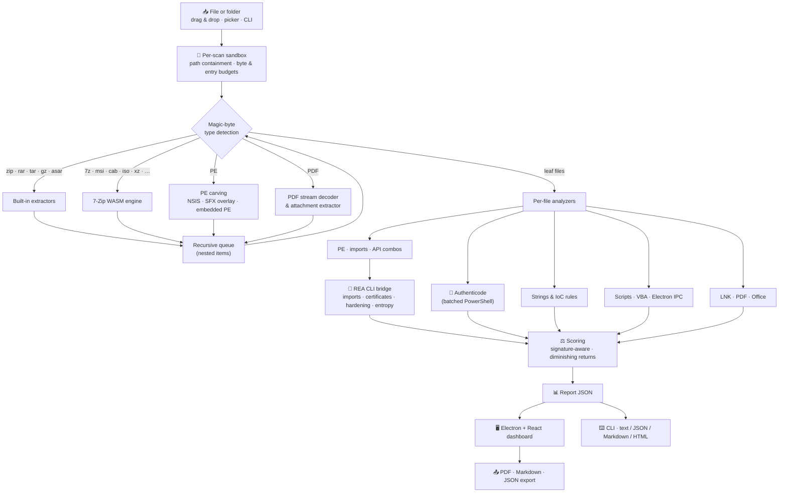

<div align="center">

[English](README.md) | [简体中文](README.zh-CN.md) | [Deutsch](README.de.md) | [Français](README.fr.md) | **Türkçe** | [日本語](README.ja.md)


# REAP-Shield

### Reverse Engineering & Automated Privacy Shield

**Şüpheli bir dosyayı çalıştırmadan önce içine bakın.**

[](LICENSE)
[](#installation)
[](#architecture)
[](#security)
[](https://github.com/morluto/rea)
[](#testing)

*Çalıştırılabilir dosyaları, kurulum paketlerini, arşivleri, belgeleri, kısayolları, betikleri ve Electron uygulamalarını statik olarak inceleyen, tehdidi kanıtlarıyla birlikte sade bir dille açıklayan açık kaynaklı bir masaüstü ve komut satırı aracı.*

> 🌱 **Bu, aktif olarak gelişen bir projedir. Projenin gelişimine katkı için geri bildirimlerinizi iletmekten çekinmeyin.** İstediğiniz zaman bir [issue](https://github.com/Teddy041/reap-shield/issues) açabilir ya da tartışma başlatabilirsiniz.


</div>

> ℹ️ Bu bir çeviridir. Güncel ve esas sürüm [İngilizce README](README.md)'dir.

---

## 📑 İçindekiler

- [Neden REAP-Shield?](#why)
- [Proje Hedefleri](#goals)
- [Kimler İçin?](#audience)
- [Ekran Görüntüleri](#screenshots)
- [Özellikler](#features)
- [Desteklenen Formatlar](#formats)
- [Mimari](#architecture)
- [Kurulum](#installation)
- [Kullanım: Masaüstü Uygulaması](#usage-desktop)
- [Kullanım: CLI ve CI/CD](#usage-cli)
- [REA Entegrasyonu](#rea)
- [YARA Kuralları](#yara)
- [Tehdit Puanlaması](#scoring)
- [Güvenlik Modeli](#security)
- [Proje Yapısı](#structure)
- [Testler](#testing)
- [Windows Exe Dosyasını Derleme](#building)
- [Sınırlamalar](#limitations)
- [Yol Haritası](#roadmap)
- [Katkıda Bulunma](#contributing)
- [Lisans ve Sorumluluk Reddi](#license)

---

<a id="why"></a>
## 🔍 Neden REAP-Shield?

Bulaşmaların çoğu aynı şekilde başlar: biri, kendisine gönderilen ya da indirdiği bir dosyaya çift tıklar. Bu bir "crack"lenmiş araç, bir oyun modu, ZIP içindeki bir fatura, PDF gibi görünen bir kısayol ya da tanımadığı bir siteden indirilmiş bir kurulum dosyası olabilir. Antivirüs motorları evet/hayır cevabı verir. REAP-Shield ise ondan önce gelen soruyu cevaplar: **bu dosya gerçekte ne yapabilir?**

Bir dosyayı ya da klasörü pencereye bırakın. REAP-Shield onu hiçbir şeyi çalıştırmadan, yalıtılmış bir sandbox içinde açar ve her katmanı inceler:

- hash'ler ve dijital imzalar
- PE başlıkları, import tablosu ve packer'lar
- metinler ve ele geçirilme göstergeleri (IoC)
- makrolar, PDF JavaScript'i ve kısayol komut satırları
- Electron güvenlik yapılandırması

Sonuçta **0–100 arası bir tehdit puanı**, **Low / Medium / High / Critical** bir karar ve her biri kendisini tetikleyen kanıtla birlikte kategorilere ayrılmış bulgular elde edersiniz.

> **Hiçbir şey çalıştırılmaz.** REAP-Shield sadece baytları okur. Arşivler, her tarama için ayrı açılan ve tarama bitince silinen bir sandbox içine çıkarılır.

---

<a id="goals"></a>
## 🎯 Proje Hedefleri

1. **Çalıştırma öncesi incelemeyi herkes için erişilebilir kılmak.** Tersine mühendislik bilgisi sürükle-bırak bir araca dönüştürülür. Böylece bir dosyanın kod enjekte ettiğini, tarayıcı parolalarını çaldığını ya da bir Discord webhook'una veri gönderdiğini görmek için zararlı yazılım analisti olmanız gerekmez.
2. **Paketleme hilelerinin ardını görmek.** İç içe arşivler, kurulum dosyaları, kendini açan dropper'lar, gömülü exe'ler, sıkıştırılmış makrolar ve PDF stream'leri katman katman açılır; payload'lar bir alt katmana saklanamaz.
3. **Sadece işaretlemek değil, açıklamak.** Her bulgu dosyayı, kuralı, kanıtı (kod satırı, API, metin, ofset) ve uygun olduğunda MITRE ATT&CK tekniğini belirtir.
4. **Yanlış pozitiflerde dürüst olmak.** Geçerli imzalı dosyalar, sistem DLL'leri ve kurulum paketlerinin iç dosyaları zararlı sayılmak yerine bağlamlarına göre puanlanır.
5. **Tasarımdan itibaren güvenli olmak.** Aracın kendisi asla zayıf halka olmamalıdır: çalıştırma yok, sıkı yol sınırlaması, kaynak bütçeleri ve sağlamlaştırılmış bir Electron kabuğu.
6. **Otomasyona uymak.** Aynı motor; JSON/Markdown/HTML çıktısı ve CI'ya uygun çıkış kodları olan arayüzsüz bir CLI'a da güç verir.
7. **Yerel ve açık kalmak.** Hiçbir dosya bilgisayardan çıkmaz; bulut yüklemesi yok, hesap yok, MIT lisanslı.

---

<a id="audience"></a>
## 👥 Kimler İçin?

| Hedef kitle | Tipik kullanım |
| --- | --- |
| **Bireysel kullanıcılar ve oyuncular** | İndirilen araçları, modları, crack'leri, "ücretsiz" yazılımları ve Discord eklerini açmadan önce kontrol etmek. Token çalıcılar ve bilgi hırsızları (info-stealer) öncelikli tespit odağıdır. |
| **IT ve yardım masası ekipleri** | "Bu ek güvenli mi?" taleplerini ayıklamak: oltalamada kullanılan LNK dropper'lar, makrolu belgeler, PDF exploit'leri, ISO/IMG dosyaları ve şifreli arşivler. |
| **SOC analistleri ve olay müdahale ekipleri** | Hızlı ilk triyaj: tehdit istihbaratı sorguları için hash'ler, çıkarılmış C2 göstergeleri, ATT&CK'ye eşlenmiş yetenekler ve dışa aktarılabilir raporlar. |
| **Yazılım geliştiriciler ve sürüm mühendisleri** | CI'da sürümleri denetlemek, üçüncü taraf kurulum paketlerini incelemek ve Electron uygulamalarını yayından önce `nodeIntegration`, kapalı `contextIsolation` ve güvensiz IPC için kontrol etmek. |
| **Güvenlik araştırmacıları ve tersine mühendisler** | Ghidra veya bir debugger ile daha derin çalışmaya başlangıç noktası olarak REA üzerinden yapılandırılmış statik kanıt (import tabloları, Authenticode zincirleri, hardening, entropi). |
| **Eğitimciler, öğrenciler ve CTF oyuncuları** | Gerçek tekniklerin bir binary ya da belgede nasıl göründüğünü, her kuralın sade bir dille açıklandığı şekilde öğrenmek. |

---

<a id="screenshots"></a>
## 🖼️ Ekran Görüntüleri

> Ekran görüntüleri, test paketinin ürettiği **sentetik bir demo örneğinin** taramasını gösterir (güvensiz bir Electron uygulaması, Python dropper kalıpları, bir zip-slip girdisi, sahte çift uzantılı bir dosya ve imzalı Windows `notepad.exe` kopyası). Çalışan hiçbir zararlı yazılım içermez.

| Bırakma alanı | Canlı tarama ilerlemesi |
| :---: | :---: |
|  |  |
| **Tehdit raporu ve şiddet göstergesi** | **Kategorilere ayrılmış bulgular** |
|  |  |
| **REA kanıtlı PE incelemesi** | **Özyinelemeli dosya envanteri** |
|  |  |
| **Ham REA kanıtı** | |
|  | |

---

<a id="features"></a>
## 🚀 Özellikler

### Analiz motoru

| Alan | Ne yapar |
| --- | --- |
| 🗜️ **Güvenli açma** | Arşivleri, disk kalıplarını, kurulum dosyalarını ve belgeleri tarama başına ayrılan sandbox'a katman katman çıkarır. Zip-slip, mutlak yol ve aygıt adı girdileri engellenir. Sembolik bağlantılar asla oluşturulmaz. Şifreli girdiler, arşiv bombaları ve aşırı iç içelik raporlanır. |
| 🔐 **Hash'ler ve imzalar** | Her dosya için MD5 / SHA-1 / SHA-256 ve Shannon entropisi. Her PE, MSI, CAB ve betik için tek bir PowerShell sürecinde toplu Windows Authenticode doğrulaması. |
| 🧬 **PE incelemesi** | Savunmacı PE32/PE32+ ayrıştırıcı: bölümler ve entropi, W+X bölümler, packer imzaları (UPX, Themida, VMProtect, MPRESS, ASPack, Enigma, …), giriş noktası anormallikleri, overlay'ler, ASLR/DEP/CFG, .NET tespiti, import tablosu. |
| ⚠️ **Şüpheli API'ler** | Kötüye kullanılan ~90 Windows API'sinden oluşan katalog ve **MITRE ATT&CK**'ye eşlenmiş teknik kombinasyonları: uzak thread enjeksiyonu, process hollowing, tuş kaydı, kimlik bilgisi dökümü, indir-ve-çalıştır ve fidye yazılımı tarzı şifreleme. `GetProcAddress` arkasına gizlenen API'ler de işaretlenir. |
| 🌐 **Metinler ve IoC'ler** | ASCII ve UTF-16LE metinler birçok gösterge için taranır. Tespit edilen gizli bilgiler **raporlarda maskelenir**. Göstergeler: <ul><li>**Veri sızdırma ve C2:** Discord webhook'ları, Telegram bot token'ları, Discord token'ları, doğrudan IP'li C2 adresleri, Tor adresleri, paste / tünel / dosya paylaşım servisleri</li><li>**Çalıştırma:** kripto madenciler, PowerShell indirme kalıpları, LOLBin'ler</li><li>**Kalıcılık ve yetki:** otomatik başlatma anahtarları, zamanlanmış görevler, UAC atlatmaları</li><li>**Hırsızlık ve yıkım:** tarayıcı, cüzdan ve Discord kimlik bilgisi yolları, gölge kopya silme</li><li>**Atlatma:** sanal makine ve analiz aracı tespiti metinleri, Base64 kodlu exe'ler</li></ul> |
| 📦 **Payload çıkarma** | NSIS kurulum içerikleri, exe'lerin sonuna eklenmiş arşivler (SFX dropper'lar) ve başka exe'lerin içine gömülmüş tam PE kalıpları çıkarılır ve ayrı dosyalar olarak taranır. |
| 📄 **Belgeler** | **PDF:** anahtar kelime envanteri (hex ile gizlenmiş adlar dahil), sıkıştırılmış JavaScript'in taranabilmesi için Flate stream çözme, otomatik çalıştırma tespiti, `/Launch`, eklerin çıkarılıp taranması. **Office:** VBA kaynak kodunun açılıp (MS-OVBA) taranması, XLM makro sayfaları, uzaktan şablon enjeksiyonu, DDE, ms-msdt (Follina tarzı) kötüye kullanımı. |
| 🔗 **Kısayollar ve betik çalıştırıcıları** | **LNK:** hedef, argümanlar ve simge ayrıştırılır; LOLBin hedefleri, gizli pencereler, kılık değiştirmiş simgeler ve doldurulmuş argümanlar işaretlenir. HTML smuggling, Script Encoder ile kodlanmış JSE/VBE, `.url` / `.scf` / `.library-ms` içinde UNC tabanlı NTLM sızıntıları. |
| 🐍 **Betikler** | JavaScript, Python, PowerShell, batch ve VBA kuralları. Örnekler: çözülmüş `eval`, `child_process`, obfuscator.io çıktısı, `marshal`/`exec` dropper'ları, ctypes shellcode yükleyicileri, `winreg` kalıcılığı, tarayıcı parolası çözme. |
| ⚛️ **Electron ve IPC denetimi** | `nodeIntegration`, `contextIsolation:false`, `sandbox:false`, `webSecurity:false`, remote modülü, ham `ipcRenderer`'ın açığa çıkarılması, kısıtsız kanal aktarımı, `exec`/`shell`/`fs`'e ulaşan IPC işleyicileri, `openExternal`, TLS atlatmaları. |
| 🧠 **REA kanıtı** | [REA](https://github.com/morluto/rea)'dan yetkili PE import tabloları (gecikmeli yükleme dahil), Authenticode sertifika zincirleri, binary hardening ve bayt entropisi haritaları. İsteğe bağlı Ghidra destekli analiz. |
| 🎯 **YARA imzaları** | Kapsayıcılardan çıkarılan her şey dahil tüm dosyalar, [YARA-X](https://github.com/VirusTotal/yara-x) (WebAssembly) ile [YARA Forge](https://github.com/YARAHQ/yara-forge) kural paketine (tek tıkla indirilir) ve sizin `.yar` dosyalarınıza karşı eşleştirilir. Eşleşmelerde kural, açıklama, yazar ve ofsetleriyle birlikte eşleşen dizeler gösterilir. |

### Masaüstü uygulaması

- 🖱️ Dosyaları *veya klasörleri* **sürükleyip bırakın** ya da dosya / klasör seçiciyle göz atın.
- 📈 Aşama aşama takip ve akan bir günlükle **canlı ilerleme**; taramalar bir worker thread içinde çalışır ve iptal edilebilir.
- 🎯 Sade dilde bir özet ve kopyalanabilir hash'lerle **tehdit göstergesi** (Low / Medium / High / Critical).
- 🗂️ Şiddet filtresi ve tam metin aramasıyla 11 kategoriye ayrılmış **bulgu listesi**.
- 🧾 Özyinelemeli dosya envanteri, PE ayrıntıları (bölümler, entropi çubukları, korumalar, imza, REA hardening) ve ham REA kanıtı için **sekmeler**.
- 📤 Raporları **PDF**, **Markdown** veya **JSON** olarak **dışa aktarma**.
- 🗑️ Taranan dosya ya da klasörü Geri Dönüşüm Kutusu'na taşıyarak **silme** (onaylı ve geri alınabilir) ve yeni tarama için **Geri** butonu.

---

<a id="formats"></a>
## 📂 Desteklenen Formatlar

| Kategori | Formatlar | Motor |
| --- | --- | --- |
| Çalıştırılabilir dosyalar | `.exe` `.dll` `.sys` `.scr` `.cpl` `.ocx` `.node` (PE32/PE32+, .NET), ELF, Mach-O | Dahili PE ayrıştırıcı + REA |
| Arşivler | `.zip` (`.jar` `.apk` ve Office Open XML dahil), `.rar` (RAR4/RAR5), `.tar` `.tar.gz` `.tgz` `.gz`, `.asar` | Dahili (yauzl, node-tar, node-unrar-js WASM, özel ASAR ayrıştırıcı) |
| Arşivler ve disk kalıpları | `.7z` `.xz` `.bz2` `.zst` `.cab` `.msi` `.iso` `.vhd` `.vhdx` `.wim` `.chm` `.lzh` `.arj` `.cpio`, eski Office (OLE) | **WebAssembly'ye derlenmiş 7-Zip** (bellekte, native binary yok) |
| Kurulum paketleri | NSIS kurulum dosyaları, kendini açan arşivler (overlay çıkarma), gömülü PE kalıpları | 7-Zip WASM + dahili çıkarıcı |
| Belgeler | `.pdf`, `.doc` `.docm` `.docx` `.xls` `.xlsm` `.xlsx` `.ppt` `.pptm` `.pptx` `.rtf` `.msg` | Dahili PDF / MS-OVBA analizcileri |
| Kısayollar | `.lnk` `.url` `.scf` `.library-ms` `.searchConnector-ms` | Dahili MS-SHLLINK ayrıştırıcı + kurallar |
| Betikler ve işaretleme dilleri | `.js` `.mjs` `.cjs` `.ts` `.jse` `.py` `.ps1` `.bat` `.cmd` `.vbs` `.vbe` `.wsf` `.sct` `.hta` `.html` `.svg` `.reg` `.xml` | Kural motoru |
| Klasörler | Herhangi bir klasör (yerinde okunur, sembolik bağlantılar / junction'lar takip edilmez) | Dahili klasör tarayıcı |

İç içe kombinasyonlar katman katman açılır. Örnekler: bir `.tar.xz`, bir 7z içindeki ISO'nun içindeki zip ya da bir ZIP içindeki PDF'e eklenmiş bir betik.

---

<a id="architecture"></a>
## 🏗️ Mimari



**Analiz motoru** (`src/analyzer/`) saf Node.js'tir ve masaüstü uygulaması ile CLI tarafından ortak kullanılır. Masaüstü uygulamasında bir **worker thread** içinde çalışır; böylece arayüz donmaz ve taramalar iptal edilebilir.

---

<a id="installation"></a>
## 📦 Kurulum

### Seçenek A: Tek tıkla başlatıcı (Windows, önerilen)

Depoyu klonlayın (veya ZIP olarak indirin) ve proje klasöründeki **`REAP-Shield Launcher.exe`** dosyasına çift tıklayın. İlk çalıştırmada onay ister, bir konsol penceresinde `npm install` çalıştırıp arayüzü derler, ardından uygulamayı başlatır. Sonraki açılışlarda uygulama doğrudan açılır; arayüz yalnızca kaynakları değiştiğinde (örneğin `git pull` sonrasında) yeniden derlenir. Node.js 22+ gerekir; yüklü değilse başlatıcı Node.js indirme sayfasını açmayı önerir.

Başlatıcı, [`launcher/Launcher.cs`](launcher/Launcher.cs) dosyasından derlenen küçük (~40 KB) bir programdır. Yalnızca npm'i, Node.js'i ve projenin `node_modules` klasöründeki Electron binary'sini çalıştırır. Kod imzalı olmadığı için Windows SmartScreen *"bilinmeyen yayımcı"* uyarısı gösterebilir. Kendiniz yeniden derlemek için: `powershell -ExecutionPolicy Bypass -File launcher\build.ps1`. İlk çalıştırma onayını atlamak için `--yes` parametresini verin.

### Seçenek B: Taşınabilir Windows exe dosyası

`npm run dist` ile bir kez derleyin ([Windows Exe Dosyasını Derleme](#building) bölümüne bakın), ardından `REAP-Shield.exe`'yi çalıştırın. Kurulum gerekmez. Exe kod imzalı olmadığı için Windows SmartScreen ilk açılışta *"bilinmeyen yayımcı"* uyarısı gösterebilir.

### Seçenek C: Kaynak koddan

**Gereksinimler:** Windows, macOS veya Linux üzerinde Node.js 22+ (Node 24 önerilir). Authenticode doğrulaması için Windows gerekir.

```bash
git clone https://github.com/Teddy041/reap-shield.git
cd reap-shield
npm install
```

Electron binary'si kurulum sırasında indirilmediyse (yeni npm sürümleri kurulum betiklerini atlayabilir) şunu çalıştırın:

```bash
node node_modules/electron/install.js
```

Ardından uygulamayı başlatın:

```bash
npm start
```

---

<a id="usage-desktop"></a>
## 🖥️ Kullanım: Masaüstü Uygulaması

```bash
npm start      # build the UI and launch Electron
npm run dev    # Vite dev server + Electron with hot reload
```

1. Bir dosyayı ya da klasörü bırakma alanına **bırakın**, göz atmak için alana tıklayın veya **Scan a folder…** kullanın.
2. **Canlı ilerlemenin** Validate → Extract → Hash → Analyze → REA → Score aşamalarından geçişini izleyin.
3. **Kararı** okuyun, ardından bulgular, dosya envanteri, PE incelemesi, REA kanıtı ve uyarılar sekmelerini açın.
4. Raporu PDF, Markdown ya da JSON olarak **dışa aktarın**, öğeyi Geri Dönüşüm Kutusu'na taşıyarak **silin** ya da yeni bir tarama için **Geri** dönün.

**Tarama seçenekleri**

| Seçenek | Etkisi |
| --- | --- |
| REA analysis | PE dosyaları için REA kanıtı ekler (REA bulunduğunda otomatik açılır) |
| Deep Electron analysis | `.asar` dosyaları için REA JavaScript uygulama yeniden yapılandırması (yavaş) |
| Verify signatures | Windows Authenticode doğrulaması |
| YARA signatures | Dosyaları yüklü YARA kurallarıyla eşleştirir. **YARA rules** paneli YARA Forge kurallarını indirir veya günceller ve özel kural klasörünü açar |
| Max file size | Taranacak en büyük dosya: 256 MB – 16 GB, varsayılan **1 GB**. Daha büyük tek dosyalar anlaşılır bir mesajla reddedilir; klasörlerin içindekiler atlanır ve *Warnings* altında listelenir. Seçim hatırlanır. |

> **"Max file size" için güvenli aralık: 0.5 – 2 GB (önerilen 1 GB).** Zararlı yazılımların neredeyse tamamı 200 MB'ın altındadır. Daha yüksek sınırlar çalışır, ancak taramalar uzar, metin / IoC araması her dosyanın sadece ilk 96 MB'ını kapsar ve arşivlerden çıkarılan veri 2 GB ile sınırlı kalır (arşiv bombası koruması bu ayarla değişmez).

<a id="reliability"></a>
#### Dosya büyüdükçe sonuç neden daha az güvenilir?

Sınırı yükseltmek REAP-Shield'in büyük bir dosyayı *kabul etmesini* sağlar, ancak o dosyanın analizini eksiksiz yapmaz:

| Neden | Ne olur |
| --- | --- |
| **Kısmi okuma** | Metin ve IoC araması her dosyanın sadece ilk 96 MB'ını okur (betikler: 48 MB, PE başlıkları: 256 MB). 5 GB'lık bir dosyada bu, içeriğin %2'sinden azıdır; daha sonra saklanan hiçbir şey incelenmez. |
| **REA sınırı** | REA 64 MB'a kadar olan dosyaları inceler. Daha büyük exe'ler için REA kanıtı alınamaz. |
| **Arşiv sınırları** | 384 MB'tan büyük RAR / 7z arşivleri açılmaz, 512 MB'tan büyük tek girdiler atlanır ve çıkarma toplam 2 GB'ta durur. Büyük kapsayıcıların içi sadece kısmen görülür. |
| **Şişirme hilesi** | Saldırganlar, birçok tarayıcı büyük dosyaları atladığı ya da kestiği için zararlı yazılımı bilerek yüzlerce MB'lık gereksiz veriyle doldurur. REAP-Shield, çoğu dolgu verisinden oluşan 100 MB'tan büyük exe'leri işaretler (`evasion.inflated-file`). |
| **Hacim sınırları** | Çok büyük kurulum paketleri ve disk kalıpları 5.000 dosya ve 25 REA dosyası bütçelerini aşabilir; sonraki dosyalar daha az analiz edilir ya da hiç edilmez. |

Herhangi bir dosya kısmen incelendiğinde rapor bunu belirtir: bir **Partial coverage** bandı görünür, karar özetine bir kapsam notu eklenir ve *Scan Coverage & Limits* bulgusu her dosyayı incelenen yüzdesiyle listeler. Büyük dosyalarda **Low kararı daha zayıf bir kanıttır**; önemli olan her şeyi yalıtılmış bir sanal makinede inceleyin.

`npm run dev` çalışırken normal bir tarayıcıda `http://127.0.0.1:5173` adresini açmak, paneli hazır bir örnek raporla **demo modunda** gösterir.

---

<a id="usage-cli"></a>
## ⌨️ Kullanım: CLI ve CI/CD

```bash
npx reap-shield scan suspicious.rar
npx reap-shield scan ./Downloads/SomeTool --format md --output report.md
npx reap-shield scan app.asar --format json --output report.json
npx reap-shield scan setup.exe --fail-on medium
npx reap-shield scan sample.exe --provider ghidra --keep-sandbox
npx reap-shield rules update --package core
npx reap-shield scan sample.exe --yara-rules ./my-rules
npx reap-shield doctor
```

| Seçenek | Anlamı |
| --- | --- |
| `-f, --format` | `text` (varsayılan), `json`, `md`, `html` |
| `-o, --output` | Raporu bir dosyaya yazar |
| `--fail-on` | Karar `low`, `medium`, `high` (varsayılan), `critical` veya üstündeyse 1 koduyla çıkar; `never` hiç başarısız olmaz |
| `--no-rea` | REA mevcut olsa bile atlar |
| `--deep` | ASAR dosyaları için REA JavaScript uygulama yeniden yapılandırması |
| `--provider` | REA native sağlayıcısı, örn. `ghidra` |
| `--no-signature` | Authenticode doğrulamasını atlar |
| `--no-yara` | YARA eşleştirmesini atlar |
| `--yara-rules <path>` | Bu tarama için ek YARA kural dosyası veya klasörü (birden çok kez verilebilir) |
| `--keep-sandbox` | Çıkarılan dosyaları elle inceleme için saklar |
| `--max-size <GB>` | Taranacak en büyük dosya, 0.05 – 16 GB (varsayılan 1). Güvenli aralık 0.5 – 2 GB. |
| `-q, --quiet` | İlerleme çıktısı yok |

**Çıkış kodları:** `0` karar eşiğin altında · `1` karar `--fail-on` seviyesinde veya üstünde · `2` kullanım hatası · `3` tarama başarısız.

### GitHub Actions örneği

```yaml
- name: Inspect release artifact
  run: npx reap-shield scan dist/MyApp-Setup.exe --format md --output reap-report.md --fail-on high

- name: Upload REAP-Shield report
  if: always()
  uses: actions/upload-artifact@v4
  with:
    name: reap-shield-report
    path: reap-report.md
```

---

<a id="rea"></a>
## 🧠 REA Entegrasyonu

[REA (Reverse Engineer Anything)](https://github.com/morluto/rea), hem CLI hem de MCP sunucusu olarak kullanılabilen bir tersine mühendislik araç setidir. REAP-Shield REA'nın **CLI**'ını kullanır. Her çağrı, JSON kanıt döndüren yalıtılmış bir süreç olarak çalışır:

| REA komutu | Kullanım amacı |
| --- | --- |
| `inspect-pe-imports` | Yetkili import ve gecikmeli yükleme tabloları; API analizine birleştirilir |
| `inspect-pe-certificates` | Authenticode PKCS#7 sertifika zinciri (imzalayan, veren) |
| `inspect-binary-hardening` | ASLR, high-entropy VA, NX, CFG, SEH ve bütünlük bayrakları |
| `inspect-byte-entropy` | Paketlenmiş veya şifrelenmiş payload'lara işaret eden yüksek entropili bölgeler |
| `analyze --provider ghidra` | İsteğe bağlı decompile destekli analiz (`--provider ghidra`) |
| `analyze-javascript-application` | Electron uygulamalarının isteğe bağlı derin yeniden yapılandırması (`--deep`) |

**REA isteğe bağlıdır.** REA olmadan da tüm dahili analizciler çalışır. REAP-Shield REA'yı şu sırayla arar:

1. `REA_BIN`: `rea`, `rea.cmd` veya `scripts/rea.mjs` yolu
2. `REA_HOME`: derlenmiş bir REA kopyasının yolu
3. `../../rea` konumundaki kardeş klasör
4. `PATH` üzerindeki `rea` (`npm install -g rea-agents`)

Neyin bulunduğunu görmek için `npx reap-shield doctor` çalıştırın. REA tarama başına en fazla 25 PE dosyasında çalışır ve kanıtı **REA Evidence** sekmesinde ham haliyle gösterilir.

> **Windows notu:** REA'nın derin JavaScript yeniden yapılandırması, REA'nın git kopyasında bulunmayan paketlenmiş native modülünü gerektirir. Bu özellik için REA'yı npm'den kurun (`npm i -g rea-agents`). Modül olmadan derin analiz `capability_unavailable` olarak raporlanır ve diğer tüm kontroller yine çalışır.

---

<a id="yara"></a>
## 🎯 YARA Kuralları

REAP-Shield, arşivlerden, kurulum paketlerinden ve belgelerden çıkarılanlar dahil taranan her dosyayı, VirusTotal'ın YARA'yı Rust ile yeniden yazdığı resmî motor **[YARA-X](https://github.com/VirusTotal/yara-x)** ile YARA kurallarına karşı eşleştirir. Motor WebAssembly olarak çalışır (`@virustotal/yara-x`); bu yüzden yerel binary gerektirmeden Windows, macOS ve Linux'ta aynı şekilde çalışır. Her eşleşme, *YARA Signature Matches* kategorisinde kural adı, açıklama, yazar, ofsetleriyle eşleşen dizeler ve referans bağlantısıyla bir bulguya dönüşür.

Kural lisansları farklılık gösterdiği için **REAP-Shield ile birlikte kural gelmez.** Kuralları iki yolla eklersiniz:

| Kaynak | Nasıl |
| --- | --- |
| **YARA Forge** (önerilen) | Uygulamada bir paket seçip **Download rules** düğmesine basın; komut satırında `npx reap-shield rules update` çalıştırın. [YARA Forge](https://github.com/YARAHQ/yara-forge), birçok açık depodan kalite filtresinden geçirilmiş kuralları paketler. `core` (yaklaşık 5.000 kural) en az yanlış alarmı verir; `extended` ve `full` daha fazla kural ve daha fazla gürültü ekler. İndirilen paket, yüklü kuralların yerine ancak başarıyla derlendikten sonra geçer. Her kural kendi lisansını korur (kuralın `author`, `reference` ve `license_url` meta alanlarına bakın). |
| **Kendi kurallarınız** | `.yar` / `.yara` dosyalarını özel kural klasörüne koyun (uygulamada **Open custom rules folder**, ya da yolunu görmek için `npx reap-shield rules status`). Her dosya kendi ad alanında derlenir; hatalı bir dosya atlanıp raporlanır, diğerleri yine yüklenir. Tek bir tarama için `--yara-rules <dosya veya klasör>` ile kural ekleyin. |

Kurallar kullanıcıya özel veri klasöründe tutulur: Windows'ta `%APPDATA%\REAP-Shield\yara`, macOS'ta `~/Library/Application Support/REAP-Shield/yara`, Linux'ta `~/.config/REAP-Shield/yara` (`REAP_YARA_DIR` ile değiştirilebilir).

- **Şiddet:** kuralın `severity` meta alanı (`info` … `critical`) olduğu gibi kullanılır. Yoksa `score` alanı (YARA Forge bunu kullanır) eşlenir: 90+ critical, 75+ high, 60+ medium, 40+ low. İkisi de olmayan kurallar *medium* sayılır. Private yardımcı kurallar asla raporlanmaz; imzalı dosya düşürmesi diğer bulgulardaki gibi uygulanır.
- **Performans:** YARA Forge `core` paketinin derlenmesi yaklaşık 3–5 saniye sürer. Masaüstü uygulaması paketi bir kez derler ve bir kural dosyası değişene kadar sonraki taramalarda yeniden kullanır; CLI her çalıştırmada bir kez derler. Tipik bir exe için eşleştirme yaklaşık bir saniye sürer. Her dosyanın en fazla 96 MB'ı okunur ve dosya başına 15 saniyelik zaman aşımı uygulanır.
- **Yanlış alarmlar:** yaygın Windows sistem ve geliştirici programları (notepad, shell32, kernel32, PowerShell, certutil, git, node) üzerindeki testlerimizde `core` paketi hiç eşleşme üretmedi.

---

<a id="scoring"></a>
## ⚖️ Tehdit Puanlaması

- **Şiddet ağırlıkları:** info 0 · low 3 · medium 8 · high 18 · critical 35.
- **Azalan getiri:** aynı kuralın tekrarlanan eşleşmeleri en fazla ağırlığının 2 katı kadar ekler; böylece gürültülü tek bir kural puana hâkim olamaz.
- **Doyum:** toplam, `100 · (1 − e^(−raw/70))` ile 0–100 aralığına eşlenir.
- **Karar aralıkları:** Low < 20 ≤ Medium < 45 ≤ High < 70 ≤ Critical.
- **Yükseltme:** bir critical kural en az *High*, iki critical kural *Critical* kararını zorunlu kılar; üç high kural en az *High* yapar.
- **İmza farkındalığı:** geçerli Authenticode imzalı dosyaların yetenek bulguları düşürülür. Davranışsal critical göstergeler (webhook'lar, fidye yazılımı komutları, shellcode yükleyicileri) **asla** düşürülmez, çünkü çalıntı sertifikalarla imzalanmış zararlı yazılımlar vardır.

---

<a id="security"></a>
## 🔒 Güvenlik Modeli

- **Hiçbir şey çalıştırılmaz.** Dosyalar salt okunur açılır. Çıkarılan dosyalar `0600` izniyle, bir `DO-NOT-EXECUTE.txt` işaret dosyasının yanına yazılır. 7-Zip ve RAR çözme, native süreç olarak değil, bellekte WebAssembly olarak çalışır.
- **Sınırlama.** Her arşiv girdisinin adı `Sandbox.safeJoin`'den geçer; bu fonksiyon `..`, mutlak yolları, sürücü harflerini, NUL baytlarını ve Windows aygıt adlarını reddeder. Sembolik bağlantılar, sabit bağlantılar ve aygıt girdileri asla oluşturulmaz; klasör taramaları sembolik bağlantıları veya junction'ları asla takip etmez.
- **Bütçeler.** Her taramada şu sınırlar geçerlidir:

  | Sınır | Değer |
  | --- | --- |
  | Taranan dosyanın kendi boyutu | Kullanıcı seçer, varsayılan 1 GiB (güvenli aralık 0.5–2 GiB) |
  | Çıkarılan tek bir girdinin boyutu | 512 MiB |
  | Çıkarılan toplam bayt | 2 GiB |
  | Girdi sayısı | 20.000 |
  | Sıkıştırma oranı | 250:1 |
  | Arşiv iç içelik derinliği | 4 |
  | Bellekte açılan arşiv boyutu (RAR / 7-Zip) | 384 MiB |
  | Dosya başına metin taraması yapılan bayt | 96 MiB |
- **Hata yalıtımı.** Her aşama `guard()` içinde çalışır; bozuk bir dosya çökme değil, bir bulgu ya da hata kaydı olur. İptal edilen veya çöken taramaların sandbox'ı silinir; eski sandbox'lar açılışta temizlenir.
- **Sağlamlaştırılmış Electron kabuğu.**
  - `contextIsolation` ve renderer `sandbox`'ı açık; `nodeIntegration` kapalı.
  - Sıkı bir Content-Security-Policy uygulanır.
  - Her IPC işleyicisi gönderen çerçeveyi doğrular ve preload API'si sabittir.
  - Sayfa değiştirme ve yeni pencereler engellenir, tüm izin istekleri reddedilir.
  - PDF dışa aktarma JavaScript kapalıyken render edilir.
- **Güvenilmeyen çıktı.** Tüm rapor metinleri HTML ve Markdown'da kaçışlanır; React de tüm arayüz metinlerini kaçışlar.
- **Gizlilik.** Dosyalar bilgisayardan asla çıkmaz. Telemetri, bulut sorgusu ve hesap yoktur. Tek ağ erişimi isteğe bağlı YARA kural indirmesidir ve yalnızca **Download rules** düğmesine bastığınızda veya `rules update` komutunu çalıştırdığınızda başlar.

---

<a id="structure"></a>
## 🗂️ Proje Yapısı

```
reap-shield/
├── src/
│   ├── analyzer/              Core engine (pure Node.js, shared by GUI and CLI)
│   │   ├── index.mjs            scanFile() pipeline
│   │   ├── config.mjs           Safety limits, severities, categories
│   │   ├── sandbox.mjs          Per-scan workspace, path containment, budgets
│   │   ├── fileType.mjs         Magic-byte file type detection
│   │   ├── extractors.mjs       ZIP / TAR / GZIP / RAR / ASAR + 7-Zip WASM extractors
│   │   ├── documents.mjs        LNK, PDF and Office VBA (MS-OVBA) analyzers
│   │   ├── pe.mjs               Defensive PE32/PE32+ parser
│   │   ├── apiCatalog.mjs       Suspicious Windows APIs and ATT&CK technique combos
│   │   ├── strings.mjs          String extraction and IoC rules
│   │   ├── scripts.mjs          JS / Python / PowerShell / VBA / Electron IPC rules
│   │   ├── signature.mjs        Authenticode verification (batched PowerShell)
│   │   ├── yara.mjs             YARA-X rule loading, matching and YARA Forge updates
│   │   ├── hashing.mjs          Streaming MD5 / SHA-1 / SHA-256 + entropy
│   │   ├── rea.mjs              REA CLI bridge (locate, run, normalise evidence)
│   │   ├── scoring.mjs          Threat score and verdict
│   │   └── report.mjs           Markdown and HTML renderers
│   ├── cli/reap-shield.mjs    Headless CLI for CI/CD
│   ├── main/                  Electron main process, preload bridge, scan worker
│   └── ui/                    React 19 + Tailwind CSS 4 dashboard
├── tests/                     node:test suites with synthetic (non-functional) fixtures
├── scripts/                   Dev launcher, demo sample/report, icon, build info
├── launcher/                  One-click Windows launcher (C# source + build script)
├── REAP-Shield Launcher.exe   Prebuilt launcher (see Installation)
├── build/icon.png             Application icon
└── docs/screenshots/          README screenshots
```

---

<a id="testing"></a>
## 🧪 Testler

```bash
npm test
```

Test paketleri tüm örnek dosyaları çalışma anında üretir ve şunları kapsar:

- **Çıkarma güvenliği:** zip-slip, mutlak ve aygıt yolları, sembolik bağlantılar, bozuk arşivler, şifreli 7z, sandbox temizliği.
- **Formatlar:** ZIP, TAR.GZ, RAR (WinRAR kuruluysa), 7z, tar.xz, klasörler, LNK, otomatik çalışan JavaScript ve ek içeren PDF, şablon enjeksiyonlu Office VBA dropper, SFX overlay'ler, gömülü PE kalıpları, JSE ve HTML smuggling.
- **Tespit:** güvensiz Electron ASAR, Python dropper kalıpları, MS-OVBA açıcı.
- **Raporlama:** puanlama ve güvenilmeyen içeriğin HTML / Markdown kaçışlanması.
- **YARA:** kanıtlı özel kural eşleşmeleri, private ve hatalı kurallar, arşiv içerikleri, puan-şiddet eşlemesi ve YARA Forge güncelleyicisi (sahte bir indirmeyle).

Örnek dosyalar sadece şüpheli *metinler ve yapılar* içerir. **Hiçbiri çalışan bir zararlı yazılım değildir.**

Gerçek masaüstü uygulamasını uçtan uca test etmek için smoke testi çalıştırın. Bu test arayüzü render eder, renderer yalıtımını kontrol eder, IPC ve worker üzerinden tarama yapar ve isteğe bağlı olarak bir PDF dışa aktarır:

```bash
npm run build:ui
REAP_SMOKE_TEST=/path/to/sample.zip REAP_SMOKE_PDF=/tmp/report.pdf npx electron .
```

---

<a id="building"></a>
## 🛠️ Windows Exe Dosyasını Derleme

```bash
npm run dist
```

Bu komut tek dosyalık, **taşınabilir** bir `release/REAP-Shield.exe` üretir (yaklaşık 110 MB, kurulum gerekmez):

- **REA:** derleme, varsa kardeş REA klasörünün yolunu kaydeder; böylece exe derleme yapılan bilgisayarda REA'yı otomatik kullanır. Başka yerlerde REA'yı `REA_BIN`, `REA_HOME` veya `PATH` üzerinden arar.
- **Sandbox:** paketlenmiş uygulama sandbox'ını `%APPDATA%\REAP-Shield\sandbox` içinde tutar.

Yardımcı betikler:

| Betik | Amacı |
| --- | --- |
| `npm run icon` | `build/icon.png` dosyasını vektör logodan yeniden üretir |
| `npm run demo-report` | Tarayıcı demo modu raporunu yeniden üretir |
| `npm run screenshots` | `docs/screenshots/` görüntülerini gerçek uygulamadan yeniden yakalar. Yerel yollar anonimleştirilir. |

---

<a id="limitations"></a>
## 🚧 Sınırlamalar

- **Statik analizin kör noktaları vardır.** Güçlü biçimde paketlenmiş ya da şifrelenmiş payload'lar, çalışma anında indirilen ikinci aşamalar ve yeni teknikler davranışı gizleyebilir. **Bir *Low* kararı, dosyanın güvenli olduğunu kanıtlamaz.**
- **Sezgisel kurallar yanılabilir.** Güvenlik araçları, kurulum paketleri ve sistem yardımcıları "tehlikeli" API'leri meşru olarak kullanır. Bulgular bir karar için kanıttır, nihai hüküm değildir.
- **Platforma özgü kontroller.** Authenticode doğrulaması sadece Windows'ta çalışır; ELF / Mach-O dosyaları metin, IoC ve REA hardening kontrollerinden geçer ama derinlemesine ayrıştırılmaz.
- **Parola korumalı içerik incelenemez.** Raporlanır ama açılmaz. Inno Setup ve bazı özel kurulum formatları açılmaz.

---

<a id="roadmap"></a>
## 🗺️ Yol Haritası

- [x] YARA kural desteği ve özel kural paketleri
- [ ] İsteğe bağlı hash itibar sorguları (kullanıcı açarsa, gizliliği koruyan)
- [ ] Inno Setup ve MSIX açma
- [ ] REA üzerinden .NET IL incelemesi (`inspect-il`, `inspect-managed-artifact`)
- [ ] Tarama geçmişi ve rapor karşılaştırma
- [ ] Kod imzalı sürümler ve bir kurulum paketi
- [ ] Yerelleştirilmiş arayüz

---

<a id="contributing"></a>
## 🤝 Katkıda Bulunma

**Projenin büyümesine yardımcı olmak için geri bildirimlerinizi paylaşmaktan çekinmeyin: REAP-Shield aktif olarak geliştirilen bir projedir.** Hata bildirimleri, yanlış pozitif bildirimleri, özellik fikirleri ve sorular [Issues](https://github.com/Teddy041/reap-shield/issues) sayfasında memnuniyetle karşılanır.

Katkılarınızı bekliyoruz. Tespit kuralları `src/analyzer/scripts.mjs`, `strings.mjs` ve `apiCatalog.mjs` içinde düz veri olarak durur; bu da onları ilk katkı için iyi bir başlangıç yapar.

1. Repoyu fork'layın ve bir özellik dalı oluşturun.
2. `tests/` içinde testleri ekleyin ya da güncelleyin. Örnek dosyalar çalışma anında üretilmeli ve **asla** çalışan zararlı yazılım içermemelidir.
3. `npm test` çalıştırın ve tüm test paketlerinin geçtiğinden emin olun.
4. Değişikliğinizin hangi tekniği tespit ettiğini ve yanlış pozitiflerden nasıl kaçındığınızı anlatan bir pull request açın.

---

<a id="license"></a>
## 📜 Lisans ve Sorumluluk Reddi

REAP-Shield [MIT Lisansı](LICENSE) ile yayımlanmıştır. Şunların üzerine kuruludur: [REA](https://github.com/morluto/rea) (MIT), [7z-wasm](https://www.npmjs.com/package/7z-wasm) üzerinden 7-Zip (LGPL / unRAR lisansı), [node-unrar-js](https://www.npmjs.com/package/node-unrar-js), [yauzl](https://www.npmjs.com/package/yauzl), [node-tar](https://www.npmjs.com/package/tar), [Electron](https://www.electronjs.org/), [React](https://react.dev/) ve [Tailwind CSS](https://tailwindcss.com/).

> **Sorumluluk reddi:** REAP-Shield; savunma amaçlı güvenlik, eğitim ve yazılım kalitesi için bir statik analiz yardımcısıdır. Bir antivirüs veya uç nokta koruma ürününün yerini tutmaz. Bilinmeyen yazılımları her zaman sadece yalıtılmış bir sanal makinede çalıştırın. Yazarlar, çıktısına dayanarak verilen kararlardan sorumluluk kabul etmez.

<div align="center">

**Çalıştırmadan önce incele.** 🛡️

</div>
