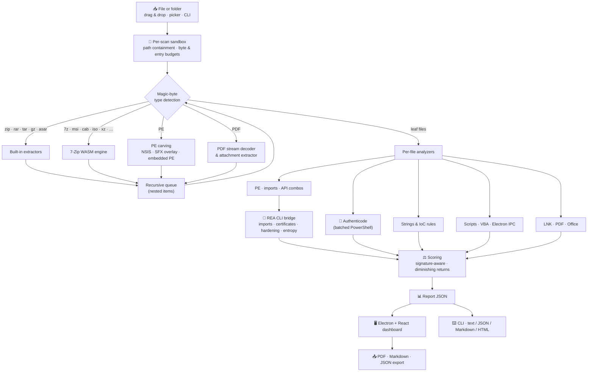

<div align="center">

[English](README.md) | **简体中文** | [Deutsch](README.de.md) | [Français](README.fr.md) | [Türkçe](README.tr.md) | [日本語](README.ja.md)


# REAP-Shield

### Reverse Engineering & Automated Privacy Shield

**在运行可疑文件之前，先看看它的内部。**

[](LICENSE)
[](#installation)
[](#architecture)
[](#security)
[](https://github.com/morluto/rea)
[](#testing)

*一款开源的桌面与命令行工具，对可执行文件、安装程序、压缩包、文档、快捷方式、脚本和 Electron 应用进行静态检查，并用通俗易懂的语言结合证据解释其威胁。*

> 🌱 **这是一个仍在积极发展的项目。欢迎随时分享您的反馈，它将帮助塑造 REAP-Shield 的未来。** 您可以随时提交 [issue](https://github.com/Teddy041/reap-shield/issues) 或发起讨论。


</div>

> ℹ️ 本文为翻译版本。最新且具有权威性的版本是[英文 README](README.md)。

---

## 📑 目录

- [为什么选择 REAP-Shield？](#why)
- [项目目标](#goals)
- [适用人群](#audience)
- [截图](#screenshots)
- [功能](#features)
- [支持的格式](#formats)
- [架构](#architecture)
- [安装](#installation)
- [使用：桌面应用](#usage-desktop)
- [使用：命令行与 CI/CD](#usage-cli)
- [REA 集成](#rea)
- [YARA 规则](#yara)
- [威胁评分](#scoring)
- [安全模型](#security)
- [项目结构](#structure)
- [测试](#testing)
- [构建 Windows 可执行文件](#building)
- [局限性](#limitations)
- [路线图](#roadmap)
- [参与贡献](#contributing)
- [许可证与免责声明](#license)

---

<a id="why"></a>
## 🔍 为什么选择 REAP-Shield？

大多数感染都以同样的方式开始：有人双击了别人发来或自己下载的文件。它可能是一个“破解版”工具、一个游戏模组、ZIP 里的一张发票、一个看起来像 PDF 的快捷方式，或者来自陌生网站的安装程序。杀毒引擎只给出“是/否”的答案，而 REAP-Shield 回答的是在此之前的问题：**这个文件实际上能做什么？**

把文件或文件夹拖到窗口中。REAP-Shield 会在隔离的沙箱中将其解包，不执行任何内容，并检查每一层：

- 哈希值和数字签名
- PE 头、导入表和加壳器
- 字符串和失陷指标（IoC）
- 宏、PDF 中的 JavaScript 和快捷方式命令行
- Electron 安全配置

最终您会得到 **0–100 的威胁评分**、**Low / Medium / High / Critical** 结论，以及分类整理的检测结果，每一条都附带触发它的证据。

> **绝不执行任何内容。** REAP-Shield 只读取字节。压缩包会被解包到每次扫描独立的沙箱中，扫描结束后即被删除。

---

<a id="goals"></a>
## 🎯 项目目标

1. **让执行前检查人人可用。** 逆向工程知识被封装进一个拖放式工具，您无需成为恶意软件分析师，就能看出一个文件会注入代码、窃取浏览器密码或向 Discord webhook 回传数据。
2. **看穿打包伎俩。** 嵌套压缩包、安装程序、自解压投放器、内嵌的可执行文件、压缩的宏和 PDF 数据流都会被递归解包，恶意载荷无法藏在更深一层。
3. **不只标记，更要解释。** 每条检测结果都会列出文件、规则、证据（代码行、API、字符串、偏移量），并在适用时给出 MITRE ATT&CK 技术编号。
4. **如实对待误报。** 具有有效签名的二进制文件、系统 DLL 和安装程序内部文件会结合上下文评分，而不是被当作恶意软件。
5. **从设计上保证安全。** 工具本身绝不能成为薄弱环节：不执行任何内容、严格的路径隔离、资源预算以及加固的 Electron 外壳。
6. **融入自动化流程。** 同一个引擎驱动无界面的命令行工具，支持 JSON/Markdown/HTML 输出和适合 CI 的退出码。
7. **保持本地与开放。** 任何文件都不会离开本机；不上传云端、无需账号，采用 MIT 许可证。

---

<a id="audience"></a>
## 👥 适用人群

| 人群 | 典型用途 |
| --- | --- |
| **普通用户与玩家** | 在打开之前检查下载的工具、模组、破解程序、“免费”软件和 Discord 附件。令牌窃取器和信息窃取木马是重点检测对象。 |
| **IT 与服务台团队** | 处理“这个附件安全吗？”的请求：钓鱼中常用的 LNK 投放器、宏文档、PDF 漏洞利用、ISO/IMG 以及加密压缩包。 |
| **SOC 分析师与应急响应人员** | 快速初筛：用于威胁情报查询的哈希值、提取出的 C2 指标、映射到 ATT&CK 的能力，以及可导出的报告。 |
| **软件开发者与发布工程师** | 在 CI 中把关发布版本，审计第三方安装程序，并在发布前检查 Electron 应用的 `nodeIntegration`、被禁用的 `contextIsolation` 和不安全的 IPC。 |
| **安全研究员与逆向工程师** | 通过 REA 获取结构化的静态证据（导入表、Authenticode 证书链、加固信息、熵），作为在 Ghidra 或调试器中深入分析的起点。 |
| **教师、学生与 CTF 选手** | 学习真实攻击技术在二进制文件或文档中的样子，每条规则都用通俗语言解释。 |

---

<a id="screenshots"></a>
## 🖼️ 截图

> 截图展示的是对测试套件生成的**合成演示样本**的扫描（不安全的 Electron 应用、Python 投放器特征、一个 zip-slip 条目、一个伪造的双扩展名文件，以及一份带签名的 Windows `notepad.exe` 副本）。其中不包含任何可运行的恶意软件。

| 拖放区域 | 实时扫描进度 |
| :---: | :---: |
|  |  |
| **威胁报告与严重程度仪表** | **分类整理的检测结果** |
|  |  |
| **带 REA 证据的 PE 检查** | **递归文件清单** |
|  |  |
| **REA 原始证据** | |
|  | |

---

<a id="features"></a>
## 🚀 功能

### 分析引擎

| 领域 | 功能说明 |
| --- | --- |
| 🗜️ **安全解包** | 将压缩包、磁盘镜像、安装程序和文档递归解包到每次扫描独立的沙箱中。阻止 zip-slip、绝对路径和设备名条目，绝不创建符号链接。报告加密条目、压缩炸弹和过深的嵌套。 |
| 🔐 **哈希与签名** | 为每个文件计算 MD5 / SHA-1 / SHA-256 和香农熵。对每个 PE、MSI、CAB 和脚本进行 Windows Authenticode 验证，并在单个 PowerShell 进程中批量完成。 |
| 🧬 **PE 检查** | 防御式 PE32/PE32+ 解析器：节区与熵、可写可执行（W+X）节区、加壳器特征（UPX、Themida、VMProtect、MPRESS、ASPack、Enigma 等）、入口点异常、附加数据（overlay）、ASLR/DEP/CFG、.NET 检测、导入表。 |
| ⚠️ **可疑 API** | 收录约 90 个常被滥用的 Windows API，以及映射到 **MITRE ATT&CK** 的技术组合：远程线程注入、进程镂空（process hollowing）、键盘记录、凭据转储、下载并执行，以及勒索软件式加密。隐藏在 `GetProcAddress` 背后的 API 也会被标记。 |
| 🌐 **字符串与 IoC** | 扫描 ASCII 和 UTF-16LE 字符串中的多种指标，检测到的敏感信息会**在报告中脱敏**。指标包括：<ul><li>**数据外传与 C2：** Discord webhook、Telegram 机器人令牌、Discord 令牌、直接使用 IP 的 C2 端点、Tor 地址、粘贴 / 隧道 / 文件投放站点</li><li>**执行：** 加密货币挖矿程序、PowerShell 下载器、LOLBin</li><li>**持久化与提权：** 自启动注册表项、计划任务、UAC 绕过</li><li>**窃取与破坏：** 浏览器、钱包和 Discord 凭据路径，删除卷影副本</li><li>**规避：** 反虚拟机和反分析字符串、Base64 编码的可执行文件</li></ul> |
| 📦 **载荷提取** | 提取 NSIS 安装程序内容、附加在可执行文件末尾的压缩包（SFX 投放器），以及嵌入在其他可执行文件中的完整 PE 映像，并作为独立文件进行扫描。 |
| 📄 **文档** | **PDF：** 关键字清单（包括十六进制混淆的名称）、解码 Flate 数据流以扫描压缩的 JavaScript、自动运行检测、`/Launch`、提取并扫描附件。**Office：** 解压（MS-OVBA）并扫描 VBA 源代码、XLM 宏表、远程模板注入、DDE、ms-msdt（Follina 式）滥用。 |
| 🔗 **快捷方式与脚本宿主** | **LNK：** 解析目标、参数和图标，标记 LOLBin 目标、隐藏窗口、伪装图标和填充过的参数。HTML 走私（HTML smuggling）、用 Script Encoder 编码的 JSE/VBE，以及 `.url` / `.scf` / `.library-ms` 中基于 UNC 的 NTLM 泄露。 |
| 🐍 **脚本** | JavaScript、Python、PowerShell、批处理和 VBA 规则。例如：解码后的 `eval`、`child_process`、obfuscator.io 混淆输出、`marshal`/`exec` 投放器、ctypes shellcode 加载器、`winreg` 持久化、浏览器密码解密。 |
| ⚛️ **Electron 与 IPC 审计** | `nodeIntegration`、`contextIsolation:false`、`sandbox:false`、`webSecurity:false`、remote 模块、直接暴露 `ipcRenderer`、不受限制的通道转发、可触达 `exec`/`shell`/`fs` 的 IPC 处理器、`openExternal`、TLS 绕过。 |
| 🧠 **REA 证据** | 来自 [REA](https://github.com/morluto/rea) 的权威 PE 导入表（包括延迟加载）、Authenticode 证书链、二进制加固信息和字节熵分布图。可选基于 Ghidra 的分析。 |
| 🎯 **YARA 签名** | 每个文件（包括从容器中解出的所有内容）都会通过 [YARA-X](https://github.com/VirusTotal/yara-x)（WebAssembly）与 [YARA Forge](https://github.com/YARAHQ/yara-forge) 规则包（一键下载）以及你自己的 `.yar` 文件进行匹配。匹配结果会显示规则、描述、作者以及命中的字符串和偏移量。 |

### 桌面应用

- 🖱️ **拖放**文件*或文件夹*，或使用文件 / 文件夹选择器浏览。
- 📈 **实时进度**，按阶段跟踪并实时输出日志；扫描在工作线程中运行，可随时取消。
- 🎯 **威胁仪表**（Low / Medium / High / Critical），附通俗易懂的摘要和可复制的哈希值。
- 🗂️ **检测结果列表**，分为 11 个类别，支持按严重程度筛选和全文搜索。
- 🧾 **标签页**：递归文件清单、PE 详情（节区、熵条、防护机制、签名、REA 加固信息）和 REA 原始证据。
- 📤 将报告**导出**为 **PDF**、**Markdown** 或 **JSON**。
- 🗑️ 将扫描过的文件或文件夹移到回收站以**删除**（可恢复，带确认），并可点击**返回**开始新的扫描。

---

<a id="formats"></a>
## 📂 支持的格式

| 类别 | 格式 | 引擎 |
| --- | --- | --- |
| 可执行文件 | `.exe` `.dll` `.sys` `.scr` `.cpl` `.ocx` `.node`（PE32/PE32+、.NET）、ELF、Mach-O | 内置 PE 解析器 + REA |
| 压缩包 | `.zip`（包括 `.jar` `.apk` 和 Office Open XML）、`.rar`（RAR4/RAR5）、`.tar` `.tar.gz` `.tgz` `.gz`、`.asar` | 内置（yauzl、node-tar、node-unrar-js WASM、自研 ASAR 解析器） |
| 压缩包与镜像 | `.7z` `.xz` `.bz2` `.zst` `.cab` `.msi` `.iso` `.vhd` `.vhdx` `.wim` `.chm` `.lzh` `.arj` `.cpio`、旧版 Office（OLE） | **编译为 WebAssembly 的 7-Zip**（在内存中运行，不使用原生程序） |
| 安装程序 | NSIS 安装程序、自解压压缩包（附加数据提取）、内嵌 PE 映像 | 7-Zip WASM + 内置提取器 |
| 文档 | `.pdf`、`.doc` `.docm` `.docx` `.xls` `.xlsm` `.xlsx` `.ppt` `.pptm` `.pptx` `.rtf` `.msg` | 内置 PDF / MS-OVBA 分析器 |
| 快捷方式 | `.lnk` `.url` `.scf` `.library-ms` `.searchConnector-ms` | 内置 MS-SHLLINK 解析器 + 规则 |
| 脚本与标记语言 | `.js` `.mjs` `.cjs` `.ts` `.jse` `.py` `.ps1` `.bat` `.cmd` `.vbs` `.vbe` `.wsf` `.sct` `.hta` `.html` `.svg` `.reg` `.xml` | 规则引擎 |
| 文件夹 | 任意文件夹（原地读取，不跟随符号链接 / 目录联接） | 内置文件夹遍历器 |

嵌套组合会被递归解包。例如：一个 `.tar.xz`、7z 里的 ISO 里的 zip，或者 ZIP 中某个 PDF 附带的脚本。

---

<a id="architecture"></a>
## 🏗️ 架构



**分析引擎**（`src/analyzer/`）是纯 Node.js 实现，由桌面应用和命令行工具共享。在桌面应用中，它运行在**工作线程**里，因此界面保持流畅，扫描也可以随时取消。

---

<a id="installation"></a>
## 📦 安装

### 方式 A：一键启动器（Windows，推荐）

克隆仓库（或以 ZIP 下载），然后双击项目文件夹中的 **`REAP-Shield Launcher.exe`**。首次运行时，它会先请求确认，然后在控制台窗口中执行 `npm install` 并构建界面，最后启动应用。之后再次运行会直接打开应用，只有在界面源码发生变化时（例如 `git pull` 之后）才会重新构建。需要 Node.js 22 及以上版本；如果未安装，启动器会提示打开 Node.js 下载页面。

启动器是由 [`launcher/Launcher.cs`](launcher/Launcher.cs) 编译而成的小程序（约 40 KB），只会运行 npm、Node.js 以及项目 `node_modules` 中的 Electron 可执行文件。它没有代码签名，因此 Windows SmartScreen 可能会显示“未知发布者”提示。如需自行重新编译，请运行 `powershell -ExecutionPolicy Bypass -File launcher\build.ps1`。加上 `--yes` 参数可跳过首次运行的确认。

### 方式 B：便携版 Windows 可执行文件

使用 `npm run dist` 构建一次（参见[构建 Windows 可执行文件](#building)），然后运行 `REAP-Shield.exe`，无需安装。该可执行文件未进行代码签名，因此首次启动时 Windows SmartScreen 可能会显示“未知发布者”提示。

### 方式 C：从源码运行

**环境要求：** Windows、macOS 或 Linux 上的 Node.js 22+（推荐 Node 24）。Authenticode 验证需要 Windows。

```bash
git clone https://github.com/Teddy041/reap-shield.git
cd reap-shield
npm install
```

如果安装过程中没有下载 Electron 程序（较新的 npm 版本可能会跳过安装脚本），请运行：

```bash
node node_modules/electron/install.js
```

然后启动应用：

```bash
npm start
```

---

<a id="usage-desktop"></a>
## 🖥️ 使用：桌面应用

```bash
npm start      # build the UI and launch Electron
npm run dev    # Vite dev server + Electron with hot reload
```

1. 将文件或文件夹**拖放**到拖放区域，点击该区域进行浏览，或使用 **Scan a folder…**。
2. 观察**实时进度**依次经过 Validate → Extract → Hash → Analyze → REA → Score。
3. 阅读**结论**，然后打开检测结果、文件清单、PE 检查、REA 证据和警告标签页。
4. 将报告**导出**为 PDF、Markdown 或 JSON，将该项目**删除**到回收站，或点击**返回**开始新的扫描。

**扫描选项**

| 选项 | 作用 |
| --- | --- |
| REA analysis | 为 PE 文件添加 REA 证据（检测到 REA 时自动启用） |
| Deep Electron analysis | 针对 `.asar` 文件进行 REA JavaScript 应用重建（较慢） |
| Verify signatures | Windows Authenticode 验证 |
| YARA signatures | 用已安装的 YARA 规则匹配文件。**YARA rules** 面板可下载或更新 YARA Forge 规则，并打开自定义规则文件夹 |
| Max file size | 可扫描的最大文件：256 MB – 16 GB，默认 **1 GB**。超出的单个文件会被拒绝并给出清晰提示；文件夹中的超大文件会被跳过并列在 *Warnings* 中。该选择会被记住。 |

> **“Max file size”的安全范围：0.5 – 2 GB（推荐 1 GB）。** 几乎所有恶意软件都小于 200 MB。更高的上限也能用，但扫描时间更长，文本 / IoC 搜索只覆盖每个文件的前 96 MB，而且从压缩包中解出的数据仍然限制在 2 GB（压缩炸弹防护不受此设置影响）。

<a id="reliability"></a>
#### 为什么文件越大，结果越不可靠？

提高上限只是让 REAP-Shield *接受*大文件，并不能让对该文件的分析变得完整：

| 原因 | 实际影响 |
| --- | --- |
| **部分读取** | 文本和 IoC 搜索只读取每个文件的前 96 MB（脚本：48 MB，PE 头：256 MB）。对于 5 GB 的文件，这不到内容的 2%；之后存放的内容根本不会被检查。 |
| **REA 限制** | REA 只检查不超过 64 MB 的文件，更大的可执行文件得不到 REA 证据。 |
| **压缩包上限** | 超过 384 MB 的 RAR / 7z 压缩包不会被解包，超过 512 MB 的单个条目会被跳过，解包总量达到 2 GB 时停止。大型容器的内部只能看到一部分。 |
| **膨胀伎俩** | 攻击者会故意在恶意软件中填充数百 MB 的垃圾数据，因为很多扫描器会跳过或截断大文件。REAP-Shield 会标记大于 100 MB 且大部分是填充数据的可执行文件（`evasion.inflated-file`）。 |
| **数量上限** | 非常大的安装程序和磁盘镜像可能超出 5,000 个文件和 25 个 REA 文件的预算，后面的文件只能得到较少分析甚至没有分析。 |

只要有文件仅被部分检查，报告就会注明：出现 **Partial coverage** 横幅，结论摘要中会添加覆盖率说明，并有一条 *Scan Coverage & Limits* 检测结果列出每个文件及其被检查的百分比。对于大文件，**Low 结论只是较弱的证据**；重要文件请在隔离的虚拟机中检查。

在 `npm run dev` 运行时，用普通浏览器打开 `http://127.0.0.1:5173`，会以**演示模式**显示仪表盘，并附带一份示例报告。

---

<a id="usage-cli"></a>
## ⌨️ 使用：命令行与 CI/CD

```bash
npx reap-shield scan suspicious.rar
npx reap-shield scan ./Downloads/SomeTool --format md --output report.md
npx reap-shield scan app.asar --format json --output report.json
npx reap-shield scan setup.exe --fail-on medium
npx reap-shield scan sample.exe --provider ghidra --keep-sandbox
npx reap-shield rules update --package core
npx reap-shield scan sample.exe --yara-rules ./my-rules
npx reap-shield doctor
npx reap-shield bench --malicious ./corpus/malicious --clean ./corpus/clean --limit 500 --jobs 4
```

| 选项 | 含义 |
| --- | --- |
| `-f, --format` | `text`（默认）、`json`、`md`、`html` |
| `-o, --output` | 将报告写入文件 |
| `--fail-on` | 结论达到或超过 `low`、`medium`、`high`（默认）或 `critical` 时以退出码 1 结束；`never` 表示从不失败 |
| `--no-rea` | 即使可用也跳过 REA |
| `--deep` | 针对 ASAR 文件进行 REA JavaScript 应用重建 |
| `--provider` | REA 原生分析提供方，例如 `ghidra` |
| `--no-signature` | 跳过 Authenticode 验证 |
| `--no-yara` | 跳过 YARA 匹配 |
| `--yara-rules <path>` | 本次扫描额外使用的 YARA 规则文件或文件夹（可多次指定） |
| `--keep-sandbox` | 保留解出的文件以便人工检查 |
| `--max-size <GB>` | 可扫描的最大文件，0.05 – 16 GB（默认 1）。安全范围 0.5 – 2 GB。 |
| `-q, --quiet` | 不输出进度 |

**退出码：** `0` 结论低于阈值 · `1` 结论达到或超过 `--fail-on` · `2` 用法错误 · `3` 扫描失败。

### GitHub Actions 示例

```yaml
- name: Inspect release artifact
  run: npx reap-shield scan dist/MyApp-Setup.exe --format md --output reap-report.md --fail-on high

- name: Upload REAP-Shield report
  if: always()
  uses: actions/upload-artifact@v4
  with:
    name: reap-shield-report
    path: reap-report.md
```

---

<a id="rea"></a>
## 🧠 REA 集成

[REA（Reverse Engineer Anything）](https://github.com/morluto/rea) 是一套逆向工程工具集，同时提供命令行和 MCP 服务器两种形式。REAP-Shield 使用的是 REA 的**命令行**。每次调用都在独立进程中运行，并返回 JSON 证据：

| REA 命令 | 用途 |
| --- | --- |
| `inspect-pe-imports` | 权威的导入表和延迟加载表，合并到 API 分析中 |
| `inspect-pe-certificates` | Authenticode PKCS#7 证书链（签名者、颁发者） |
| `inspect-binary-hardening` | ASLR、高熵 VA、NX、CFG、SEH 和完整性标志 |
| `inspect-byte-entropy` | 指示加壳或加密载荷的高熵区域 |
| `analyze --provider ghidra` | 可选的基于反编译的分析（`--provider ghidra`） |
| `analyze-javascript-application` | 可选的 Electron 应用深度重建（`--deep`） |

**REA 是可选的。** 没有 REA 时，所有内置分析器照常运行。REAP-Shield 按以下顺序查找 REA：

1. `REA_BIN`：指向 `rea`、`rea.cmd` 或 `scripts/rea.mjs` 的路径
2. `REA_HOME`：已构建的 REA 副本路径
3. 位于 `../../rea` 的同级目录
4. `PATH` 中的 `rea`（`npm install -g rea-agents`）

运行 `npx reap-shield doctor` 查看找到的内容。每次扫描最多对 25 个 PE 文件运行 REA，其证据会原样显示在 **REA Evidence** 标签页中。

> **Windows 说明：** REA 的 JavaScript 深度重建需要 REA 打包的原生模块，而通过 git 获取的 REA 副本中不包含该模块。如需此功能，请通过 npm 安装 REA（`npm i -g rea-agents`）。缺少该模块时，深度分析会报告为 `capability_unavailable`，其他所有检查仍会照常运行。

---

<a id="yara"></a>
## 🎯 YARA 规则

REAP-Shield 使用 **[YARA-X](https://github.com/VirusTotal/yara-x)** 将每个被扫描的文件（包括从压缩包、安装程序和文档中解出的文件）与 YARA 规则进行匹配。YARA-X 是 VirusTotal 用 Rust 重写的官方 YARA 实现。它以 WebAssembly 形式运行（`@virustotal/yara-x`），因此无需本地二进制文件即可在 Windows、macOS 和 Linux 上以相同方式工作。每次匹配都会成为 *YARA Signature Matches* 类别中的一条检测结果，包含规则名称、描述、作者、命中的字符串及其偏移量，以及参考链接。

由于各规则的许可证不同，**REAP-Shield 不附带任何规则。** 你可以通过两种方式添加规则：

| 来源 | 方法 |
| --- | --- |
| **YARA Forge**（推荐） | 在应用中选择一个规则包并点击 **Download rules**；在命令行中运行 `npx reap-shield rules update`。[YARA Forge](https://github.com/YARAHQ/yara-forge) 汇集了来自众多公开仓库、经过质量筛选的规则。`core`（约 5,000 条规则）误报最少；`extended` 和 `full` 规则更多，但噪声也更多。下载的规则只有在成功编译后才会替换已安装的规则。每条规则保留其自身的许可证（参见规则的 `author`、`reference` 和 `license_url` 元数据字段）。 |
| **你自己的规则** | 将 `.yar` / `.yara` 文件放入自定义规则文件夹（在应用中点击 **Open custom rules folder**，或运行 `npx reap-shield rules status` 查看其路径）。每个文件在各自的命名空间中编译；出错的文件会被跳过并报告，其他文件仍会正常加载。如只用于单次扫描，可通过 `--yara-rules <文件或文件夹>` 添加规则。 |

规则保存在每个用户的数据文件夹中：Windows 上为 `%APPDATA%\REAP-Shield\yara`，macOS 上为 `~/Library/Application Support/REAP-Shield/yara`，Linux 上为 `~/.config/REAP-Shield/yara`（可通过 `REAP_YARA_DIR` 更改）。

- **严重性：** 规则的 `severity` 元数据字段（`info` … `critical`）会被直接采用。否则会换算其 `score` 字段（YARA Forge 使用该字段）：90 及以上为 critical，75 及以上为 high，60 及以上为 medium，40 及以上为 low。两者都没有的规则视为 *medium*。private 辅助规则不会被报告，已签名文件的降级规则与其他检测结果相同。
- **性能：** 编译 YARA Forge 的 `core` 规则包约需 3–5 秒。桌面应用只编译一次，并在规则文件变化之前于后续扫描中重复使用；CLI 每次运行编译一次。对典型的可执行文件，匹配约需 1 秒。每个文件最多读取 96 MB，每个文件的超时时间为 15 秒。
- **误报：** 在我们对常见 Windows 系统程序和开发工具（notepad、shell32、kernel32、PowerShell、certutil、git、node）的测试中，`core` 规则包没有产生任何匹配。

---

<a id="scoring"></a>
## ⚖️ 威胁评分

- **严重程度权重：** info 0 · low 3 · medium 8 · high 18 · critical 35。
- **收益递减：** 同一规则的重复命中最多只增加其权重的 2 倍，避免单条“嘈杂”规则主导评分。
- **饱和：** 总分通过 `100 · (1 − e^(−raw/70))` 映射到 0–100。
- **结论区间：** Low < 20 ≤ Medium < 45 ≤ High < 70 ≤ Critical。
- **升级规则：** 一条 critical 规则至少强制为 *High*，两条强制为 *Critical*，三条 high 规则至少强制为 *High*。
- **签名感知：** 具有有效 Authenticode 签名的文件，其能力类检测结果会被降级。行为类关键指标（webhook、勒索软件命令、shellcode 加载器）**绝不**降级，因为确实存在使用被盗证书签名的恶意软件。

---

<a id="security"></a>
## 🔒 安全模型

- **不执行任何内容。** 文件以只读方式打开。解出的文件以 `0600` 权限写入，并旁附一个 `DO-NOT-EXECUTE.txt` 标记文件。7-Zip 和 RAR 解码以 WebAssembly 形式在内存中运行，绝不作为原生进程运行。
- **隔离。** 每个压缩包条目名称都要经过 `Sandbox.safeJoin`，它会拒绝 `..`、绝对路径、盘符、NUL 字节和 Windows 设备名。绝不创建符号链接、硬链接和设备条目，文件夹扫描也绝不跟随符号链接或目录联接。
- **资源预算。** 每次扫描都适用以下限制：

  | 限制 | 数值 |
  | --- | --- |
  | 被扫描文件本身的大小 | 由用户选择，默认 1 GiB（安全范围 0.5–2 GiB） |
  | 单个解出条目的大小 | 512 MiB |
  | 解出的总字节数 | 2 GiB |
  | 条目数量 | 20,000 |
  | 压缩比 | 250:1 |
  | 压缩包嵌套深度 | 4 |
  | 内存中解码的压缩包大小（RAR / 7-Zip） | 384 MiB |
  | 每个文件扫描字符串的字节数 | 96 MiB |
- **故障隔离。** 每个阶段都在 `guard()` 中运行，畸形文件只会变成一条检测结果或错误记录，绝不会导致崩溃。被取消或崩溃的扫描会删除其沙箱，残留的旧沙箱会在启动时清理。
- **加固的 Electron 外壳。**
  - 启用 `contextIsolation` 和渲染进程 `sandbox`；关闭 `nodeIntegration`。
  - 采用严格的 Content-Security-Policy。
  - 每个 IPC 处理器都会校验发送方 frame，preload API 是固定的。
  - 禁止页面跳转和新窗口，并拒绝所有权限请求。
  - PDF 导出在禁用 JavaScript 的情况下渲染。
- **不可信输出。** 所有报告文本在 HTML 和 Markdown 中都会被转义，React 也会转义所有界面文本。
- **隐私。** 文件绝不会离开本机。没有遥测、没有云端查询、无需账号。唯一的网络访问是可选的 YARA 规则下载，只有在点击 **Download rules** 或运行 `rules update` 时才会开始。

---

<a id="structure"></a>
## 🗂️ 项目结构

```
reap-shield/
├── src/
│   ├── analyzer/              Core engine (pure Node.js, shared by GUI and CLI)
│   │   ├── index.mjs            scanFile() pipeline
│   │   ├── config.mjs           Safety limits, severities, categories
│   │   ├── sandbox.mjs          Per-scan workspace, path containment, budgets
│   │   ├── fileType.mjs         Magic-byte file type detection
│   │   ├── extractors.mjs       ZIP / TAR / GZIP / RAR / ASAR + 7-Zip WASM extractors
│   │   ├── documents.mjs        LNK, PDF and Office VBA (MS-OVBA) analyzers
│   │   ├── pe.mjs               Defensive PE32/PE32+ parser
│   │   ├── apiCatalog.mjs       Suspicious Windows APIs and ATT&CK technique combos
│   │   ├── strings.mjs          String extraction and IoC rules
│   │   ├── scripts.mjs          JS / Python / PowerShell / VBA / Electron IPC rules
│   │   ├── signature.mjs        Authenticode verification (batched PowerShell)
│   │   ├── yara.mjs             YARA-X rule loading, matching and YARA Forge updates
│   │   ├── benchmark.mjs        Detection benchmark: labelled corpus, metrics and report
│   │   ├── hashing.mjs          Streaming MD5 / SHA-1 / SHA-256 + entropy
│   │   ├── rea.mjs              REA CLI bridge (locate, run, normalise evidence)
│   │   ├── scoring.mjs          Threat score and verdict
│   │   └── report.mjs           Markdown and HTML renderers
│   ├── cli/reap-shield.mjs    Headless CLI for CI/CD
│   ├── main/                  Electron main process, preload bridge, scan worker
│   └── ui/                    React 19 + Tailwind CSS 4 dashboard
├── tests/                     node:test suites with synthetic (non-functional) fixtures
├── scripts/                   Dev launcher, demo sample/report, icon, build info
├── launcher/                  One-click Windows launcher (C# source + build script)
├── REAP-Shield Launcher.exe   Prebuilt launcher (see Installation)
├── build/icon.png             Application icon
├── assets/logo-source.webp    Logo source image (icons are generated from it)
└── docs/screenshots/          README screenshots
```

---

<a id="testing"></a>
## 🧪 测试

```bash
npm test
```

测试套件在运行时生成所有测试文件，覆盖以下内容：

- **解包安全：** zip-slip、绝对路径与设备路径、符号链接、畸形压缩包、加密 7z、沙箱清理。
- **格式：** ZIP、TAR.GZ、RAR（安装了 WinRAR 时）、7z、tar.xz、文件夹、LNK、带自动运行 JavaScript 和附件的 PDF、带模板注入的 Office VBA 投放器、SFX 附加数据、内嵌 PE 映像、JSE 和 HTML 走私。
- **检测：** 不安全的 Electron ASAR、Python 投放器特征、MS-OVBA 解压器。
- **报告：** 评分，以及对不可信内容的 HTML / Markdown 转义。
- **YARA：** 带证据的自定义规则匹配、private 规则与错误规则、压缩包内的文件、分数到严重性的映射，以及 YARA Forge 更新程序（使用模拟下载）。
- **基准测试：** 语料收集（去重、可复现抽样、标签冲突）、混淆矩阵指标、逐样本错误处理，以及基于合成样本的端到端运行。

测试文件只包含可疑的*字符串和结构*。**它们都不是可运行的恶意软件。**

对真实桌面应用进行端到端冒烟测试。该测试会渲染界面、检查渲染进程隔离、通过 IPC 和工作线程执行扫描，并可选择导出 PDF：

```bash
npm run build:ui
REAP_SMOKE_TEST=/path/to/sample.zip REAP_SMOKE_PDF=/tmp/report.pdf npx electron .
```

### 检测基准测试

```bash
npx reap-shield bench --malicious ./corpus/malicious --clean ./corpus/clean --limit 500 --jobs 4
npx reap-shield bench --clean "C:/Windows/System32" --ext exe,dll --limit 300 --max-fp 2
```

在**您自己的已标注语料**上衡量 REAP-Shield 区分恶意文件与正常文件的能力。每个样本都会经过常规静态分析（不执行任何内容），结果写入 `benchmark.md` 和 `benchmark.json`：

- **指标：** 在 `--threshold` 级别下的检出率（召回率）、误报率、精确率和 F1，另附每个阈值（*Medium+*、*High+*、*Critical+*）的表格。
- **细分：** 按标签的判定分布、按文件类型的结果、在正常文件上触发最多的规则（误报来源），以及只在恶意文件上出现的规则。
- **列表：** 每个漏检的恶意样本和每个误报，附类型、大小、分数和 SHA-256。漏检样本是编写新规则最有价值的素材。
- **语料处理：** 文件夹会被递归遍历；空文件、完全重复的文件（SHA-256）以及同时带两种标签的文件会被跳过并计数。`--limit` 配合 `--seed` 选取可复现的随机子集；`--ext` 只保留指定扩展名。
- **CI 门禁：** `--min-detection <%>` 和 `--max-fp <%>` 会在指标变差时使命令以退出码 `1` 结束。

| 选项 | 含义 |
| --- | --- |
| `--malicious <path>` | 已知恶意样本的文件或文件夹（可重复） |
| `--clean <path>` | 已知正常样本的文件或文件夹（可重复） |
| `--threshold <level>` | 视为检出的最低判定：`medium`（默认）、`high`、`critical` |
| `--ext <list>` | 仅使用这些扩展名，例如 `exe,dll,ps1` |
| `--limit <n>` | 每个标签最多 *n* 个样本（可复现的随机子集，`--seed`） |
| `--jobs <n>` | 并行扫描的样本数，1 – 8（默认 1） |
| `--min-detection <%>` / `--max-fp <%>` | 检出率更低 / 误报率更高时以退出码 `1` 结束 |
| `-o, --output <dir>` | 输出文件夹（默认 `temp/benchmark/<时间>`） |

> **只在隔离的虚拟机中处理恶意软件。** MalwareBazaar 等样本库以带密码的 ZIP 分发样本：请先在虚拟机内解压，因为加密压缩包只会被报告，不会被解包。如果杀毒软件在运行中隔离了某个样本，它会被记为错误，运行继续进行。语料过小或偏向一方会得到误导性的比率。

---

<a id="building"></a>
## 🛠️ 构建 Windows 可执行文件

```bash
npm run dist
```

该命令会生成单文件的**便携版** `release/REAP-Shield.exe`（约 110 MB，无需安装）：

- **REA：** 构建时会记录同级 REA 副本的路径（如果存在），因此在构建所用的电脑上，该可执行文件会自动使用 REA。在其他电脑上，它会通过 `REA_BIN`、`REA_HOME` 或 `PATH` 查找 REA。
- **沙箱：** 打包后的应用将沙箱保存在 `%APPDATA%\REAP-Shield\sandbox` 中。

辅助脚本：

| 脚本 | 用途 |
| --- | --- |
| `npm run icon` | 根据 `assets/logo-source.webp` 重新生成 `build/icon.png` 和应用内标志 |
| `npm run demo-report` | 重新生成浏览器演示模式使用的报告 |
| `npm run screenshots` | 从真实应用重新截取 `docs/screenshots/`，本地路径会被匿名化。 |

---

<a id="limitations"></a>
## 🚧 局限性

- **静态分析存在盲区。** 高强度加壳或加密的载荷、运行时才下载的第二阶段载荷以及新出现的技术都可能隐藏其行为。**一个 *Low* 结论并不能证明文件是安全的。**
- **启发式规则可能误判。** 安全工具、安装程序和系统实用程序会合法地使用“危险”API。检测结果是辅助决策的证据，而不是最终判决。
- **平台相关的检查。** Authenticode 验证仅适用于 Windows；ELF / Mach-O 文件会进行字符串、IoC 和 REA 加固检查，但不会被深度解析。
- **无法检查受密码保护的内容。** 这类内容只会被报告，不会被解包。Inno Setup 和部分专有安装程序格式不会被解包。

---

<a id="roadmap"></a>
## 🗺️ 路线图

- [x] 支持 YARA 规则和自定义规则包
- [x] 基于已标注语料的检测基准测试（检出率与误报率）
- [ ] 可选的哈希信誉查询（需用户开启，保护隐私）
- [ ] 解包 Inno Setup 和 MSIX
- [ ] 通过 REA 检查 .NET IL（`inspect-il`、`inspect-managed-artifact`）
- [ ] 扫描历史和报告对比
- [ ] 代码签名的发布版本和安装程序
- [ ] 本地化界面

---

<a id="contributing"></a>
## 🤝 参与贡献

**欢迎分享您的反馈，帮助项目成长：REAP-Shield 正处于积极开发中。** 欢迎在 [Issues](https://github.com/Teddy041/reap-shield/issues) 中提交错误报告、误报反馈、功能建议和问题。

欢迎贡献代码。检测规则以普通数据的形式保存在 `src/analyzer/scripts.mjs`、`strings.mjs` 和 `apiCatalog.mjs` 中，非常适合作为第一次贡献。

1. Fork 本仓库并创建一个功能分支。
2. 在 `tests/` 中添加或更新测试。测试文件必须在运行时生成，**绝不能**包含可运行的恶意软件。
3. 运行 `npm test`，确保所有测试套件通过。
4. 提交 pull request，说明您的修改能检测哪种技术，以及您如何避免误报。

---

<a id="license"></a>
## 📜 许可证与免责声明

REAP-Shield 基于 [MIT 许可证](LICENSE)发布。它构建于以下项目之上：[REA](https://github.com/morluto/rea)（MIT）、通过 [7z-wasm](https://www.npmjs.com/package/7z-wasm) 使用的 7-Zip（LGPL / unRAR 许可证）、[node-unrar-js](https://www.npmjs.com/package/node-unrar-js)、[yauzl](https://www.npmjs.com/package/yauzl)、[node-tar](https://www.npmjs.com/package/tar)、[Electron](https://www.electronjs.org/)、[React](https://react.dev/) 和 [Tailwind CSS](https://tailwindcss.com/)。

> **免责声明：** REAP-Shield 是用于防御性安全、教育和软件质量的静态分析辅助工具，不能替代杀毒软件或终端防护产品。请务必只在隔离的虚拟机中运行未知软件。对于基于其输出所做的决定，作者不承担任何责任。

<div align="center">

**先检查，再执行。** 🛡️

</div>
